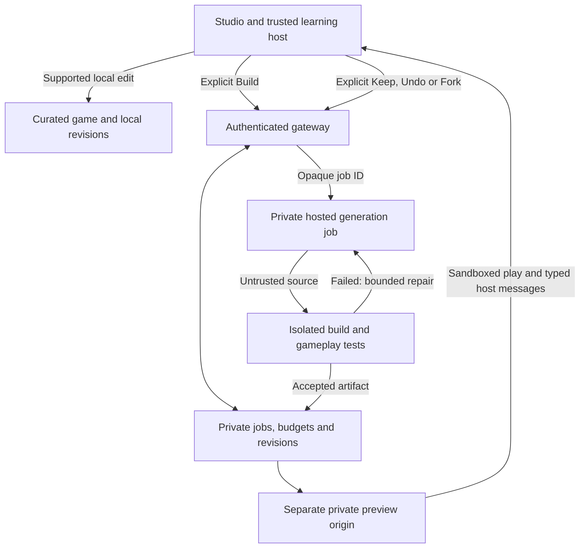

# Jems current architecture

This is a map of the **implemented source architecture**, not an assertion that every component is deployed or enabled. Read [Delivery state](DELIVERY-STATE.md) for dated release evidence and [Product doctrine](PRODUCT-DOCTRINE.md) for intent. Update this map in the same PR that changes a boundary, contract, storage owner, runtime or execution path.

**Reviewed source:** this feature starts from verified `main` [`079978f3034e007e8bbad1f43571aaa7867b5098`](https://github.com/jzwyrzyk/family-game-factory/commit/079978f3034e007e8bbad1f43571aaa7867b5098), the merge of [PR55](https://github.com/jzwyrzyk/family-game-factory/pull/55). It includes the previously reviewed trusted devices, private coach/dictation, Game Intelligence, canonical documentation, and same-site adult/guardian-consent integration. The Creation Studio additions below describe `feature/jems-creation-lab-20261119`; they are not a deployment claim. The linked paths follow the branch being read; reconcile with its actual commit before making changes. Historical live observations retain their dates in the delivery ledger.

**Latest main integration:** merge preparation also includes `8b915b26e1f4be4b1523b6803cb6549d228f3e83` ([PR61](https://github.com/jzwyrzyk/family-game-factory/pull/61)). Its private-coach build verifier ignores explicit read-only execution metadata while preserving exact executable-step checks. The Creation Studio application changes and runtime boundaries are unchanged by that integration.

## System boundaries

Jems is a TypeScript/Vite browser application with local curated play, revisions and learning. Remote generation uses an authenticated gateway, durable private state, a separate private GitHub Actions worker and an isolated preview origin. Conversational inference and short speech transcription use a separate private service; they do not generate games or dispatch builds.

The temporary adult development profile uses this same browser site. Selecting it performs the authenticated switch and makes the approved AI tools available; no separate frontend or second activation control is required. A local profile label is not authorization. The server checks a trusted device, its operator-issued adult permit and a recent adult session for every privileged request. Child profiles and the adult workspace remain separate. See [ADR0005](docs/decisions/0005-temporary-adult-profile.md) for the accepted scope and removal condition.

The gateway's existing coordinator owns dispatch, retries and acceptance. New game families, intent analysis or repair research must integrate with this path rather than introduce a competing generation or repair pipeline. A tested candidate remains separate from a kept revision.

## Component and source map

| Component | Responsibility and source of truth |
| --- | --- |
| Browser entry and curated runtimes | [src/main.ts](src/main.ts), [runtime registry](src/runtime/registry.ts), [manifests](src/runtime/manifests.ts), and [games](src/games/) install existing game implementations. Preserve old saved-game runtime choices when changing defaults. |
| Studio | [UI](src/studio/ui.ts), [adapter](src/studio/adapter.ts), [design records](src/studio/design.ts), and [notebook](src/studio/notebook.ts) coordinate conversation, drafts, experiments, play and explicit Keep. The adapter reuses existing game engines, learning and revision storage. |
| Creation Studio | [Scene UI](src/creation/ui.ts), [model](src/creation/model.ts), [deterministic engine](src/creation/engine.ts), [source adapters](src/creation/projects.ts), [challenges](src/creation/challenges.ts), and [observations](src/creation/progress.ts) share editable actions between free scenes and rebuild practice. `?creation=1` and the Studio navigation open the separate page; supported games link exact source revisions through Animate & code. |
| Local changes | [Interpreter](src/factory/interpreter.ts), [routing](src/factory/remix-routing.ts), and [workspace](src/factory/workspace.ts) implement bounded supported edits and immutable local revision history. Unsupported mechanics need the builder; a label change is not a mechanic change. |
| Learning | [Math engine](src/learning/engine.ts), [language engine](src/language/engine.ts), [host](src/learning/host.ts), and [remote adapter](src/learning/remote.ts) keep subject evidence, checkpoint policy and pause/resume in trusted host code. Generated game code does not choose grades or bypass learning. |
| Browser remote client | [Builder client](src/builder/client.ts) validates configuration, submits/polls/cancels durable jobs and checks preview origin. [familyFetch](src/builder/session.ts) handles trusted-session checks and renewal. |
| Temporary adult profile | [Profile UI](src/adult-pilot/ui.ts), [tab session](src/adult-pilot/session.ts) and [storage adapter](src/adult-pilot/storage.ts) integrate the switch with the existing selector, cancel stale UI work and isolate local adult records. [Server policy](server/adult-pilot.ts) and [trusted-device routes](server/trusted-devices.ts) issue and verify the revocable grant. |
| Guardian privacy choices | [Parent panel](src/builder/privacy.ts), [consent policy](server/privacy/parent-consent.ts) and [owner verification](server/privacy/owner-verify.ts) separate pending choices from externally verified scope evidence. Both guardian and adult owner commands reuse the configured workspace/artifact bucket. Parent management and adult development authorization are different grants. |
| Gateway | [server/gateway.ts](server/gateway.ts) composes family sessions, trusted devices, job API, worker callbacks, coach and audio routes. [JobService](server/pipeline/service.ts) owns family-scoped jobs, revisions, idempotency and admission. |
| Private generation | [Coordinator](server/actions/coordinator.ts), [dispatcher](server/actions/dispatcher.ts), [worker identity](server/actions/identity.ts), [worker CLI](server/actions/worker-cli.ts), and [agent](server/agent/openai.ts) connect the private workflow to bounded model generation and repair. |
| Game Intelligence | [server/quality](server/quality/) adds source-grounded intent/form advice, functional contracts and sanitized repair diagnostics. [Independent playtests](server/sandbox/intent-playtest-v2.cjs) require a trusted, independently authored plan; arbitrary ideas without coverage remain `NOT_TESTED`. See [evidence boundaries](docs/game-intelligence/merge-handoff.md). |
| Isolation and preview | [Docker gate](server/sandbox/docker-gate.ts), [sandbox worker](server/sandbox/worker.cjs), [trusted runtime archives](server/sandbox/trusted/README.md), [preview server](server/preview-server.ts), and [preview handler](server/pipeline/http.ts) separate untrusted games from credentials and the app origin. |
| Coach and speech | [Coach service](server/coach/service.ts), [speech service](server/coach/speech.ts), [private bridge](server/coach/private-bridge.ts), and [private executor](server/coach/private-executor.ts) enforce separate consent, identity, budgets and provider availability. The [approved input contract](docs/issue-28/PUSH_TO_TALK_MVP.md) is Speak → transcribe → edit → explicit Send; Build remains separate. |
| Deployment tooling | [Deployment scripts](scripts/deployment/) build and configure gateway, preview and private coach; [Pages workflow](.github/workflows/pages.yml) publishes the browser build through manual dispatch. Their presence is not deployment evidence. |

## Contracts to consult before changing an API

The executable route composition is [gateway.ts](server/gateway.ts), with request/response behavior in the handlers below. [openapi.json](server/openapi.json) describes the job/revision/worker API and the adult-profile, session-status, parent-unlock and privacy routes added by this integration. It remains **incomplete for coach, speech and other trusted-device routes**. Do not infer route absence from that schema, or treat proposed [legacy contracts](server/contracts/api.ts) as implemented endpoints.

| Boundary | Implemented route family | Handler |
| --- | --- | --- |
| Family session and devices | `/v1/sessions`, `/v1/sessions/enroll`, `/v1/sessions/renew`, `/v1/sessions/status`, `/v1/devices` and device operations | [sessions.ts](server/sessions.ts), [trusted-devices.ts](server/trusted-devices.ts) |
| Adult profile switch | `/v1/sessions/adult/unlock`, `/v1/sessions/adult/lock`; availability/eligibility/active state in `/v1/sessions/status` | [trusted-devices.ts](server/trusted-devices.ts), [adult-pilot.ts](server/adult-pilot.ts) |
| Parent privacy and receipt erasure | `/v1/devices/unlock` prerequisite; `/v1/devices/privacy` GET/POST, `/revoke` and `/erase` operations | [trusted-devices.ts](server/trusted-devices.ts), [parent-consent.ts](server/privacy/parent-consent.ts); current pending choice UUID is visible only in the authenticated parent flow |
| Builder and revisions | `/v1/builder/status`; `/v1/jobs` with status, cancel and retry; `/v1/revisions` with preview, keep, undo and fork; `/v1/creations` | [pipeline/http.ts](server/pipeline/http.ts) |
| Editable generated companion | `GET /v1/revisions/{id}/creation`, authenticated family/adult audience, returns a validated data manifest or `null` for a game without one | [pipeline/http.ts](server/pipeline/http.ts), [generated validation](server/agent/generated.ts), [client](src/builder/client.ts) |
| Conversation | `/v1/coach`, `/v1/coach/status`, `/v1/coach/erase` | [coach/http.ts](server/coach/http.ts) |
| Short dictation | `/v1/coach/audio`, `/v1/coach/audio/status` | [coach/audio-http.ts](server/coach/audio-http.ts) |
| Worker and scheduler | `/v1/worker/jobs/...` and `/v1/internal/dispatch` | [actions/http.ts](server/actions/http.ts), [gateway.ts](server/gateway.ts) |
| Private game preview | `/preview/{revisionId}` on the **separate preview origin** with a short-lived signed capability | [preview-server.ts](server/preview-server.ts), [pipeline/http.ts](server/pipeline/http.ts) |

`/v1/jobs` is the implemented generation API. The original charter's `/v1/generations`, interpret and publish endpoints are historical proposals, not alternate working APIs. API changes should update the executable contracts, affected clients/tests and the applicable schema together; the existing schema gap is not permission to enlarge it.

## Data ownership and persistence

| Data | Owner and persistence | Constraints |
| --- | --- | --- |
| Profiles, game progress, Math and English evidence | Browser [legacy store](src/legacy/store.js), `family-game-factory-state-v1` | Profile-separated local state; failed loads/saves must not silently reset existing progress. Parent learning settings are separate from game difficulty. |
| Local project/revision graph | Browser [RevisionStore](src/factory/workspace.ts), `family-game-factory-workspace-v2` | Immutable revisions, explicit kept selection, checkout/fork and validated migration. |
| Conversation, design notes and candidate UI state | Browser [Studio notebook](src/studio/notebook.ts), `family-game-factory-studio-v1` | Per profile/project; no credentials, signed preview URLs or executable source. Clearing chat is distinct from deleting game versions. |
| Editable scenes, drafts and specific practice checks | Browser [CreationStore](src/creation/storage.ts), `family-game-factory-creation-v1` | Owner-scoped immutable revisions, separate recovery drafts, explicit kept pointer and source pins. The existing adult namespace applies. Family backups add optional `factoryCreation`; old backups restore an empty scene workspace. Corrupt originals can be exported as `factoryCreationRecoveryRaw` and are preserved on failed reads/imports. Check records are tied to the tested revision; hint history survives reopening. |
| Adult development profile, notebook and local game workspace | Browser [profile storage adapter](src/adult-pilot/storage.ts), prefix `family-game-factory-adult:<adultProfileId>:` | Separate device-bound namespace; existing child records are not copied into adult context. Session authority is held only in tab memory and is not restored from these records. Local separation is not encryption against browser-storage access. |
| Original drawings and derived provenance | Browser [drawing store](src/assets/private-drawings.ts), IndexedDB `family-private-drawings-v1` | Owner, content hashes and source links; not a claim of cloud sync, recognition or rigging. |
| Remote jobs, revisions, sessions/devices, budgets and receipts | Server [FirestoreRepository](server/pipeline/firestore.ts) | Transactional workspace state; local file repository is a development adapter, disallowed for Cloud Run. Authentication and spending admission remain server-owned. |
| Adult permits, grants and remote audience | [Adult policy](server/adult-pilot.ts), [pipeline state](server/pipeline/types.ts), [audience checks](server/pipeline/audience.ts) | Permit receipt and cookie/proof secrets are hashed in server records. Jobs retain the exact admitting grant and device; revisions retain their adult profile audience. Seeds and idempotency are namespaced by audience; new grants cannot revive old job execution. |
| Parent privacy choice and verification evidence | [Parent policy](server/privacy/parent-consent.ts) | Current notice, exact boolean scopes, family/device/subject, request/verification/expiry and hashed external receipt. Acknowledgments create pending records; changed scopes revoke prior permission. No identity document or raw verification receipt is stored. |
| Larger generated game payloads | [Private artifact store](server/storage/artifacts.ts) | Optional private GCS externalization with content hashes, integrity and size checks. Relationships/authorization/budgets stay in transactional state; no public artifact URLs. |
| Coach replies and accounting | [Coach service](server/coach/service.ts) | Completed reply cache has a 15-minute age threshold, pruned on later requests. This is opportunistic cleanup, **not a guaranteed background deletion deadline**. Explicit receipt erasure preserves aggregate accounting. |
| Recorded audio | [Speech service](server/coach/speech.ts) and [browser capture](src/studio/private-speech.ts) | Short request processing; audio and transcription are not persisted in server audio receipts. Edited/sent text may become local conversation or design/build context. Provider retention is a separate verified configuration. |

Browser stores are device- and origin-specific. Server revisions do not imply automatic synchronization of local profiles, learning or drawings. Any origin migration, deletion, backup or cross-device feature must explicitly cover each store and preserve recovery.

## Editable creation and generated companions

The [Creation Studio contract](docs/creation-studio/README.md) defines `jems.creation.v1`, a bounded data language interpreted in trusted application code. Its assets come from a reviewed local catalogue; projects cannot supply JavaScript, HTML, remote URLs, or preview credentials. The engine uses a fixed logical clock, bounded blocks/events, and validated actor/variable references. The editor and five open rebuild challenges use the same runtime. Behavioral probes observe complete paths, order, repeated actions, tap response and multiple variable cases rather than comparing exact block text.

Curated Dragon, Buckets and Robot adapters copy supported artwork/settings into a **new scene** linked to the selected source game revision. Reopening that source resumes its existing scene. The original game remains independently playable. This is not a conversion of every original mechanic or bidirectional synchronization of arbitrary code.

New generated artifacts may contain optional `creationManifest` data. The provider's strict nullable schema in [creation-schema.ts](server/agent/creation-schema.ts), shared validation, unchanged-manifest publication check, existing revision authorization and client stale-response check form the complete transport. A supplied scene is marked assisted. Generated games without a manifest return `null`; the browser explains the absence. The companion may use only catalogue assets and must not imply extraction of custom art from generated JavaScript. The existing runtime archives, sandbox source execution and generation spending caps remain unchanged. Gateway and preview image COPY inputs include the shared validators.

Companion validation bounds the normalized, attributed representation to 32,000 UTF-8 bytes. The trusted Docker gate keeps that data outside sandbox stdin and restores it only after validating the executable source's compiled attestation; the sandbox cannot replace the companion. Before any provider call, the generation adapter can omit the optional companion schema, instructions and base scene when they would exceed an existing input or remaining-spend cap. The complete requested game and repair context are retained, both modes count schema bytes, and an over-limit game-only request still fails closed without reading a key or retrying.

Play, Step, target preview and challenge checks use the existing host Math/Language checkpoint policy. Editing and challenge evaluation do not call a model. My Powers and Parent Controls display recent checks for the selected profile as specific observations, with recorded hint support, without a global thinking score. Editable JSON export retains the scene; supported canvas recording exports a silent video, while profile changes and navigation cancel unfinished capture. These are source capabilities, not child-learning efficacy or live-provider acceptance.

An unresolved recovery draft blocks scene changes and execution until the child explicitly resumes it or chooses the saved version; leaving or exporting a family backup preserves the draft. The homepage Creation Studio card follows the playable starter shelf so its additional entrance does not push the first complete game choice below the mobile viewport.

## Trust and execution rules

1. **Browser and gateway remain model-keyless.** The gateway rejects model credentials at startup. Browser config selects gateway/preview origins; it cannot authorize spending or prove readiness. Origin/CSRF checks supplement authenticated family scope.
2. **Trusted-device checks survive every integration.** Protected routes verify the current device, and paid admission rechecks revocation and expiry at transaction execution time. A `401` can trigger family renewal; ambiguous or rejected paid `POST` requests are not automatically replayed. Adult privileges never renew through that path. Inspect [the auth contract](docs/auth/TRUSTED_FAMILY_DEVICES.md) and [adult/guardian integration contract](docs/privacy/ADULT_CHILD_RELEASE_INTEGRATION.md) when changing any remote client or handler.
3. **Generation and execution are separate.** The private hosted generation job holds its dedicated model key and does not run generated source. The ephemeral test runner executes generated code only inside the reviewed gVisor container, with no network, a read-only root, bounded resources and no model/cloud credentials passed into it. Hosted cleanup is separate.
4. **Coach-only exception is narrow.** The approved [private inference architecture](docs/issue-28/SECURE_INFERENCE_AND_RELEASE.md) permits a new, separately scoped coach key in the dedicated private Cloud Run executor. It does not move the generation-worker key. The keyless gateway uses Google-signed service identity; the executor independently checks exact audience/caller. IAM and internal ingress still require a working, verified network route.
5. **Preview is untrusted.** Generated code runs behind a separate host, restrictive CSP and sandboxed iframe/worker interfaces. Preview capabilities are short-lived and excluded from persistent notebook state. An adult preview signature also binds the grant, device and profile; the preview server verifies the still-live audience before serving the artifact. A new adult unlock cannot renew an old URL. A browser watchdog is not a guaranteed browser heap limit.
6. **Runtime archives are immutable.** Compiled games identify exact `runtimeVersion` and `runtimeHash` alongside source/compiled hashes. Preserve approved archives and registry entries. A runtime upgrade for a saved game is a new revision; unknown or changed archives fail closed.
7. **Readiness and evidence remain specific.** Configuration defaults fail closed. This source audit does not inspect live flags, IAM, network routing or devices. Passing fixture/CI tests does not establish arbitrary-game fidelity, observed enjoyment, learning gains or actual provider acceptance.

## Adult development and future child authorization

`FACTORY_ADULT_PILOT_MODE` selects the temporary adult-only remote policy. It also requires owner approval and `FACTORY_ADULT_PILOT_PROFILE_ACCESS_VERIFIED`; the former private-frontend-host flag is obsolete. The public app origin remains the existing site, while provider keys and execution retain their existing private backend boundaries. In this mode child profiles retain local behavior and cannot borrow the adult's paid capabilities.

The passphrase profile switch requires an eligible enrolled device and creates a server grant lasting at most 60 minutes, bounded by its current permit/device authorization. API authentication requires the ordinary family session, an HttpOnly adult cookie and an independent tab-memory proof. A shared cookie alone does not activate AI in a child tab. Changing profile clears the proof and requests revocation; an offline request may not confirm server revocation, so the absolute expiry remains the fallback. Reload/new tab starts locked. Permit replacement, device revocation and confirmed lock invalidate the grant independently.

Generation checks the original grant at dispatch, claims and publication. Resource reads, library lists, keep/fork/undo and signed previews check the adult audience. Coaching separates reply-cache identity by grant and checks permission in the same completion transaction that settles usage and publishes a reply. Speech similarly rechecks permission before returning a transient transcript; its receipts contain no recording or transcript. Profile changes invalidate late browser callbacks as well as the local credential.

With adult mode disabled, the child policy requires independently verified, current-notice guardian scopes for generation, conversation and remote speech in addition to the applicable provider/privacy/safety/spending approvals. Form acknowledgments do not verify guardianship, grant provider ZDR or activate paid AI. The authenticated parent flow can show the pending choice UUID, withdraw permission and erase completed server coach/audio receipts; running requests must finish before receipt erasure. Game/backup/provider deletion is a separate scope.

Detailed operation, temporary-feature removal and deployment acceptance are in the [adult release guide](docs/adult-pilot/VOICE_RELEASE_AND_UAT.md) and [parent privacy contract](docs/privacy/PARENT_CONSENT_AND_ADULT_PILOT.md). The changes do not alter explicit Send, Build or Keep, or claim actual child/provider/device acceptance.

## Cross-repository and release coupling

The companion [private worker repository](https://github.com/family-game-factory-lab/family-game-factory-worker) owns workflow orchestration and runner control. The inspected worker `main` was [`21203a6dcedc19fb18e23795cd9377b20f5f81e3`](https://github.com/family-game-factory-lab/family-game-factory-worker/commit/21203a6dcedc19fb18e23795cd9377b20f5f81e3). Its [exact workflow](https://github.com/family-game-factory-lab/family-game-factory-worker/blob/21203a6dcedc19fb18e23795cd9377b20f5f81e3/.github/workflows/factory-private.yml) checks out public source `3b5e0a9d8ec48d3a8d27f0be914269ff95cddc75`. That is the **repository's configured source**, not proof of which workflow or image is currently active in production. A newer source proposal is tracked by [worker PR #13](https://github.com/family-game-factory-lab/family-game-factory-worker/pull/13); its current status belongs in [Delivery state](DELIVERY-STATE.md).

Treat these as separate release identities: frontend source/build, gateway image, preview image, coach image/configuration, private workflow commit, generated-code source pin, sandbox image digest and trusted runtime version/hash. A frontend deployment or application merge does not repin the private worker. A worker source change also requires matching image/runtime acceptance and the existing reviewed trust process.

Record live release facts once in [Delivery state](DELIVERY-STATE.md), with evidence identifying the component, source/image/configuration, scope and observation time. Preserve existing storage, service identities and rollback targets when reconciling older branches. Update this map and the relevant [decision record](docs/decisions/) when architecture changes; update feature-specific documents for detailed contracts.
