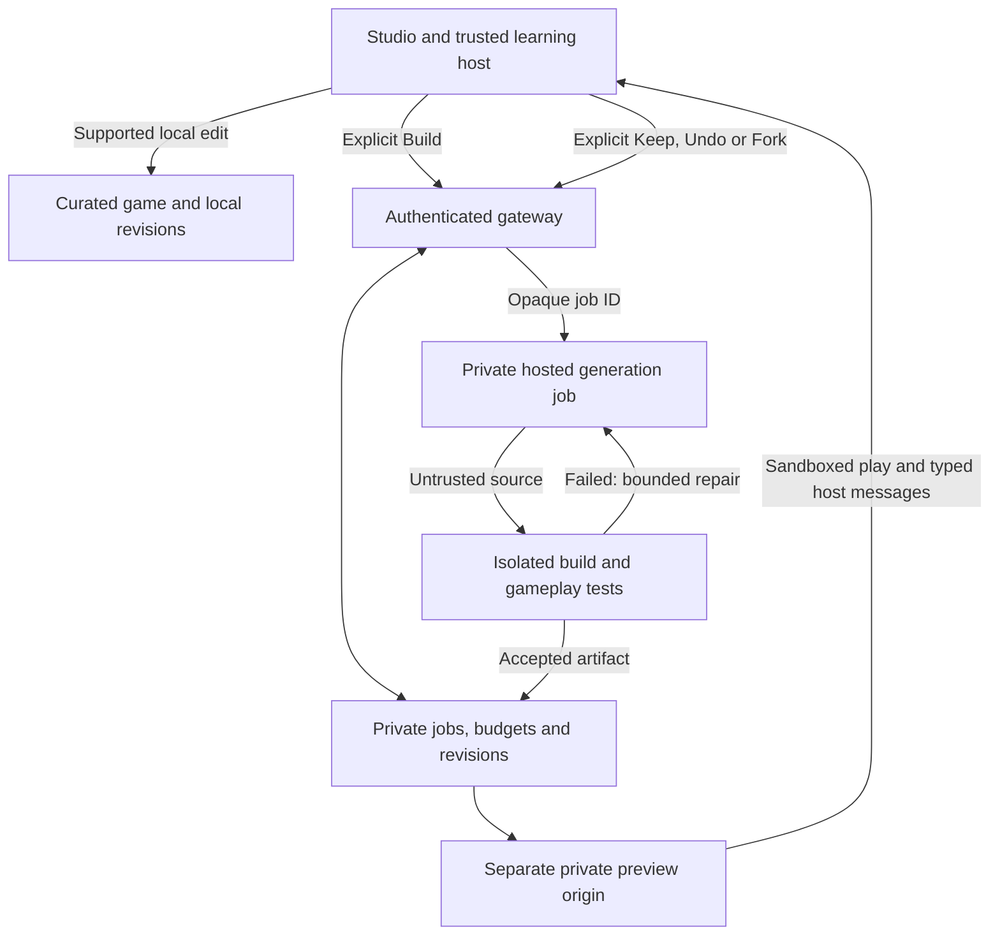

# Jems current architecture

This is a map of the **implemented source architecture**, not an assertion that every component is deployed or enabled. Read [Delivery state](DELIVERY-STATE.md) for dated release evidence and [Product doctrine](PRODUCT-DOCTRINE.md) for intent. Update this map in the same PR that changes a boundary, contract, storage owner, runtime or execution path.

**Reviewed source baseline:** application [`493eb9ce2a98de5f3be8f6d17e63dfe2f6a7e3a7`](https://github.com/jzwyrzyk/family-game-factory/commit/493eb9ce2a98de5f3be8f6d17e63dfe2f6a7e3a7), including merged [#42 trusted devices](https://github.com/jzwyrzyk/family-game-factory/pull/42), [#36 private coach and dictation](https://github.com/jzwyrzyk/family-game-factory/pull/36), and [#43 Game Intelligence](https://github.com/jzwyrzyk/family-game-factory/pull/43). This baseline identifies the audit; the linked source paths follow the branch being read. Reconcile with the actual branch before making changes.

## System boundaries

Jems is a TypeScript/Vite browser application with local curated play, revisions and learning. Remote generation uses an authenticated gateway, durable private state, a separate private GitHub Actions worker and an isolated preview origin. Conversational inference and short speech transcription use a separate private service; they do not generate games or dispatch builds.

The gateway's existing coordinator owns dispatch, retries and acceptance. New game families, intent analysis or repair research must integrate with this path rather than introduce a competing generation or repair pipeline. A tested candidate remains separate from a kept revision.

## Component and source map

| Component | Responsibility and source of truth |
| --- | --- |
| Browser entry and curated runtimes | [src/main.ts](src/main.ts), [runtime registry](src/runtime/registry.ts), [manifests](src/runtime/manifests.ts), and [games](src/games/) install existing game implementations. Preserve old saved-game runtime choices when changing defaults. |
| Studio | [UI](src/studio/ui.ts), [adapter](src/studio/adapter.ts), [design records](src/studio/design.ts), and [notebook](src/studio/notebook.ts) coordinate conversation, drafts, experiments, play and explicit Keep. The adapter reuses existing game engines, learning and revision storage. |
| Local changes | [Interpreter](src/factory/interpreter.ts), [routing](src/factory/remix-routing.ts), and [workspace](src/factory/workspace.ts) implement bounded supported edits and immutable local revision history. Unsupported mechanics need the builder; a label change is not a mechanic change. |
| Learning | [Math engine](src/learning/engine.ts), [language engine](src/language/engine.ts), [host](src/learning/host.ts), and [remote adapter](src/learning/remote.ts) keep subject evidence, checkpoint policy and pause/resume in trusted host code. Generated game code does not choose grades or bypass learning. |
| Browser remote client | [Builder client](src/builder/client.ts) validates configuration, submits/polls/cancels durable jobs and checks preview origin. [familyFetch](src/builder/session.ts) handles trusted-session checks and renewal. |
| Gateway | [server/gateway.ts](server/gateway.ts) composes family sessions, trusted devices, job API, worker callbacks, coach and audio routes. [JobService](server/pipeline/service.ts) owns family-scoped jobs, revisions, idempotency and admission. |
| Private generation | [Coordinator](server/actions/coordinator.ts), [dispatcher](server/actions/dispatcher.ts), [worker identity](server/actions/identity.ts), [worker CLI](server/actions/worker-cli.ts), and [agent](server/agent/openai.ts) connect the private workflow to bounded model generation and repair. |
| Game Intelligence | [server/quality](server/quality/) adds source-grounded intent/form advice, functional contracts and sanitized repair diagnostics. [Independent playtests](server/sandbox/intent-playtest-v2.cjs) require a trusted, independently authored plan; arbitrary ideas without coverage remain `NOT_TESTED`. See [evidence boundaries](docs/game-intelligence/merge-handoff.md). |
| Isolation and preview | [Docker gate](server/sandbox/docker-gate.ts), [sandbox worker](server/sandbox/worker.cjs), [trusted runtime archives](server/sandbox/trusted/README.md), [preview server](server/preview-server.ts), and [preview handler](server/pipeline/http.ts) separate untrusted games from credentials and the app origin. |
| Coach and speech | [Coach service](server/coach/service.ts), [speech service](server/coach/speech.ts), [private bridge](server/coach/private-bridge.ts), and [private executor](server/coach/private-executor.ts) enforce separate consent, identity, budgets and provider availability. The [approved input contract](docs/issue-28/PUSH_TO_TALK_MVP.md) is Speak → transcribe → edit → explicit Send; Build remains separate. |
| Deployment tooling | [Deployment scripts](scripts/deployment/) build and configure gateway, preview and private coach; [Pages workflow](.github/workflows/pages.yml) publishes the browser build through manual dispatch. Their presence is not deployment evidence. |

## Contracts to consult before changing an API

The executable route composition is [gateway.ts](server/gateway.ts), with request/response behavior in the handlers below. [openapi.json](server/openapi.json) describes the job/revision/worker API but is **incomplete for newer coach, speech and trusted-device routes** at the reviewed baseline. Do not infer route absence from that schema, or treat proposed [legacy contracts](server/contracts/api.ts) as implemented endpoints.

| Boundary | Implemented route family | Handler |
| --- | --- | --- |
| Family session and devices | `/v1/sessions`, `/v1/sessions/enroll`, `/v1/sessions/renew`, `/v1/sessions/status`, `/v1/devices` and device operations | [sessions.ts](server/sessions.ts), [trusted-devices.ts](server/trusted-devices.ts) |
| Builder and revisions | `/v1/builder/status`; `/v1/jobs` with status, cancel and retry; `/v1/revisions` with preview, keep, undo and fork; `/v1/creations` | [pipeline/http.ts](server/pipeline/http.ts) |
| Conversation | `/v1/coach`, `/v1/coach/status`, `/v1/coach/erase` | [coach/http.ts](server/coach/http.ts) |
| Short dictation | `/v1/coach/audio`, `/v1/coach/audio/status` | [coach/audio-http.ts](server/coach/audio-http.ts) |
| Worker and scheduler | `/v1/worker/jobs/...` and `/v1/internal/dispatch` | [actions/http.ts](server/actions/http.ts), [gateway.ts](server/gateway.ts) |
| Private game preview | `/preview/{revisionId}` on the **separate preview origin** with a short-lived signed capability | [preview-server.ts](server/preview-server.ts), [pipeline/http.ts](server/pipeline/http.ts) |

`/v1/jobs` is the implemented generation API. The original charter's `/v1/generations`, interpret and publish endpoints are historical proposals, not alternate working APIs. API changes should update the executable contracts, affected clients/tests and the applicable schema together; the existing schema gap is not permission to enlarge it.

## Data ownership and persistence

| Data | Owner and persistence | Constraints |
| --- | --- | --- |
| Profiles, game progress, Math and English evidence | Browser [legacy store](src/legacy/store.js), `family-game-factory-state-v1` | Profile-separated local state; failed loads/saves must not silently reset existing progress. Parent learning settings are separate from game difficulty. |
| Local project/revision graph | Browser [RevisionStore](src/factory/workspace.ts), `family-game-factory-workspace-v2` | Immutable revisions, explicit kept selection, checkout/fork and validated migration. |
| Conversation, design notes and candidate UI state | Browser [Studio notebook](src/studio/notebook.ts), `family-game-factory-studio-v1` | Per profile/project; no credentials, signed preview URLs or executable source. Clearing chat is distinct from deleting game versions. |
| Original drawings and derived provenance | Browser [drawing store](src/assets/private-drawings.ts), IndexedDB `family-private-drawings-v1` | Owner, content hashes and source links; not a claim of cloud sync, recognition or rigging. |
| Remote jobs, revisions, sessions/devices, budgets and receipts | Server [FirestoreRepository](server/pipeline/firestore.ts) | Transactional workspace state; local file repository is a development adapter, disallowed for Cloud Run. Authentication and spending admission remain server-owned. |
| Larger generated game payloads | [Private artifact store](server/storage/artifacts.ts) | Optional private GCS externalization with content hashes, integrity and size checks. Relationships/authorization/budgets stay in transactional state; no public artifact URLs. |
| Coach replies and accounting | [Coach service](server/coach/service.ts) | Completed reply cache has a 15-minute age threshold, pruned on later requests. This is opportunistic cleanup, **not a guaranteed background deletion deadline**. Explicit receipt erasure preserves aggregate accounting. |
| Recorded audio | [Speech service](server/coach/speech.ts) and [browser capture](src/studio/private-speech.ts) | Short request processing; audio and transcription are not persisted in server audio receipts. Edited/sent text may become local conversation or design/build context. Provider retention is a separate verified configuration. |

Browser stores are device- and origin-specific. Server revisions do not imply automatic synchronization of local profiles, learning or drawings. Any origin migration, deletion, backup or cross-device feature must explicitly cover each store and preserve recovery.

## Trust and execution rules

1. **Browser and gateway remain model-keyless.** The gateway rejects model credentials at startup. Browser config selects gateway/preview origins; it cannot authorize spending or prove readiness. Origin/CSRF checks supplement authenticated family scope.
2. **Trusted-device checks survive every integration.** Protected routes verify the current device, and paid admission rechecks revocation transactionally. A `401` can trigger renewal; ambiguous or rejected paid `POST` requests are not automatically replayed. Inspect [the auth contract](docs/auth/TRUSTED_FAMILY_DEVICES.md) when changing any remote client or handler.
3. **Generation and execution are separate.** The private hosted generation job holds its dedicated model key and does not run generated source. The ephemeral test runner executes generated code only inside the reviewed gVisor container, with no network, a read-only root, bounded resources and no model/cloud credentials passed into it. Hosted cleanup is separate.
4. **Coach-only exception is narrow.** The approved [private inference architecture](docs/issue-28/SECURE_INFERENCE_AND_RELEASE.md) permits a new, separately scoped coach key in the dedicated private Cloud Run executor. It does not move the generation-worker key. The keyless gateway uses Google-signed service identity; the executor independently checks exact audience/caller. IAM and internal ingress still require a working, verified network route.
5. **Preview is untrusted.** Generated code runs behind a separate host, restrictive CSP and sandboxed iframe/worker interfaces. Preview capabilities are short-lived and excluded from persistent notebook state. A browser watchdog is not a guaranteed browser heap limit.
6. **Runtime archives are immutable.** Compiled games identify exact `runtimeVersion` and `runtimeHash` alongside source/compiled hashes. Preserve approved archives and registry entries. A runtime upgrade for a saved game is a new revision; unknown or changed archives fail closed.
7. **Readiness and evidence remain specific.** Configuration defaults fail closed. This source audit does not inspect live flags, IAM, network routing or devices. Passing fixture/CI tests does not establish arbitrary-game fidelity, observed enjoyment, learning gains or actual provider acceptance.

## Cross-repository and release coupling

The companion [private worker repository](https://github.com/family-game-factory-lab/family-game-factory-worker) owns workflow orchestration and runner control. The inspected worker `main` was [`21203a6dcedc19fb18e23795cd9377b20f5f81e3`](https://github.com/family-game-factory-lab/family-game-factory-worker/commit/21203a6dcedc19fb18e23795cd9377b20f5f81e3). Its [exact workflow](https://github.com/family-game-factory-lab/family-game-factory-worker/blob/21203a6dcedc19fb18e23795cd9377b20f5f81e3/.github/workflows/factory-private.yml) checks out public source `3b5e0a9d8ec48d3a8d27f0be914269ff95cddc75`. That is the **repository's configured source**, not proof of which workflow or image is currently active in production. A newer source proposal is tracked by [worker PR #13](https://github.com/family-game-factory-lab/family-game-factory-worker/pull/13); its current status belongs in [Delivery state](DELIVERY-STATE.md).

Treat these as separate release identities: frontend source/build, gateway image, preview image, coach image/configuration, private workflow commit, generated-code source pin, sandbox image digest and trusted runtime version/hash. A frontend deployment or application merge does not repin the private worker. A worker source change also requires matching image/runtime acceptance and the existing reviewed trust process.

Record live release facts once in [Delivery state](DELIVERY-STATE.md), with evidence identifying the component, source/image/configuration, scope and observation time. Preserve existing storage, service identities and rollback targets when reconciling older branches. Update this map and the relevant [decision record](docs/decisions/) when architecture changes; update feature-specific documents for detailed contracts.
