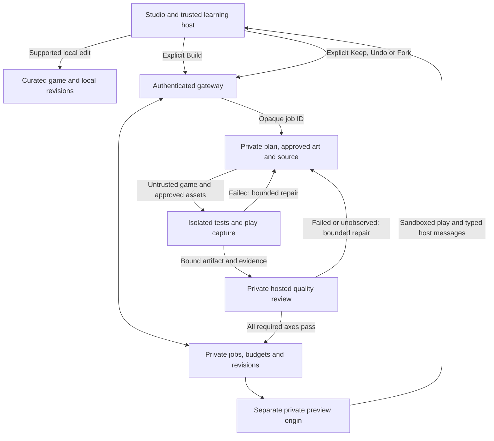

# Jems current architecture

This is a map of the **implemented source architecture**, not an assertion that every component is deployed or enabled. Read [Delivery state](DELIVERY-STATE.md) for dated release evidence and [Product doctrine](PRODUCT-DOCTRINE.md) for intent. Update this map in the same PR that changes a boundary, contract, storage owner, runtime or execution path.

**Parent reporting source:** [PR65](https://github.com/jzwyrzyk/family-game-factory/pull/65) merged as [`864bee8f9427bce4a8dc0e7df5495e576fd3bcdc`](https://github.com/jzwyrzyk/family-game-factory/commit/864bee8f9427bce4a8dc0e7df5495e576fd3bcdc) on November 19, 2026, at 10:53:45 a.m. America/New_York, preserving prior main `7fa7ff252e277bd9610a11afeca8bf8f1ae13715`. Its complete tree matches final tested PR head `d3082160d82c131e44f1a738378ce1455f3c8858`. The [merge receipt](DELIVERY-STATE.md#pr65-parent-reporting--merged) records all five passing final-head workflows and the source-only release boundary.

**Reviewed source:** [PR57](https://github.com/jzwyrzyk/family-game-factory/pull/57) merged the approved branding v1.2 and illustrated making journey into `main` as [`c6576c16e005ae58ce8c706801414be4d864242e`](https://github.com/jzwyrzyk/family-game-factory/commit/c6576c16e005ae58ce8c706801414be4d864242e), November 19, 2026. Its complete tree matches tested candidate `148887156d6d1ef33239755c8e602ca83281a943` and clean local integration `879c93e`. It preserves prior main [`eebeebeb8896554bd3619029d8ca80d4b06b2f2b`](https://github.com/jzwyrzyk/family-game-factory/commit/eebeebeb8896554bd3619029d8ca80d4b06b2f2b), including PR55 adult/guardian integration, PR58 Gem Factory and style-diverse production/review, PR61 coach-build verification, PR62 Creation Studio and PR63 documentation. [Delivery state](DELIVERY-STATE.md) records the exact checks and merge receipt; deployment remains separate. [Handbook coverage](docs/brand/LIBRARY_V1_2.md#handbook-coverage-in-this-application) distinguishes active visual integration from installed optional assets and illustrative future screens.

**Rewards source integration, November 19, 2026:** [PR67](https://github.com/jzwyrzyk/family-game-factory/pull/67) merged as `28c18cdae8bf958ef01f6e622e9c4ef6e2035e5c`, after parent reporting and the expanded PR69 branding. The reward components implement [ADR0010](docs/decisions/0010-lifetime-gems-and-shared-rewards.md); formative problem-solving integration preserves that accepted earning policy and extends the existing coordinated backup to its additional source. Source merge does not assert deployment.

**Reviewed rewards integration:** PR57 merged to main as `c6576c16e005ae58ce8c706801414be4d864242e` on November 19, 2026 at 10:02 a.m. America/New_York (15:02 UTC), with exactly the tree of approved-brand head `148887156d6d1ef33239755c8e602ca83281a943`. Rewards targets main directly. Local reconciliation `ecb12d51a825e60f9ecc6f6cb75f7b1a7131c9bf` has the same complete tree as reviewed candidate `10404ed25b3f623a0af043d8fdaba5515bdcf4b4`; approved art and the maker journey inherit from main. Rewards is a separate feature; [delivery state](DELIVERY-STATE.md) records publication, review and deployment alongside PR63's earlier documentation receipt, implementation history and exact tree identity.

**Earlier documentation source:** main `7fa7ff252e277bd9610a11afeca8bf8f1ae13715` incorporates PR66's official branding receipt and handbook coverage. That documentation update preserved the shared Rewards policy, local persistence/recovery and PR67 publication receipt without changing application runtime, assets or test implementations. Later runtime changes are described in their own sections below. [Delivery state](DELIVERY-STATE.md) distinguishes the exact branded source checks from rewards checks and subsequent hosted validation.

**Creation Studio source scope:** [ADR0007](docs/decisions/0007-creation-and-rebuild-practice.md) and the [Creation Studio contract](docs/creation-studio/README.md) describe editable scenes, rebuild practice and specific formative evidence. The [style-diverse production and review path](docs/game-intelligence/PRESENTATION-QUALITY.md) follows [ADR0006](docs/decisions/0006-style-diverse-playable-quality.md). Trusted devices, private coach/dictation, Game Intelligence, canonical documentation and same-site adult/guardian consent remain integrated. PR61's private-coach build verifier ignores explicit read-only execution metadata while preserving exact executable-step checks.

**Historical scoped branding review, November 18, 2026, 11:52 p.m. America/New_York (`2026-11-19T04:52Z`):** [PR57](https://github.com/jzwyrzyk/family-game-factory/pull/57), source [`f650bdac730be9bb6655325b32052a9524880933`](https://github.com/jzwyrzyk/family-game-factory/commit/f650bdac730be9bb6655325b32052a9524880933), introduced the cosmetic making journey. Its reconciliation with the then-current documentation baseline `1c86ccdfb56113c67d66cc2d26b5d878533d3833` changed no application runtime files. Those historical checks do not establish acceptance of the current combined source.

**Merge receipt:** [PR62](https://github.com/jzwyrzyk/family-game-factory/pull/62) merged the reviewed Creation Studio implementation into main as [`c4ce21be410e7fccb16922c4711f4c4172edbc7e`](https://github.com/jzwyrzyk/family-game-factory/commit/c4ce21be410e7fccb16922c4711f4c4172edbc7e) on November 19, 2026. Its complete tree matches reviewed head `8e305150b9811479d866bae7e252c59b4045bbbf`. The earlier development/integration description above records how that source was assembled; [delivery state](DELIVERY-STATE.md) records the merge separately from deployment.

**Formative evidence source integration, November 19, 2026:** [PR64](https://github.com/jzwyrzyk/family-game-factory/pull/64) merged as `09e43beb4405526117493ab27688b076136078f4`, preserving main `28c18cdae8bf958ef01f6e622e9c4ef6e2035e5c` and its branding, parent-reporting and lifetime-rewards contracts. The merged tree `62893dc035abdf589533de6e4ad9a21dd48f7963` exactly matches the final tested feature head. The sections below describe the formative feature and [ADR0011](docs/decisions/0011-formative-problem-solving-evidence.md); its [implementation record](docs/problem-solving/IMPLEMENTATION.md) and [delivery receipt](DELIVERY-STATE.md#pr64-formative-problem-solving--merged) record the five passing workflows and scoped visual review. Source integration does not establish deployment, standardized assessment or validated learning improvement.

## System boundaries

### Parent reporting

Merged PR65's `src/parent/` area adds read-only deterministic reporting over copies of the selected profile's Math and Language records and the validated Creation workspace, preserving the approved brand library and maker journey. The reporting model owns no learner scores or persistent child-data store. The parent UI reuses the existing parent route, settings, backup handlers and guardian/device controls. The problem-solving capability is read through `FG.problemSolvingEvidence` using the canonical episode validator; unavailable or malformed evidence is disclosed. This branch supplies that provider. One native parent report distinguishes unscored source context from structured task observations; My Powers retains the child view. Source integration does not establish deployment, a cross-device parent account or assessment validation. See the [feature contract](docs/parent-progress/README.md), [research](docs/parent-progress/RESEARCH.md) and [decision](docs/decisions/2026-11-19-parent-evidence-reporting.md).

Jems is a TypeScript/Vite browser application with local curated play, revisions and learning. Remote generation uses an authenticated gateway, durable private state, a separate private GitHub Actions worker and an isolated preview origin. Conversational inference and short speech transcription use a separate private service; they do not generate games or dispatch builds.

The temporary adult development profile uses this same browser site. Selecting it performs the authenticated switch and makes the approved AI tools available; no separate frontend or second activation control is required. A local profile label is not authorization. The server checks a trusted device, its operator-issued adult permit and a recent adult session for every privileged request. Child profiles and the adult workspace remain separate. See [ADR0005](docs/decisions/0005-temporary-adult-profile.md) for the accepted scope and removal condition.

The gateway's existing coordinator owns dispatch, retries and acceptance. New real metered games and current v2 revisions require the review path shown above; existing generated v1 revisions retain their legacy compatibility gate. New output cannot select v1 to evade current policy. The server re-applies the policy to older queued real jobs. New game families, intent analysis or repair research must integrate with this path rather than introduce a competing generation or repair pipeline. A tested or Ready candidate remains separate from a kept revision.

Actions repair feedback preserves all allowlisted quality findings and the validated review's four axis statuses within the existing worker's 1,500-character limit. The optional private execution `lastFailure` record retains the latest test/review rejection's stage, attempt, stable category/code, finding enums and review axes before retry advancement or final exhaustion. It contains no source, prompt, capture or free-form error, and is not exposed through the browser job response. Earlier repair feedback and this rejection record have separate provenance; a later Ready result or unrelated terminal error must be read from the current job status. The [quality contract](docs/game-intelligence/PRESENTATION-QUALITY.md#four-independent-review-judgments) describes the unchanged acceptance and retention boundaries.

## Component and source map

| Component | Responsibility and source of truth |
| --- | --- |
| Browser entry and curated runtimes | [src/main.ts](src/main.ts), [runtime registry](src/runtime/registry.ts), [manifests](src/runtime/manifests.ts), and [games](src/games/) install existing game implementations. Preserve old saved-game runtime choices when changing defaults. |
| Native Gem Factory | [Game](src/games/gem-factory.ts), [pattern rules](src/games/gem-factory-pattern.ts) and [physical sorter](src/games/gem-factory-physics.ts) provide next-in-pattern choices, one-gem-at-a-time bucket routing and direct actions on the illustrated factory line. Wrapping choices affect the actual gift and its current-round collection. The existing host owns required learning and profile-separated day/coin persistence; pattern play does not create a new learning score or data store. See the [feature contract](docs/brand/GEM_FACTORY.md). |
| Studio | [UI](src/studio/ui.ts), [coaching](src/studio/coaching.ts), [creation readiness](src/studio/creation-readiness.ts), [guided planning](src/studio/guided-planning.ts), [adapter](src/studio/adapter.ts), [design records](src/studio/design.ts), and [notebook](src/studio/notebook.ts) coordinate conversation, evidence-bound first-creation readiness, drafts, experiments, play and explicit Keep. Request compilation has no independent generation authority. The adapter reuses existing game engines, learning and revision storage. |
| Local mining adventure | [Mind Your Jems](src/games/mind-your-jems.ts) mounts one reusable illustrated scene over a deterministic movement/contact/holding simulation. [Rules](src/games/mind-your-jems-rules.ts) own carried and deposited jems, sporadic spawns, warnings, shakes, visible falls, explicit retry and bucket-based levels; they do not alter learning, lifetime rewards or generated-job progress. The first overhaul retains the existing thin build-wait dialog wrapper while the separate navigation follow-up connects the same controller to the common native host. Studio owns the original build identity and explicit candidate handoff. [Feature contract](docs/mind-your-jems/README.md), [owner-directed decision](docs/decisions/2026-11-22-mining-gameplay-and-navigation.md). |
| Cosmetic making journey | [Evidence derivation](src/brand/gem-progress.ts), the owner-scoped [maker renderer](src/brand/maker-identity.ts), [journey page and rank thumbnails](src/brand/journey.ts), and [Delight popups](src/brand/delight.ts) use the active owner's validated Studio evidence. The same selected-maker/level mapping chooses the unchanged native Spark/Nova atlas frame for Journey, cards and earned popups. This browser feature adds no backend endpoint, paid request, learning score or independent award database. |
| Lifetime engagement rewards | [Policy and receipts](src/rewards/model.ts), [transactional local ledger](src/rewards/store.ts), [learning source adapter](src/rewards/integration.ts), [source write guard](src/rewards/write-guard.ts), and [Rewards UI](src/rewards/ui.ts) connect saved activities to cumulative nonspendable gems. Source outboxes are projected idempotently; existing maker rank is rendered alongside the total and is never computed from it. See the [Rewards contract](docs/rewards/README.md). |
| Approved visual library | [Brand library v1.2](docs/brand/LIBRARY_V1_2.md) and its [asset/provenance map](docs/brand/art-library/README.md) define the current supplied logo, five Gem companion poses, factory artwork, local fonts and shared interface states. Runtime artwork is served locally from `public/jems-art/`; existing `public/jems-journey/` atlases remain the canonical maker/gem source. Visual assets do not create gameplay or determine progress. |
| Private Art Studio | [Library and entry points](src/drawing/studio.ts), [original storage](src/assets/private-drawings.ts), [atomic art stores](src/drawing/library.ts), [movement editor](src/drawing/lab.ts), [portable bundles](src/drawing/transfer.ts) and [scene adapter](src/creation/private-art.ts) preserve original pixels, exact rig revisions, recovery and profile ownership. Native Rally revisions carry `drawingRigId`; scene actors use validated local hash-bearing references. Generated manifests remain bundled-only. See the [feature contract](docs/drawings/ART_STUDIO.md). |
| Creation Studio | [Scene UI](src/creation/ui.ts), [model](src/creation/model.ts), [deterministic engine](src/creation/engine.ts), [source adapters](src/creation/projects.ts), [challenges](src/creation/challenges.ts), and [observations](src/creation/progress.ts) share editable actions between free scenes and rebuild practice. `?creation=1` and the Studio navigation open the separate page; supported games link exact source revisions through Animate & code. |
| Local changes | [Interpreter](src/factory/interpreter.ts), [routing](src/factory/remix-routing.ts), and [workspace](src/factory/workspace.ts) implement bounded supported edits and immutable local revision history. Unsupported mechanics need the builder; a label change is not a mechanic change. |
| Learning | [Math engine](src/learning/engine.ts), [language engine](src/language/engine.ts), [host](src/learning/host.ts), and [remote adapter](src/learning/remote.ts) keep subject evidence, checkpoint policy and pause/resume in trusted host code. Generated game code does not choose grades or bypass learning. |
| Formative problem-solving observations | [Evidence modules](src/problem-solving/) retain versioned, owner-scoped activity context and structured reasoning choices. Trusted-host signals/adapters observe Math, Language, Creation and Studio; original deterministic practice supplies specific rule outcomes. Try an idea (`?problem-solving=1`) is optional. Parent/My Powers reports preserve source, support and coverage; no LLM or generated-game grader is introduced. |
| Browser remote client | [Builder client](src/builder/client.ts) validates configuration, submits/polls/cancels durable jobs and checks preview origin. [familyFetch](src/builder/session.ts) handles trusted-session checks and renewal. |
| Temporary adult profile | [Profile UI](src/adult-pilot/ui.ts), [tab session](src/adult-pilot/session.ts) and [storage adapter](src/adult-pilot/storage.ts) integrate the switch with the existing selector, cancel stale UI work and isolate local adult records. [Server policy](server/adult-pilot.ts) and [trusted-device routes](server/trusted-devices.ts) issue and verify the revocable grant. |
| Guardian privacy choices | [Parent panel](src/builder/privacy.ts), [consent policy](server/privacy/parent-consent.ts) and [owner verification](server/privacy/owner-verify.ts) separate pending choices from externally verified scope evidence. Both guardian and adult owner commands reuse the configured workspace/artifact bucket. Parent management and adult development authorization are different grants. |
| Gateway | [server/gateway.ts](server/gateway.ts) composes family sessions, trusted devices, job API, worker callbacks, coach and audio routes. [JobService](server/pipeline/service.ts) owns family-scoped jobs, revisions, idempotency and admission. |
| Private generation and review | [Coordinator](server/actions/coordinator.ts), [dispatcher](server/actions/dispatcher.ts), [worker identity](server/actions/identity.ts), [worker CLI](server/actions/worker-cli.ts), and [agent](server/agent/openai.ts) connect authenticated generation/test/review stages. Generation plans, optionally prepares approved art and writes code; review evaluates captured evidence without executing source. |
| Game Intelligence | [server/quality](server/quality/) owns source-grounded intent/form advice, style plans, evidence binding, four-axis acceptance and sanitized repair diagnostics. [Capture](server/sandbox/quality-capture.cjs) observes actual desktop/tablet play; [independent authored playtests](server/sandbox/intent-playtest-v2.cjs) remain a separate optional internal contract. Missing required captured behavior cannot become a review pass. See [current quality contract](docs/game-intelligence/PRESENTATION-QUALITY.md) and [earlier research evidence boundaries](docs/game-intelligence/merge-handoff.md). |
| Generated artwork | [Asset validation](server/agent/game-assets.ts) owns bounded immutable PNG/WebP packs and provenance. [Image production](server/agent/illustrations.ts) needs separate explicit approval and budget; code-native games can use an empty style-bearing pack. The trusted renderer decodes approved bytes; generated source references IDs. Child-art upload/library discovery is not added by this path. |
| Isolation and preview | [Docker gate](server/sandbox/docker-gate.ts), [sandbox worker](server/sandbox/worker.cjs), [trusted runtime archives](server/sandbox/trusted/README.md), [preview server](server/preview-server.ts), and [preview handler](server/pipeline/http.ts) separate untrusted games from credentials and the app origin. |
| Coach and speech | [Coach service](server/coach/service.ts), [speech service](server/coach/speech.ts), [private bridge](server/coach/private-bridge.ts), and [private executor](server/coach/private-executor.ts) enforce separate consent, identity, budgets and provider availability. The [approved input contract](docs/issue-28/PUSH_TO_TALK_MVP.md) is Speak → transcribe → edit → explicit Send; Build remains separate. |
| Deployment tooling | [Deployment scripts](scripts/deployment/) build and configure gateway, preview and private coach; [Pages workflow](.github/workflows/pages.yml) publishes the browser build through manual dispatch. Their presence is not deployment evidence. |

## Existing destinations and continuation

The [first-creation journey](docs/child-journey/FIRST-CREATION.md) begins an eligible first visit with the existing Spark/Nova character cards and **Let’s create**. Saving a character does not dismiss the welcome, create a project or grant progress; the explicit continuation opens the existing composer. A failed save leaves a retryable choice or continuation in view. Existing meaningful work, legacy preferences and intentional direct entrances retain their entry behavior. The header’s Menu keeps parent access and help available before selection. The shared [guide card](src/studio/guide-card.ts) renders a small in-flow hint with optional action and durable dismissal. Studio supplies owner-aware callbacks to Creation and Rewards; those components do not create their own preference stores. Journey help can reset dismissed tips without resetting work or the remembered welcome choice.

### Conversation-led creation, readiness and Build handoff

**Candidate source, November 21:** the owner rejected the provisional answer-chip/delegation implementation. The corrected source follows the [clarified decision](docs/decisions/2026-11-20-guided-chat-creation.md): a genuine contextual conversation guides the child to their own answers, with no new game until enough coherent child intent is understood. Candidate checks, production delivery and observed conversational quality are separate evidence; the earlier chip/delegation fixtures do not establish acceptance of this correction.

[Coaching](src/studio/coaching.ts) retains the actual model's conversation and at most one useful open question. It must not replace that exchange with a fixed field order, supplied-answer buttons or a delegate-rest action. Additional plan details, experiment/support tools and the new-idea art entrance remain under **More choices**. The private coach's existing [policy and response schema](server/coach/policy.ts) carry contextual assessment; no automatic inference retry or new provider is added. An explicit **Check my idea** or **Reconnect chat** uses that same endpoint to assess saved authored words without adding a child message or starting a game.

[Creation readiness](src/studio/creation-readiness.ts) validates a model verdict containing `ready`, exact child evidence for action, consequence, experience and world, and unresolved material issues. The verdict is required when creation context opts in; an absent/null verdict is a failed coach response, while older contexts retain their existing contract. The model assesses coherence and relevance; exact-quote checks establish provenance, not semantic understanding. A durable `DesignRecord.creationReview` records the model source and a fingerprint of current authored conversation/plan. The host rejects absent, false, stale or unsupported reviews and unsent changes. Accepted helper fields, legacy delegation, `approvedPlan`, a model proposal or an optional plan button cannot substitute for this first-creation gate. The visible Build control remains disabled with a brief reason until these checks pass; existing jobs and games keep their recovery/play paths.

Creation context preserves the original premise and prioritizes recent exact child statements within the existing 16-message and input-size limits, carrying accepted plan values separately. Superseded, refused and helper-authored statements remain excluded from child evidence. Readiness targets a faithful playable first version: chosen challenge/stakes/purpose may express experience, and optional art, scoring or numerical tuning do not create mandatory questions. A validated ready response suppresses any extra question. New-idea technical failures show a saved-idea/reconnect notice instead of the former local fixed interview.

The private provider distinguishes actual refusals/content filtering from incomplete or failed technical responses. Its status path checks fixed policy/schema/output-budget arithmetic locally without inference; configuration readiness does not prove a model reply. The Studio and adult banner retain actual successful/failed conversation outcomes separately from service availability, scoped to the current owner and adult-session version. Healthy status refreshes cannot turn the latest failed reply into connected chat.

The private executor emits one bounded `jems_private_coach_failure` diagnostic for a failed conversation POST. It identifies the failing step (including caller verification, admission, moderation, inference and reply validation), a fixed reason category, elapsed time and, where available, a provider HTTP status or allowlisted incomplete-output reason. It never logs prompts, replies, credentials, identity fields or raw exceptions. Existing public error responses and spending behavior stay unchanged; there is no automatic inference retry. The [private inference contract](docs/issue-28/SECURE_INFERENCE_AND_RELEASE.md#private-conversation-diagnostics) describes the fields and the read-only serving-configuration inspector. Request metadata and source tests remain distinct from a successful real conversation.

The [Build handoff](src/studio/build-handoff.ts) owns a temporary native dialog scoped to one explicit attempt and its owner/project. Only its `begin` path can open it. Updates distinguish sending, accepted work, uncertainty, failure and a durably saved ready candidate; they cannot reopen a dismissed dialog. The Studio host supplies guarded actions for the existing wait arcade or ready result and invalidates callbacks on navigation/profile changes. The dialog owns no job, timer, saved progress, retry policy or generation authority. Existing notebook job identity and client polling remain authoritative.

Known failure exposes **Try build again**; uncertainty about an acknowledged job exposes read-only **Check build status**. The client recovers a failed job from its saved ID without an in-memory request and uses the gateway's exact-request retry endpoint. In the admission transaction, a failed job has one same-family/same-adult-workspace successor, reused before any new budget reservation. Authorized `GET /v1/jobs/:id` optionally returns `retryJobId`; the client follows the accepted chain without automatically retrying a failed child. Ambiguous legacy successors fail closed. A new POST with no acknowledged ID remains a distinct limitation: the current view blocks replay and cannot use an older job as outcome evidence, but this change adds no durable pending-request record or general lookup endpoint. Deploy the additive gateway recovery contract before relying on the updated browser's lost-retry recovery.

Compiled build context is separate from the child's displayed message and editable draft. It carries the original idea, current child decisions and additional authored game statements after readiness is satisfied. Newer corrections take priority; superseded answers and refused turns do not return through history. A late coach reply cannot replace a choice edited while pending. Existing helper suggestions keep their provenance and cannot become child evidence through adoption. A new unsent idea must return to conversation rather than silently enter a reviewed build. Existing supported game-change requests consume only their own submitted draft. Requests beyond the current 2,000-character job limit receive a recoverable explanation instead of silently truncated intent.

[Conversation presentation](src/studio/conversation-view.ts) handles legacy visible entries without rewriting durable notebook history. Build lifecycle status uses the handoff and existing status/return surfaces rather than a technical conversation dump. The host suppresses decorative reward popups while chat is visible; the ledger, earned levels and header totals retain their existing updates. The updated notebook reader accepts records without the optional readiness review. This adds no backend route, provider activation or reward rule.

This contract crosses **the gateway validator, private coach and web app**. Both the gateway's [coach service](server/coach/service.ts) and the [private executor](server/coach/private-executor.ts) validate the opt-in creation context and reply. Their shared design validator imports the pure readiness and conversation-view modules; the gateway Docker image and its exact-source publication archive must include those dependencies, as must the private coach build. Deploy and verify compatible gateway and private-coach revisions before publishing the new web app. Old request contexts retain their prior reply shape; an old gateway or executor rejects the new creation context, and a reply without readiness cannot unlock first Build.

Compatibility is directional. The new reader opens older notebooks, but the pre-change reader rejects a saved `design.creationReview` and cannot initialize Studio. A frontend rollback after new reviews have been saved must retain a compatible notebook reader or use a separately tested, no-loss migration; restoring the old static bundle alone is not a safe data rollback. Preserve current data and known service revisions, traffic, exact configuration mounts, identities, budgets and generation pins through the [in-place release contract](docs/assignment-006/RELEASE-CONTINUITY.md). Backend rollback must also account for the new web protocol; failing closed does not establish a working conversation.

This creation change does not alter the generation worker, its accepted application source, sandbox runtime or immutable image. Their verified pins may be retained when those executable inputs and live identities are unchanged. The minimum release evidence is successful exact-source service packaging, the compatible authenticated coach path, complete selected-source web regressions and a bounded authorized creation journey. A worker/runtime change or unverified isolation state requires its separate sandbox acceptance; a web or conversation-service change alone does not require rotating an unchanged worker or rebuilding its image. [Delivery state](DELIVERY-STATE.md) records the actual acceptance, publication and activation separately.

Welcome eligibility includes existing scenes and private artwork. An owner-keyed in-memory presence read uses the existing drawings API, with a 1.5-second bound and conservative ordinary-home fallback if storage is pending or unavailable. Art updates invalidate that result; profile changes clear it. Owner, view and focus checks prevent a late response from replacing another profile's page or an active home interaction. Transient deferral survives passive renders in that home view, while an explicit Home advances the view. Startup establishes Home once before awaiting the same cached read rather than resetting it after completion. This read adds no persisted creation, guidance, reward or learning record.

[guidance.ts](src/studio/guidance.ts) derives a return recommendation from owner-scoped notebook sessions: saved ready result, active build, unfinished experiment/failed build/authored idea, then existing play. It excludes archived and dismissed-resume records and re-resolves the target when clicked. A first saved ready result can open directly through its explicit action without a previously selected main game; background readiness still never starts play or chooses Keep. **Done for now** uses existing draft saving and navigation guards, so a save failure remains visible on the current work.

The [navigation adapter](src/studio/navigation.ts) keeps **My Games**, **Create** and **Menu** visible in the ordinary shell and moves the existing secondary buttons, reward summary, subject choice and Journey help into a labelled native modal drawer. The original button handlers retain draft, owner, learning and recovery authority. The drawer groups Make, Your world, Learn & explore, Grown-ups and Help, with permanent parent dashboard and private-session actions. Phone navigation sits below ordinary browsing pages and returns to document flow in play/editing workspaces so it does not cover their controls. The drawer supports Escape, focus return, background scroll locking and current-destination indication. The ordinary library’s first playable choice remains visible on a narrow phone. **My Games → Saved ideas & drawings** restores access to the existing collection page, with an explicit **My Games** return. Its older idea notebook remains shared across family profiles, including records without an assigned player; drawings retain their per-player ownership. The collection-navigation repair itself introduced no record migration; the later Art Studio storage upgrade is described below. Entry flushes current drafts, respects required learning and restores heading focus. Explicit legacy URLs retain the old experience and offer **Open current Jems**, removing only the activating legacy query flags while preserving unrelated query and hash values.

The four earning rows in **My rewards** are keyboard-accessible actions. Math and English open the existing practice page through its parent-selected subject rules; Coding opens the Creation challenge shelf; Your own game opens an idea. An unset maker opens the existing chooser directly. These links grant no gems by themselves and add no alternative learning or reward authority. Mind Your Jems has an in-memory **Saved** score and a separate current-level bucket target. Deposits survive a fall, but leaving resets the run; Help explains that this score does not add to lifetime rewards. The gameplay overhaul does not itself change the existing build-wait entrance.

The [default-navigation regression](tests/navigation-continuity.cjs) covers restored access, shared ideas versus private drawings, failed saves, empty collections, phone layout and legacy return links. Existing Rewards, Journey and Creation browser suites exercise the connected activities and continuation through their real local handlers. These fixtures do not establish production deployment or physical-device acceptance.

### Drawing, art and saved-version continuity

The November 20 entry correction extracts stable Art Studio entrances to `src/studio/art-entry.ts`: a compact home action beside Invent, the retained library shortcut, consistently named Art Studio links, and **Use my picture** available even while a new idea hides its game toolbar. The later guided-chat refinement places that new-idea entrance under **More choices**, retaining the existing game-toolbar entrance. The host retains the navigation/save/learning authority. Local art and scene installation precedes the asynchronous, 10-second-bounded builder-configuration read. Completion refreshes readiness for the current owner without replaying a route or build; placeholder clients created before configuration are disconnected so later explicit actions use the validated configuration. A reconciliation error is reported without tearing down the local tools. The compact navigation adapter described above retains these route handlers.

Successful upload, drawing and edited-picture saves reveal the selected artwork on narrow screens and focus its title after an open editor closes. Captured owner, page epoch and selected ID are checked again before focus moves. No storage schema, saved-version reference, remote-art permission or provider route changes.

Merged [PR23](https://github.com/jzwyrzyk/family-game-factory/pull/23) supplies Art Studio (`?art=1`) as a creation subdestination reached from My Games, the idea workspace, Create & code and the preserved saved collection. First-creation guidance is combined with that source from main `90743ab2b1da098188db15dc5e40c3dfd799e291`; [delivery state](DELIVERY-STATE.md) distinguishes the previously tested sources, final local integration checks and hosted acceptance. The seven existing destinations are retained, with My Pals added by the separate companion host. Picture edits create new derivatives; saved movement versions are immutable. An art-selected Rally game records the exact rig in its native revision, propagates it through edits/forks, and refuses to drive if that private asset is unavailable. Decoded original image aspect and a uniform scale govern the body, wheel artwork, anchors and generic playground; infeasible bounded geometry is rejected before a new native game is created. Create & code resolves original/rig references only inside the trusted owner-scoped renderer; a cutout design acts as one block-programmable character, with separate articulated physics remaining in Rally and the drawing playground. A game-derived scene with private artwork retains both its exact-art label and its explicit return to the original game; optional guidance does not remove either source relationship.

The original drawing IndexedDB upgrades to version 2 and owns originals, rigs, drafts and dependency records in one transaction boundary. Art exports validate bytes and references, imports create isolated copies, and explicit restore preserves compatible IDs to reconnect a family-progress restore. Scene/art files bundle an individual editable creation. The existing progress backup does not embed images; parent settings explain this separate download/restore. No upload-to-provider route, image POST, learning score or new reward policy is added.

## Functional icon and state-art adapters

The shared [icon adapter](src/brand/icons.ts) resolves the unchanged approved SVG sprite against `document.baseURI`; [icon styles](src/brand/icons.css) are imported once by the host. Studio, Creation, Journey, legacy/live-remix, parent/adult/privacy, learning support, offline and playable-game controls consume it. SVGs are decorative; visible labels and dynamic accessible names carry meaning. Existing game art, profile avatars, counting stimuli and code/direction notation retain their original content. The adapter changes presentation only and creates no persistent state.

Studio binds all five Gem companion poses and saved/work-in-progress/reconnect spots to existing conversation, saved collection and job states. The [coverage/state table](docs/brand/LIBRARY_V1_2.md#interface-styles-and-states) specifies the mapping. Speech adapters expose optional host render callbacks without changing capture, consent, cancellation or Send behavior. The offline build precaches ten active artwork files and the shared sprite; unused covers and editorial art retain the strict same-origin, cache-on-request policy. Future game covers and the handbook's composed parent examples do not create features.

## Contracts to consult before changing an API

The executable route composition is [gateway.ts](server/gateway.ts), with request/response behavior in the handlers below. [openapi.json](server/openapi.json) describes the job/revision/worker API and the adult-profile, session-status, parent-unlock and privacy routes added by this integration. It remains **incomplete for coach, speech and other trusted-device routes**. Do not infer route absence from that schema, or treat proposed [legacy contracts](server/contracts/api.ts) as implemented endpoints.

| Boundary | Implemented route family | Handler |
| --- | --- | --- |
| Family session and devices | `/v1/sessions`, `/v1/sessions/enroll`, `/v1/sessions/renew`, `/v1/sessions/status`, `/v1/devices` and device operations | [sessions.ts](server/sessions.ts), [trusted-devices.ts](server/trusted-devices.ts) |
| Adult profile switch | `/v1/sessions/adult/unlock`, `/v1/sessions/adult/lock`; availability/eligibility/active state in `/v1/sessions/status` | [trusted-devices.ts](server/trusted-devices.ts), [adult-pilot.ts](server/adult-pilot.ts) |
| Parent privacy and receipt erasure | `/v1/devices/unlock` prerequisite; `/v1/devices/privacy` GET/POST, `/revoke` and `/erase` operations | [trusted-devices.ts](server/trusted-devices.ts), [parent-consent.ts](server/privacy/parent-consent.ts); current pending choice UUID is visible only in the authenticated parent flow |
| Builder and revisions | `/v1/builder/status`; `/v1/jobs` with status, cancel and retry; `/v1/revisions` with preview, keep, undo and fork; `/v1/creations` | [pipeline/http.ts](server/pipeline/http.ts) |
| Editable generated companion | `GET /v1/revisions/{id}/creation`, authenticated family/adult audience, returns a validated data manifest or `null` for a game without one | [pipeline/http.ts](server/pipeline/http.ts), [generated validation](server/agent/generated.ts), [client](src/builder/client.ts) |
| Conversation | `/v1/coach`, `/v1/coach/status`, `/v1/coach/erase` | [coach/http.ts](server/coach/http.ts) |
| Short dictation | `/v1/coach/audio`, `/v1/coach/audio/status` | [coach/audio-http.ts](server/coach/audio-http.ts) |
| Worker and scheduler | `/v1/worker/jobs/...` and `/v1/internal/dispatch` | [actions/http.ts](server/actions/http.ts), [gateway.ts](server/gateway.ts) |
| Private game preview | `/preview/{revisionId}` on the **separate preview origin** with a short-lived signed capability | [preview-server.ts](server/preview-server.ts), [pipeline/http.ts](server/pipeline/http.ts) |

`/v1/jobs` is the implemented generation API. The original charter's `/v1/generations`, interpret and publish endpoints are historical proposals, not alternate working APIs. API changes should update the executable contracts, affected clients/tests and the applicable schema together; the existing schema gap is not permission to enlarge it.

## Learning presentation and optional narration

Native checkpoints mount into `learning-modal-card`, a layout-only host distinct from the dark `modal-card` used for game results. Math retains its dark palette; Language owns its pale card, dark headings and writing labels. Host save warnings own an explicit background and foreground. The activities lead with their actual questions and share the brand's 18px label / 20px body tokens. [The child-interface contract](docs/brand/CHILD_INTERFACE.md) is the design target; its presence does not imply the broader site cleanup has shipped.

The shared [friendly narrator](src/speech/friendly-narrator.ts) supplies Language reading, Studio Hear reply and Idea Workshop directions. It chooses a recognized female local English voice, favors higher-quality named variants, waits for asynchronous voice discovery, and cancels stale pending/active requests. A missing eligible voice receives a short visible notice instead of arbitrary default speech. Language records read-aloud support on playback start. This adds no provider, recording path, endpoint or persistence; browser/device voice quality remains unverified until heard on the actual device.

## Data ownership and persistence

The separate [Jem Pals contract](docs/pals/README.md) adds local collectible companions to the rewards-enabled application. The catalog, growth projection and transactional store live in `src/pals/`; the trusted host connects them to Studio and Creation. No remote service or generation-worker capability is added by this feature.

| Data | Owner and persistence | Constraints |
| --- | --- | --- |
| Profiles, game progress, Math and English evidence | Browser [legacy store](src/legacy/store.js), `family-game-factory-state-v1` | Profile-separated local state; failed loads/saves must not silently reset existing progress. Parent learning settings are separate from game difficulty. |
| Local project/revision graph | Browser [RevisionStore](src/factory/workspace.ts), `family-game-factory-workspace-v2` | Immutable revisions, explicit kept selection, checkout/fork and validated migration. |
| Conversation, design notes and candidate UI state | Browser [Studio notebook](src/studio/notebook.ts), `family-game-factory-studio-v1` | Per profile/project; no credentials, signed preview URLs or executable source. Clearing chat is distinct from deleting game versions. |
| Welcome and contextual hint preferences | Optional owner-keyed `guidance` map in the same version-1 [Studio notebook](src/studio/notebook.ts) | Strict `welcomeDismissed` boolean and bounded unique supported `dismissedTips`. Old notebooks remain valid; existing backup/adult namespace applies. Writes retain the writer guard and do not add design evidence or reward facts. |
| Character choice and making evidence | Optional fields in the same version-1 [Studio notebook](src/studio/notebook.ts): owner-keyed `avatars`, session `keptExperiments` and `verifiedRemoteExperiments` | Cosmetic `spark`/`nova` selection; exact experiment/base/revision receipts; verified real remote-test IDs. Existing notebook backup/restore carries these fields. No gender field or separate stored level; old notebooks remain valid without retrospective credit for unproved keeps. |
| Collectible Jem Pals | [PalsStore](src/pals/store.ts), IndexedDB `family-game-factory-pals-v1`, owner-separated records in captured family/adult namespaces | Starter, owned/unlocked IDs, equipment timeline, immutable activity assignments and visibility/encouragement preferences. No duplicated currency total, transcripts, answers or proficiency field. Family export uses `factoryPals`; explicit replacement/reset and the shared recovery journal cover this store. |
| Pending reward facts | Optional `rewardOutbox` in each learning profile, the [Studio notebook](src/studio/notebook.ts), and [CreationStore](src/creation/storage.ts) | Saved with the qualifying source action; no backfill scan. Projected only after a successful source save and acknowledged after the ledger transaction. Stable source identities prevent duplicate awards after retries, copies, imports or attempt pruning. |
| Lifetime gem receipts | [RewardsStore](src/rewards/store.ts), IndexedDB `family-game-factory-rewards-v1`, object store `workspaces` | One native read/write transaction per captured family/adult namespace; owner-separated immutable-policy receipts and practice bonuses. Minimal IDs/amounts rather than answers/transcripts. Explicit backup validation, recovery and deletion; no server authority or cloud synchronization. |
| Family reward backup journal | [Backup coordinator](src/rewards/backup.ts), localStorage `family-game-factory-reward-backup-journal-v1` | Preserves five exact source strings, including problem-solving data, and the raw family ledger before replacement/reset. Older four-source journals restore only captured keys. Pending operations roll back before startup projection; committed/rolled-back markers require a fresh document before source writes resume. Originals that cannot be preserved losslessly stop replacement before mutation. |
| Editable scenes, drafts and specific practice checks | Browser [CreationStore](src/creation/storage.ts), `family-game-factory-creation-v1` | Owner-scoped immutable revisions, separate recovery drafts, explicit kept pointer and source pins. The existing adult namespace applies. Family backups add optional `factoryCreation`; old backups restore an empty scene workspace. Corrupt originals can be exported as `factoryCreationRecoveryRaw` and are preserved on failed reads/imports. Check records are tied to the tested revision; hint history survives reopening. |
| Problem-solving context, practice episodes and drafts | Browser [evidence modules](src/problem-solving/), `family-game-factory-problem-solving-v1` | Versioned local workspace, owner/session/task identity, immutable completed observations and prefix-preserving drafts. The existing adult namespace and family backup/reset/deletion lifecycle apply. Bounded retention preserves early/recent records with explicit discarded counts; those windows are not calibrated baseline/post measures. |
| Adult development profile, notebook and local game workspace | Browser [profile storage adapter](src/adult-pilot/storage.ts), prefix `family-game-factory-adult:<adultProfileId>:` | Separate device-bound namespace; existing child records are not copied into adult context. Session authority is held only in tab memory and is not restored from these records. Local separation is not encryption against browser-storage access. |
| Original drawings, movement designs and reuse | Browser [drawing store](src/assets/private-drawings.ts) and [art transactions](src/drawing/library.ts), IndexedDB `family-private-drawings-v1` version 2 | Owner, immutable bytes/hashes, derivative links, rig revisions, drafts and dependency records. Local profile isolation and explicit portable transfer; no automatic cloud synchronization or universal recognition. |
| Remote jobs, revisions, sessions/devices, budgets and receipts | Server [FirestoreRepository](server/pipeline/firestore.ts) | Transactional workspace state; local file repository is a development adapter, disallowed for Cloud Run. Authentication and spending admission remain server-owned. |
| Adult permits, grants and remote audience | [Adult policy](server/adult-pilot.ts), [pipeline state](server/pipeline/types.ts), [audience checks](server/pipeline/audience.ts) | Permit receipt and cookie/proof secrets are hashed in server records. Jobs retain the exact admitting grant and device; revisions retain their adult profile audience. Seeds and idempotency are namespaced by audience; new grants cannot revive old job execution. |
| Parent privacy choice and verification evidence | [Parent policy](server/privacy/parent-consent.ts) | Current notice, exact boolean scopes, family/device/subject, request/verification/expiry and hashed external receipt. Acknowledgments create pending records; changed scopes revoke prior permission. No identity document or raw verification receipt is stored. |
| Larger generated game payloads and temporary capture evidence | [Private artifact store](server/storage/artifacts.ts) | Optional private GCS externalization of revision games, active candidates and quality evidence with hashes, integrity and size checks. Relationships/authorization/budgets stay in transactional state; no public artifact URLs. |
| Quality review and raw captures | [Coordinator](server/actions/coordinator.ts), [service](server/pipeline/service.ts), [quality contract](server/quality/game-quality.ts) | Accepted revisions retain compact source/artifact/evidence-bound review metadata. Raw captures are removed from live job state on completion, cancellation, failure or recovery. This removes references, not previously externalized objects: the store has no GC/delete API, and retention verification remains a release gap. |
| Coach replies and accounting | [Coach service](server/coach/service.ts) | Completed reply cache has a 15-minute age threshold, pruned on later requests. This is opportunistic cleanup, **not a guaranteed background deletion deadline**. Explicit receipt erasure preserves aggregate accounting. |
| Recorded audio | [Speech service](server/coach/speech.ts) and [browser capture](src/studio/private-speech.ts) | Short request processing; audio and transcription are not persisted in server audio receipts. Edited/sent text may become local conversation or design/build context. Provider retention is a separate verified configuration. |

Browser stores are device- and origin-specific. Server revisions do not imply automatic synchronization of local profiles, learning or drawings. Any origin migration, deletion, backup or cross-device feature must explicitly cover each store and preserve recovery.

## Shared rewards, source handoff and concurrency

The [reward schedule](docs/rewards/README.md) grants 2 gems per completed Math/Language activity or saved unscored writing, 8 once per scene challenge, 25 once per qualifying canonical developed project, and 5/10/20/40 once per newly earned maker level. Practice-count bonuses and lifetime gem milestones have deterministic keys. These values express engagement policy; assistance, mastery interpretation and grade selection remain in the existing engines.

Learning rewards are staged at the live host completion/save boundary. Studio writes stage new maker transitions and qualifying Keep receipts atomically with the notebook. Canonical `rewardProjectId` survives forks and local/remote transitions, preventing a copied session from becoming another development award. Creation writes stage a passed challenge under its owner/challenge identity. The model validates typed minimal facts; window/game events and model narration cannot choose amounts or invent source evidence.

The coordinator captures the owner and `adultStorageKey(REWARDS_DB_NAME)` namespace before asynchronous work. Native IndexedDB transactions union new semantic identities and their earned practice bonuses. Only successful projection permits source acknowledgement. Interrupted projection leaves durable pending facts; interrupted acknowledgement leaves harmless duplicates for the next retry. The ledger does not depend on retaining every old source attempt, and it never scans historical source arrays to manufacture an initial balance. A new policy version must preserve old receipt identities and amounts.

An origin-wide exclusive Web Lock, `jems-source-writer-v1`, protects the existing synchronous source stores from a second tab overwriting a newer activity/outbox. The second tab is explicitly paused and can retry after the writer releases its lock. A browser without the required safe write mechanism receives a clear unsupported-saving state. Adult exit may restore the family selection in memory after lock release; this cleanup writes no persistent data, and durable writes plus profile entry/selection remain guarded. This source guard and the IndexedDB ledger transaction protect different boundaries; neither supplies cross-device synchronization or tamper-proof local data.

The core reward backup includes its namespace and validated owners. Explicit replacement can recover damaged ledger state; merge unions stable IDs without replaying celebrations. Family backup/restore/reset validates all domains and saves a durable journal of the four original source strings plus raw ledger before replacement. Source writes and projection stay paused while the journal exists. Startup acquires the writer lock, rolls a pending operation back, and reloads before sources can write again; the next document clears a completed marker. A safety-copy or unsupported-value failure prevents mutation, and a damaged journal blocks startup for recovery. This is coordinated rollback across separate stores, not one cross-store transaction.

Chat/project evidence deletion leaves previously committed lifetime gems intact while current creator rank may fall. Scoped owner-removal primitives do not provide a new profile-deletion interface. Family reset or backup replacement covers pending source facts and receipts together, leaves adult namespaces separate, and treats missing legacy domains as empty. Corrupt originals remain available for supported recovery rather than becoming an empty total.

The Rewards page and compact entry reuse the approved gem art and selected-maker thumbnail. Loading/error/profile-change states prevent stale totals; celebrations announce committed grants politely without focus changes, autoplay sound or blocked input. The reward ledger adds no shop, spending balance, backend route or provider request. The separate Pals consumer below reads its committed facts. Core, source-integration, component and built-app browser checks run through `test:rewards` and `test:rewards-browser`; exact results and their limits are recorded in [delivery state](DELIVERY-STATE.md).

## Collectible companions and editable Pal scenes

[catalog.ts](src/pals/catalog.ts) defines 24 approved character identities, exact Base/Grown art and bounded scripted lines. Persisted `glim`, `kip` and `riff` are explicit aliases for Luma, Nook and Wink, preserving owned inventory, receipt assignments and selection history. The compact [generated artwork lookup](src/pals/catalog-artwork.generated.ts) derives from the existing original-23 manifest and Brio's approved neutral records; its generator verifies every binding and copied byte. Luma and Nook are free first-Pal choices; the other starter remains eligible at 50 lifetime gems and Wink at 150. The other 20 original profiles follow manifest order from 200 through 1,150 in 50-gem steps; Brio is 1,200. These are explicit cosmetic collection settings, not prices or ability measures. No gems are subtracted. [model.ts](src/pals/model.ts) retains one adventure per five eligible saved Math/Language activities, or one per qualifying scene challenge/developed game. Base is 0–4 adventures and Grown starts at five, using the actual approved Grown image. Saved schemas and receipt history remain intact.

[service.ts](src/pals/service.ts) validates an export of the shared reward ledger and extracts only activity receipts. Maker/practice bonuses can contribute to unlock totals but never become extra adventures. Pre-starter receipts are baselined. Immutable assignments and the equipment timeline attribute delayed rewards to the Pal selected when the activity occurred; replay, reload and subsequent switching cannot move or multiply old work. Captured owner/namespace and epochs protect async results; mutations share the source write guard and recheck an open learning activity immediately before applying a choice.

[host.ts](src/pals/host.ts) installs My Pals, a home entry, an optional inline game cameo, parent settings and a delegated host hint button. Saved-action encouragement joins the existing reward toast where present, is throttled and defers while learning is active. It uses no autoplay audio, focus capture or generated-game message authority. `FG.pals` offers only navigation and a cloned read view. Disabling appearance/encouragement does not stop progress.

Owned Pals are available through one-click playgrounds and the free-scene actor picker in [Creation Studio](src/creation/ui.ts). [creation.ts](src/pals/creation.ts) creates validated starter-attributed scenes with editable start/tap programs; jump, dance and speech run in the existing deterministic engine. Adding a Pal preserves the other actors, program, exact game source and private-art hash/version bindings. Passive Pal updates do not dismiss an active art/actor choice. Existing token asset IDs stay stable. New scene uses select the owned form through the trusted `palForm` hook and pin `pal-{slug}-{form}-{assetVersion}`. Growth never rewrites an already saved actor. Scene images preserve aspect ratio, expose loading/unavailable states, retry on reopening, and retain only the current scene's decoded image cache. Challenge solutions/targets remain unchanged, and a scene imported with a Pal asset grants no collection entitlement. This is supported scene authoring, not automatic arbitrary-code injection into generated games.

Family backup controls drain the Pals queue before freezing reward/source writes. The existing write-ahead recovery journal captures the original source bytes, rewards and Pals before replacement; a failure restores all covered stores, and startup recovers an interrupted journal before allowing new progress. Old reward-only journals leave Pals untouched. Historical four-source journals restore only their captured keys, preserving uncaptured problem-solving data. The current coordinator also retains notebook guidance ownership checks and rejects raw Pal/problem-solving recovery exports as full backups. Private drawing bytes still use the separate art backup. An explicitly selected legacy family backup with no Pals replaces the collection with empty data. Corrupt originals are preserved for recovery export; failed reads never fabricate a fresh collection. Tests in `tests/pals*` distinguish core/receipt fixtures, fault-injected persistence and actual built-app interaction.

### Approved character and expression previews

The [approved-art resolver](src/pals/artwork.ts) and [transient controller](src/pals/expressions.ts) use exact character keys, `base`/`mature` forms and four expression states for the original 23-profile artwork set. Its [versioned manifest](public/jems-pals/manifest.json), `core-2026-11-20`, binds 184 lossless WebPs to the approved source hashes. The [asset verifier](scripts/verify-pal-assets.mjs) checks the committed bytes; the browser validates manifest identity and shape before resolving an image.

The main My Pals page leads with two free starters and the full approved roster, using the shared synchronous generated lookup for cards, owned detail, home widget, cameo and notices. The optional expression controls are bound to the selected owned character and earned form; they cannot choose/equip another character or manufacture growth. The earlier standalone expression explorer is retained as an isolated component rather than the main child selection flow. The [portrait controller/view](src/pals/artwork-view.ts) still supports isolated validated-manifest expression clients; the collection's direct image renderer uses exact same-character/form paths and its own unavailable/retry state.

The [offline shell](tools/offline-build.ts) installs the plain original manifest and caches allowed portraits only when requested. It does not precache the 207,077,748 core image bytes or the two separate Brio PNGs under `jems-pals-extra/`. Previously viewed images may work offline; unseen images have no such promise. Private endpoints and unknown paths remain excluded. The detailed presentation contract is [Approved Gem Pal expressions](docs/pals/EXPRESSIONS.md).

Gateway/preview source packaging now includes the two pure Pal catalog modules because the trusted scene catalog imports their approved form/version allowlist. No new backend route, provider call or credential is introduced. Existing backends and legacy scenes remain compatible with the frontend. New local Pal scenes and backups do not upload their asset IDs. The optional provider companion schema also derives its allowlist from this catalog; a future worker deployment must coordinate support in gateway/preview validators before emitting new IDs. This frontend release leaves the existing worker pinned. Newly earned roster IDs and new scene assets require this or a later compatible frontend; a rollback must retain stored bytes and must not clear a collection an older binary cannot recognize. See the [approved-collection decision](docs/decisions/2026-11-21-approved-pal-collection.md).

## Making journey integration and evidence

Studio owns the internal `journey` view, reached through **My journey**, the illustrated home action, or the compact saved-project summary. Opening it flushes the draft, respects an active learning guard, stops speech and disposes the live game. The page owns rendering and the keyboard-accessible character dialog; Studio owns the active owner, durable selection and evidence. Late callbacks must respect both owner/project and current view. Future-stage previews change presentation only; the actual earned level remains visible.

The Journey primary action continues a current-owner, unarchived, nonbusy cut jem before a rough jem, using the newest eligible session within each stage. Studio resolves the target again on activation and opens its saved My tests or My ideas tab without automatically playing, building or keeping a version. If no eligible session exists, the action remains **Make a jem**. An unavailable remote preview therefore cannot block access to local continuation.

`builderJourney()` derives rough, cut and polished project states and four overall levels. A cut needs a real saved test plus a nonempty child observation or saved test note tied to it. A polished jem additionally needs a confirmed keep receipt for that exact test and its original non-null base. Mock/unknown remote results, unrelated history and runtime outcomes alone cannot provide that evidence. Three independent polished projects yield Gem Master after duplicate project/test/revision evidence is removed. The [feature contract](docs/brand/GEM_PROGRESS.md) defines authorship, migration and all eligibility details.

Archives retain evidence. Copies reset tests and keep receipts. Clearing chat removes design observations and keep receipts while preserving working versions and saved test prompts/notes, which may still support rough/cut status. Removing the only reflection for a kept test can lower the level; the displayed character follows current evidence. Successful action callbacks compare before/after evidence and emit at most one achievement for an upward transition. Rendering, reloading, owner changes and downgrades do not emit awards.

The clear-chat confirmation states that removing making evidence can lower the maker level and change the outfit, while lifetime gems and saved game versions remain. This explains existing behavior; it changes neither the maker derivation nor the lifetime-reward ledger.

The active owner, chosen character and displayed outfit level feed the pure `maker-identity.ts` renderer; `journey.ts` exposes compatible character/rank helpers, and `delight.ts` reuses them for earned notifications. Home and profile portraits share that mapping. Choice changes clear transient celebrations before rerendering, without writing a reward or rank event. For a project-stage event, the popup uses the current overall earned outfit, not the event's lower project stage. When no maker is saved, use neutral gem imagery; both humans appear only in an explicit selection UI. Future-stage chooser previews follow the explicit preview level while the current earned level remains truthful. Large stage art and popups use the original full character frame; standalone gems are small secondary indicators. No medal, shield or generated Master diamond replaces the maker. The [approved visual decision](docs/decisions/0009-approved-brand-library-v1-2.md) records that owner-directed presentation refinement.

The focused [evidence/persistence tests](tests/gem-progress.test.ts) and [production-browser journey checks](tests/gem-journey-browser.cjs) cover these boundaries, save failures, owner isolation, exact-test reflection/keep, avatar persistence, responsive layout, keyboard/focus and reduced motion. [Review images](docs/brand/achievement-art/README.md) use isolated sample profiles; the popup is exercised through actual local preview/reflection/Keep actions. These checks do not establish live remote-provider acceptance, physical-device reliability, child enjoyment or learning efficacy.

## Editable creation and generated companions

The [Creation Studio contract](docs/creation-studio/README.md) defines `jems.creation.v1`, a bounded data language interpreted in trusted application code. Local scenes can use the reviewed catalogue or validated owner-scoped private-art references; generated companion manifests remain catalogue-only. Projects cannot supply JavaScript, HTML, remote URLs, or preview credentials. The engine uses a fixed logical clock, bounded blocks/events, and validated actor/variable references. The editor and five open rebuild challenges use the same runtime. Behavioral probes observe complete paths, order, repeated actions, tap response and multiple variable cases rather than comparing exact block text.

Curated Dragon, Buckets and Robot adapters copy supported artwork/settings into a **new scene** linked to the selected source game revision. Reopening that source resumes its existing scene. The original game remains independently playable. This is not a conversion of every original mechanic or bidirectional synchronization of arbitrary code.

Saved free scenes and challenge attempts are visible on both shelf tabs. A challenge card resumes the current owner's most recently active attempt, including saved edits, drafts and checks; **Start a new scene** explicitly creates another attempt. The shelf's **Open a scene file** validates an import before creating one assisted project, so opening a file does not require a throwaway scene. Existing pending edits and unresolved recovery remain guarded; owner or view changes invalidate a late file read.

For unsupported native games, Studio offers **Start a separate scene** and opens the shelf without implying a conversion. A generated game with no editable companion likewise opens the shelf with an explanation; supported source links and explicit Keep requirements remain intact.

New generated artifacts may contain optional `creationManifest` data. The provider's strict nullable schema in [creation-schema.ts](server/agent/creation-schema.ts), shared validation, unchanged-manifest publication check, existing revision authorization and client stale-response check form the complete transport. A supplied scene is marked assisted. Generated games without a manifest return `null`; the browser explains the absence. The companion may use only catalogue assets and must not imply extraction of custom art from generated JavaScript. The companion path preserves the merged quality runtime, approved-asset/plan/playthrough attestations, review gate and spending/resource caps. Gateway and preview image COPY inputs include the shared validators.

Companion validation bounds the normalized, attributed representation to 32,000 UTF-8 bytes. The trusted Docker gate keeps that data outside sandbox stdin and restores it only after validating executable source, compiled/runtime identity, assets, production plan and playthrough; requested quality evidence must also validate. The sandbox cannot replace the companion. Before its source-generation provider call, the adapter can omit the optional companion schema, instructions and base scene when they would exceed an existing input or remaining-spend cap. The complete requested game, presentation context and required repair captures are retained, both modes count schema bytes, and an over-limit game-only request fails closed before source-generation key access. The merged planning/art/review stages remain required; companion fallback adds no call or retry.

Play, Step, target preview and challenge checks use the existing host Math/Language checkpoint policy. Editing and challenge evaluation do not call a model. My Powers and Parent Controls display recent checks for the selected profile as specific observations, with recorded hint support, without a global thinking score. Editable JSON export retains the scene; supported canvas recording exports a silent video, while profile changes and navigation cancel unfinished capture. These are source capabilities, not child-learning efficacy or live-provider acceptance.

An unresolved recovery draft blocks scene changes and execution until the child explicitly resumes it or chooses the saved version; leaving or exporting a family backup preserves the draft. The homepage Creation Studio card follows the playable starter shelf so its additional entrance does not push the first complete game choice below the mobile viewport.

## Formative problem-solving evidence

The [feature contract](docs/problem-solving/README.md) separates `context-only` records from `structured-practice` outcomes. Source adapters retain short trusted facts/references from saved Math/Language activities, Creation checks and Studio decisions. They do not duplicate full conversations or score free-form text. Context records cannot claim a demonstrated APS dimension; passing ordinary subject or scene tasks does not automatically become general reasoning evidence.

The first optional practice offers three authored task families and grade 1–2/3–4 demand bands. Task/version/variant, first/repeated exposure, first committed decisions, recorded help and supplied result evidence support specific deterministic observations of test selection, interpretation and revision. The six-dimension model also represents definition, comparison and transfer without inventing demonstrations when those opportunities were not offered. Equivalent valid responses belong in each task's declared rule; input speed, words typed and generated artifact complexity are not grading criteria.

The local ledger distinguishes learner/shared/helper/unknown authorship, access-only/strategy/solution/unknown support and prompted/spontaneous behavior. `none-observed` means no recorded support, not verified independence. Summary logic counts an episode's first relevant response to a dimension rather than every click, keeps technical invalidity/missingness separate, and does not produce a global score, LLM mastery estimate or calibrated growth claim. Optional observation failures cannot change an already saved source answer/game and must remain visible on the evidence surface.

Optional practice shares the merged My journey shell. A destination change closes the character picker, hides the previous page and stops practice read-aloud; Creation edits are flushed before leaving. The existing SVG navigation destinations, including Rewards, Try an idea and My Pals, remain reachable through the compact shell’s Menu with their original guarded handlers. Active required subject attempts retain the existing learning guard, including repeated My Powers/Create navigation. Cosmetic maker ranks and problem-solving observations remain separate; rendering, avatar choice, real-build verification and Keep alone cannot manufacture reasoning evidence. APS also adds no award to the existing lifetime gem schedule. Its store shares the source-writer guard and family backup coordinator so asynchronous import/reset cannot race an open draft.

This source feature complements the unmerged [PR54 independent-assessment research](https://github.com/jzwyrzyk/family-game-factory/pull/54); it does not install protected benchmark forms, human research scoring, external test imports or a cloud learning warehouse. The [implementation contract](docs/problem-solving/IMPLEMENTATION.md) records storage, recovery and acceptance details; the [standards comparison](docs/problem-solving/BENCHMARKS.md) states the scope of educational precedents.

## Trust and execution rules

1. **Browser and gateway remain model-keyless.** The gateway rejects model credentials at startup. Browser config selects gateway/preview origins; it cannot authorize spending or prove readiness. Origin/CSRF checks supplement authenticated family scope.
2. **Trusted-device checks survive every integration.** Protected routes verify the current device, and paid admission rechecks revocation and expiry at transaction execution time. A `401` can trigger family renewal; ambiguous or rejected paid `POST` requests are not automatically replayed. Adult privileges never renew through that path. Inspect [the auth contract](docs/auth/TRUSTED_FAMILY_DEVICES.md) and [adult/guardian integration contract](docs/privacy/ADULT_CHILD_RELEASE_INTEGRATION.md) when changing any remote client or handler.
3. **Generation, review and execution are separate.** Private hosted generation/art preparation and the separate quality-review stage use the approved model credential and do not run generated source. Review receives actual validated PNGs and ordinary-input receipts, not code. The ephemeral test runner executes generated code only inside the reviewed gVisor container, with no network, a read-only root, bounded resources and no model/cloud credentials passed into it. Hosted cleanup is separate.
4. **Coach-only exception is narrow.** The approved [private inference architecture](docs/issue-28/SECURE_INFERENCE_AND_RELEASE.md) permits a new, separately scoped coach key in the dedicated private Cloud Run executor. It does not move the generation-worker key. The keyless gateway uses Google-signed service identity; the executor independently checks exact audience/caller. IAM and internal ingress still require a working, verified network route.
5. **Preview is untrusted.** Generated code runs behind a separate host, restrictive CSP and sandboxed iframe/worker interfaces. Preview capabilities are short-lived and excluded from persistent notebook state. An adult preview signature also binds the grant, device and profile; the preview server verifies the still-live audience before serving the artifact. A new adult unlock cannot renew an old URL. A browser watchdog is not a guaranteed browser heap limit.
6. **Runtime archives and approved art are immutable.** Compiled games identify exact `runtimeVersion` and `runtimeHash` alongside source/compiled hashes and, for asset-bearing games, `assetsHash`. Current quality also binds plan, input suggestions and captured evidence. Preserve approved archives and registry entries; existing saved games retain their recorded runtime. A runtime upgrade is a new revision; unknown or changed bindings fail closed.
7. **Readiness and evidence remain specific.** Configuration defaults fail closed. This source audit does not inspect live flags, IAM, network routing or devices. Passing fixture/CI tests does not establish arbitrary-game fidelity, observed enjoyment, learning gains or actual provider acceptance.

## Adult development and future child authorization

`FACTORY_ADULT_PILOT_MODE` selects the temporary adult-only remote policy. It also requires owner approval and `FACTORY_ADULT_PILOT_PROFILE_ACCESS_VERIFIED`; the former private-frontend-host flag is obsolete. The public app origin remains the existing site, while provider keys and execution retain their existing private backend boundaries. In this mode child profiles retain local behavior and cannot borrow the adult's paid capabilities.

The passphrase profile switch requires an eligible enrolled device and creates a server grant lasting at most 60 minutes, bounded by its current permit/device authorization. API authentication requires the ordinary family session, an HttpOnly adult cookie and an independent tab-memory proof. A shared cookie alone does not activate AI in a child tab. Changing profile clears the proof and requests revocation; an offline request may not confirm server revocation, so the absolute expiry remains the fallback. Reload/new tab starts locked. Permit replacement, device revocation and confirmed lock invalidate the grant independently.

Generation and quality review check the original grant and applicable current generation consent at dispatch, every stage claim and state-changing report, before review evidence leaves the coordinator, and immediately before publication. The local service rechecks permission before generation/repair, sandbox and review, after review returns and at final publication. A passing quality verdict cannot restore revoked authority or start automatic repair after a permission denial. Resource reads, library lists, keep/fork/undo and signed previews check the adult audience; accepted quality revisions retain that audience.

Coaching separates reply-cache identity by grant and checks permission in the same completion transaction that settles usage and publishes a reply. Speech similarly rechecks permission before returning a transient transcript; its receipts contain no recording or transcript. Profile changes invalidate late browser callbacks as well as the local credential.

With adult mode disabled, the child policy requires independently verified, current-notice guardian scopes for generation, conversation and remote speech in addition to the applicable provider/privacy/safety/spending approvals. Form acknowledgments do not verify guardianship, grant provider ZDR or activate paid AI. The authenticated parent flow can show the pending choice UUID, withdraw permission and erase completed server coach/audio receipts; running requests must finish before receipt erasure. Game/backup/provider deletion is a separate scope.

The private-session UI is installed even when the public workshop configuration is unavailable. **Menu → Grown-ups → Private parent session** and its Parent Settings card remain visible, while the optional **Adult (development)** profile choice is still server-gated. The same dialog explains unconfigured, disconnected, disabled, approval/renewal, unavailable and ready states; it unlocks only through the existing passphrase/server session. Read-only readiness checks are bounded and owner/session-aware. An authenticated adult sees separate conversation, build and dictation availability. Connection settings navigation first saves/stops the current workspace through the existing Studio lifecycle.

Detailed operation, temporary-feature removal and deployment acceptance are in the [adult release guide](docs/adult-pilot/VOICE_RELEASE_AND_UAT.md) and [parent privacy contract](docs/privacy/PARENT_CONSENT_AND_ADULT_PILOT.md). The changes do not alter explicit Send, Build or Keep, or claim actual child/provider/device acceptance.

## Cross-repository and release coupling

The [operations policy foundation](docs/operations/POLICY_FOUNDATION.md) installs the real read-only CI check and its complete operational source/test dependencies. The privileged image-publication and Cloud Run rollout workflows remain in draft PR107; this foundation adds no automatic service, traffic, IAM or provider changes. Existing protected merges and deployment paths can deliver game fixes independently of that later access activation.

The companion [private worker repository](https://github.com/family-game-factory-lab/family-game-factory-worker) owns workflow orchestration and runner control. The inspected worker `main` was [`21203a6dcedc19fb18e23795cd9377b20f5f81e3`](https://github.com/family-game-factory-lab/family-game-factory-worker/commit/21203a6dcedc19fb18e23795cd9377b20f5f81e3). Its [exact workflow](https://github.com/family-game-factory-lab/family-game-factory-worker/blob/21203a6dcedc19fb18e23795cd9377b20f5f81e3/.github/workflows/factory-private.yml) checks out public source `3b5e0a9d8ec48d3a8d27f0be914269ff95cddc75`. That is the **repository's configured source**, not proof of which workflow or image is currently active in production. A newer source proposal is tracked by [worker PR #13](https://github.com/family-game-factory-lab/family-game-factory-worker/pull/13); its current status belongs in [Delivery state](DELIVERY-STATE.md).

Treat these as separate release identities: frontend source/build, gateway image, preview image, coach image/configuration, private workflow commit, generated-code source pin, sandbox image digest and trusted runtime version/hash. A frontend deployment or application merge does not repin the private worker. A worker source change also requires matching image/runtime acceptance and the existing reviewed trust process. The new `review` stage additionally needs compatible private workflow and environment identity configuration; optional image production needs its own explicit model/rate allowance. Neither is activated by its presence in source.

Record live release facts once in [Delivery state](DELIVERY-STATE.md), with evidence identifying the component, source/image/configuration, scope and observation time. Preserve existing storage, service identities and rollback targets when reconciling older branches. Update this map and the relevant [decision record](docs/decisions/) when architecture changes; update feature-specific documents for detailed contracts.
