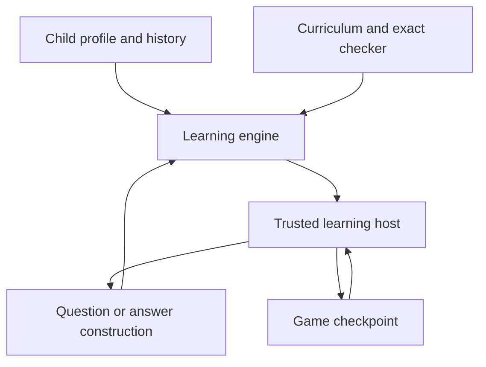

# Learning integration contracts

## Ownership

The host owns learner records, grade eligibility, item selection, exact evaluation, evidence, persistence, question budget, and allowed presentation modes. Games own their ordinary mechanics and run outcome. A new game must integrate with the shared host; it must not implement a parallel learner score or remove math in response to a child prompt.



## Core service

`src/learning/types.ts` is the canonical contract. `engine.ts` exports the deterministic functions used by the host and tests:

- `ensureLearning(profile, now)` validates/migrates supported state without discarding an unsupported record.
- `selectItem(profile, context)` returns a grade-eligible item with a purpose and actual representation. An injected clock/random source makes scenarios repeatable.
- `beginAttempt(profile, item, context)` establishes one attempt and preserves interrupted prior work.
- `submitAnswer(profile, attemptId, raw, now)` records every valid submission immediately and finishes a correct result. Its result distinguishes malformed input from an incorrect mathematical response.
- `useHint(profile, attemptId, level, now)` records support before any subsequent response.
- `finishAttempt(profile, attemptId, outcome, now)` is idempotent. Unanswered interruptions are not fabricated errors.
- `report(profile, now)` provides explicit evidence states and observations; `validateLearning(value)` protects persisted/imported data.

All mutations must be followed by persistence. The browser adapter wraps these calls with `FG.store.save()`. The activity host also saves immediately after item creation, each response, each help event, and completion/interruption; save failures are shown in the activity.

A `LearningContext` carries `sessionId`, `gameId`, `versionId`, `projectId`, and mode. It contains no game-derived estimate of intelligence or mathematical correctness. Profile ownership is captured when the activity begins; stale callbacks cannot write into another child's active UI.

## Activity contract

`mountMathActivity(target, options)` returns `{item, attemptId, dispose}`. Options supply the profile/context, optional explicit item, mode, save callback, completion callback, and optional legacy IDs/challenge behavior.

The mathematical attempt is shared between written and construction views. A constructed quantity/fraction records a visual representation. A correct first response without requested help can be independently solved visual work; it does not prove symbolic fluency. A hint or correction marks assistance. A worked example can return the child to play with outcome `shown`.

The completion callback occurs once, after short answer feedback or explicit supported continuation. Disposal cancels that callback and closes open work as interrupted. The host must call disposal when changing games, versions, profiles, or pages. The host should keep navigation available so a child can leave; abandonment is evidence about an unfinished opportunity, not proof of inability.

## Native game contract

`GameInstance` optionally supplies:

```ts
isPlaying(): boolean;
pause(): boolean; // true only after the game reaches a safe frozen state
resume(): void;
```

The original construction, Splash, and Dragon adapters implement it. Games without that capability still use completed-round checkpoints; the host does not invent a safe mid-round pause. In the lifecycle, pause sets the game mount inert and excludes the interval from play duration. Resume is idempotent and cannot revive a disposed instance. Held keys/taps must be cleared by the game where relevant. UI outside the game mount remains usable.

The shell counts visible active play, checks the shared budget, and requests pause at the configured 90-second checkpoint. If pause returns false, it waits for another safe opportunity. After the learning activity, it resumes the same game state. At a round boundary, ordinary next/retry actions remain in control of the existing game lifecycle.

Historical remixes that use the older simplified rule adapters have completed-round checkpoints. They do not claim a mid-round pause capability until that adapter implements one.

## Generated-preview protocol

The trusted preview renderer encloses validated generated code in the existing isolated worker. The parent document never evaluates generated module source. Existing CSP, output bounds, restricted draw commands, worker limits, and authentication remain in force.

Renderer → parent:

```ts
{
  type: 'factory-preview',
  channel: string,
  artifactId: string,
  event: 'ready' | 'round-complete' | 'math-checkpoint',
  roundId: number,
  // round-complete only:
  won?: boolean,
  score?: number,
  // math-checkpoint only:
  checkpointId?: number
}
```

Parent → renderer:

```ts
{
  type: 'factory-learning',
  channel: string,
  artifactId: string,
  action: 'connect' | 'pause' | 'resume'
}
```

The bridge validates exact `event.source === frame.contentWindow`, channel, artifact, active child, event type, integer bounds, and duplicate event identity. A fresh frame instance contributes a nonce to the host checkpoint key. Reloaded/replayed rounds therefore remain separate opportunities while duplicate messages from one round do not add credit.

`connect` negotiates the host lifecycle without exposing any profile or item. Isolated renderer smoke tests can still exercise a standalone preview. In the actual app, the bridge connects on frame load and renderer ready, and requires incrementing round IDs for learning events. A stale renderer without the required protocol is paused with an update message instead of silently becoming a math-free preview. Frontend and trusted renderer changes must therefore be deployed together after review.

While connected, a round result locks replay until the host handles the eligible learning opportunity. The host may immediately resume if the shared question budget is exhausted. During a mid-game math checkpoint the worker stops stepping; the watchdog does not report a false hung-worker error while deliberately paused. Inputs are cleared; resuming resets the watchdog's time origin. The wrapper also avoids simulation progress in a hidden document.

Only the trusted host can decide whether a learning opportunity is eligible and whether its answer is correct. Generated worker output cannot report `math-complete`, supply an answer, award learning credit, remove a checkpoint, or modify the child's selected grade.

The bridge and game must be disposed on navigation/profile change. A remote result callback is deferred until learning completes, so the game-design reflection does not obscure the question.

## Adding a skill or game

For a new skill: add one canonical skill with bounded grade/standards/prerequisites; implement exact parameterized items, actual representation, three graduated hints and worked explanation; extend the independent answer oracle and source-aligned coverage catalog. A standards label alone is not a complete implementation.

For a new game: choose a stable project key, pass version/session provenance, wire completed-round checkpoints, implement real safe pause if mid-play learning is desired, and dispose cleanly. Math-mode preferences may be stored per game; evidence remains per child. Forking a game may copy its mode preference but must never clone or reset the child's learning history.

For a bespoke in-world mathematical action: submit the same `MathItem`/attempt through the shared engine, record the actual visual/choice representation, expose equivalent hints and supported continuation, and prevent the game's speed or motor-control result from being graded as mathematical knowledge. Use a new adapter rather than a second mastery model.
