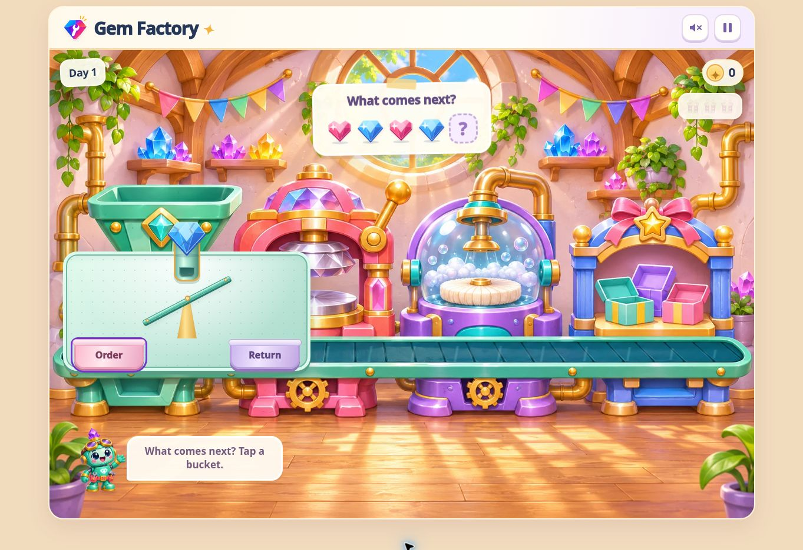
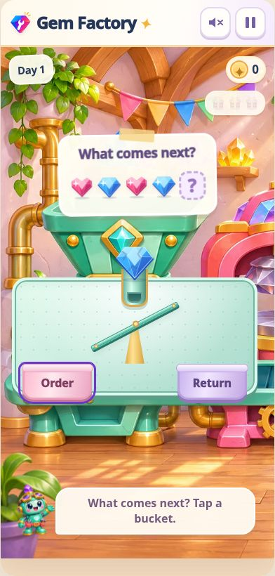
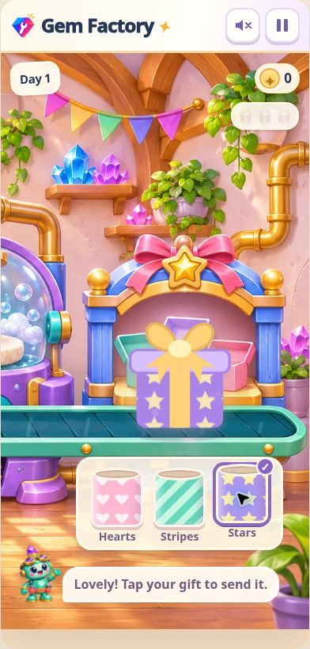

# Gem Factory

A complete, cheerful starter game: find the next gem in a pattern, route it into
a gift, work the machines on the factory line, and choose its wrapping paper.
It appears first
in **Ready to Play jems**. This game has its own local play progress and does not
depend on mining, achievements, or GemBots.

## Child-facing design

The owner's latest direction is to make the illustrated factory itself the
interface. The two buckets are directly clickable; the cutter, gem polisher and
gift are the controls for their own actions. The former right-hand instructions,
separate Drop/recovery controls, numbered stepper and Sort/Cut/Polish/Pack signs
are removed. A short contextual prompt and an active-station cue explain the
next action without covering the production line with a control panel.

Pattern completion replaces the earlier one-to-one order match. Wrapping is an
expressive choice: its result must remain visible on the actual gift, rather than
being a selected swatch with no effect. These are native gameplay changes; they
do not redefine the host's Math/Language learning or claim measured educational
benefit.

## Play

- Read the pictured gem sequence on the taped card and work out what belongs in
  its **?** slot. Four to six examples establish a repeating pattern. The
  required gem is the exact next position, not any color already in the sequence.
- The hopper presents one candidate. Tap the actual **Order** bucket if it is
  next in the pattern, or the actual **Return** bucket if it is a distractor.
  This one action aims the ramp and releases the gem; there is no separate Drop
  button. The bucket buttons also support ordinary keyboard activation.
- Gravity, ramp contact and tray sensors determine the physical journey. One gem
  moves at a time, and both buckets remain locked during its flight so another
  tap cannot accidentally redirect it. A correct distractor return presents the
  next candidate. A correct Order arrival fills the gap and moves the gem to the
  cutter.
- A wrong bucket leaves the pattern unsolved, reduces the bounded sorting bonus
  and automatically presents that candidate for another try. It never awards
  coins or requires a separate recovery control.
- Tap the cutter on the line as its pointer crosses the mint stripe. Every cut
  succeeds; timing earns one, two or three stars and changes the coins awarded
  for the packed gem.
- Rub or hold the gem at the polisher to make it shine. Repeated activation also
  works with a keyboard or assistive technology. The physical gem is the input
  target, and its shine shows progress.
- At the gift station, choose **hearts**, **stripes** or **stars** from the three
  paper rolls. The gift preview changes immediately. Tap the gift to wrap and
  send it; its selected paper stays visible during shipping and in the finished
  gift collection. Each gift can have a different paper.
- Complete the day's order to reach the existing required learning activity.
  The normal host **Next level** action opens the next day.
- Day one introduces alternating **AB** patterns. Day two introduces **AAB**;
  day three uses **ABC**. Later days vary the sequence and palette. A sequence
  may stop at a different position in its repeating unit, so the answer is not
  always the first color. Supplies include distractors, and an incorrect gem
  cannot complete the gap merely by reaching Order.
- Sound is opt-in. Pause, reduced motion, touch cancellation, and host learning
  pauses are supported. Reduced motion removes decorative movement while the
  essential physical sorting remains playable. Day and earned coins save
  separately for each profile.

The game exposes three real remix settings: gifts per day, cutter speed, and
extra sparkle power. There is no shared gem currency, purchase system, network
call, new achievement database, or new child data field.

## Artwork

`public/gem-factory-workshop.webp` and `public/gem-factory-helper.webp` were
created with the built-in image-generation tool for this game. They are local
assets (about 311 KB combined), not external image dependencies. SVG game pieces
remain crisp and preserve distinct heart, diamond, hexagon, crystal, and star
silhouettes. All order labels, controls, live gems, animation, and rewards are
functional UI drawn above the backdrop.

Workshop prompt direction: a luminous premium cartoon gem workshop, cream
plaster walls, honey-colored curved timber beams, sunny round window, rainbow
bunting, crystal shelves, substantial mint hopper, coral cutter, lilac/turquoise
polisher and a ribboned gift station. Empty continuous teal conveyor, bright
Jems palette, no baked-in text or UI, no industrial grime.

Helper prompt direction: a lovable mint robot with large navy eyes, rosy cheeks,
amethyst crystal hat, golden goggles and coral tool belt, waving on transparency,
with soft dimensional casual-game shading.

## Verification

The updated `npm run test:gem-factory` contract plays the actual Studio starter
at desktop, tablet and phone widths in normal motion, plus a reduced-motion
phone pass. It checks direct bucket taps, the one-gem flight lock, actual tray
contact, exact next-pattern acceptance, wrong-choice recovery, keyboard input,
on-line machine actions and three visibly different wrapped gifts. It preserves
pointer-cancellation, both pause paths, required learning, next-day progression,
profile isolation, persistence and scene-coverage checks. Captures go to
`test-results/gem-factory/`; the visual-review workflow retains them as
`gem-factory-gameplay`.

That browser contract has been updated for this redesign; its presence is not a
claim that it has run successfully. Current interactive Site verification and
executed source checks must be reported separately in the delivery receipt.

`tests/gem-factory-physics.test.ts` separately checks route differences for the
same released gem, a mid-flight tilt, collisions between live gems, fixed-step
behavior at 30/60/120 render rates, bounded catch-up and disposal. The lower-level
simulation still supports multiple bodies; the child-facing interaction
deliberately releases only one at a time. Pattern unit checks verify the clue,
its exact next item and the progression independently of browser rendering.
Actual tablet performance and children's enjoyment have not been measured in
this change.

The approved workshop is a visual reference for this illustrated game. The
[presentation-quality contract](../game-intelligence/PRESENTATION-QUALITY.md)
also supports pixel, flat 2D, dimensional and realistic games without copying
this room, palette or mascot into every game. Child-uploaded artwork remains a
separate future task.

## Current interactive captures

These screenshots were captured from the actual revised native game in the Site
preview. Desktop play completed a gift, including a deliberately wrong bucket,
automatic retry, correct next-pattern selection, cutter, held/keyboard polish,
all three paper previews and a shipped striped gift. A 390 px browser frame
completed the same route and shipped a star-wrapped gift. The existing host's
Math activity paused and resumed both sessions. A resized 820 px frame was also
visually checked; these frame sizes do not establish actual touch-device
performance or a completed full-day/profile-isolation browser run.

The earlier `gem-factory-desktop.png` and `gem-factory-phone.png` files remain
historical evidence for the preceding physical-sorter interface; they are not
current UI captures.
