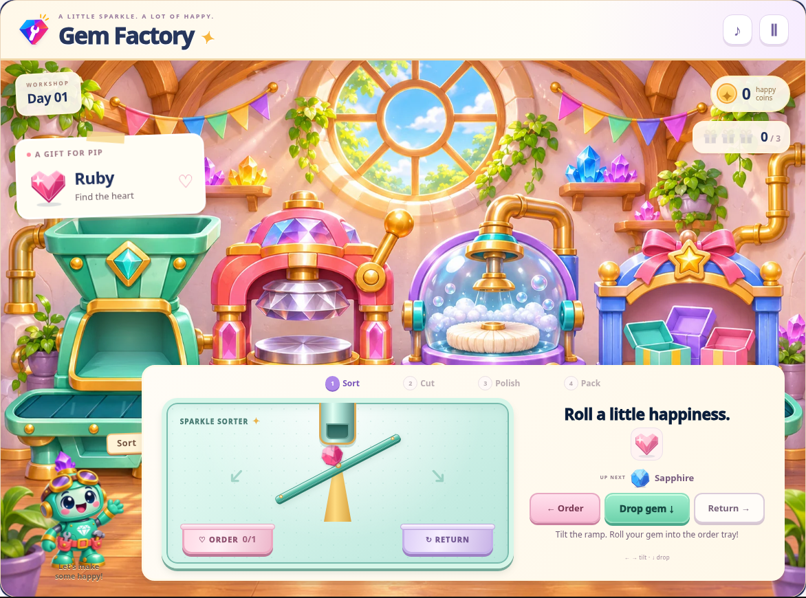
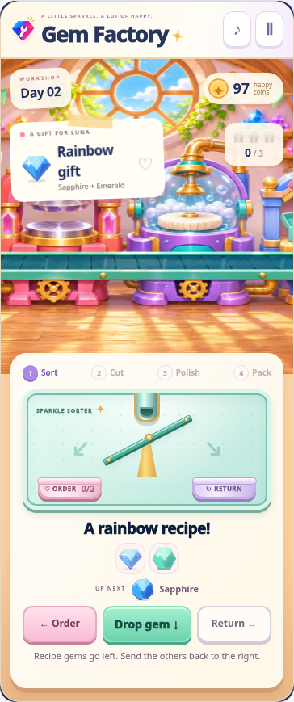

# Gem Factory

A complete, cheerful starter game: route falling gems into a gift order, time its cut,
rub or hold to polish it, and pack it with a burst of sparkles. It appears first
in **Ready to Play jems**. This game has its own local play progress and does not
depend on mining, achievements, or GemBots.

## Play

- Tilt the mint sorting ramp toward **Order** or **Return**, then **Drop** a gem.
  Arrow keys also work: left/right tilt; down releases the next gem. The arrows
  are controls for the actual ramp, not a direct command to accept a gem.
- Gravity, ramp contact, tray sensors and gem-to-gem collisions determine where
  gems land. Change the tilt while a gem is moving to change its route. Up to
  four gems can be in flight together.
- Match by name, color, and shape. Route gems needed for the current recipe to
  Order, and extra colors to Return. A wrong route costs part of the sorting
  bonus and offers a visible **Try again** action; the order remains recoverable.
- Cut as the pointer crosses the mint stripe. Every cut succeeds; timing earns
  one, two, or three stars and changes the coins awarded for the packed gem.
- Polish by rubbing the gem, holding the button, or activating it repeatedly
  with a keyboard or assistive technology.
- Complete the day's order to reach the existing required learning activity.
  The normal host **Next level** action opens the next day.
- Day one introduces single-color orders. Day two requires two colors and adds
  amethyst; day three onward requires three colors, with sunshine stars and later
  rainbow bundles. Supplies include colors outside the recipe, so simply
  sending every gem into Order does not solve the task. The completed bundle
  stays visible through cutting, polishing and packing.
- Sound is opt-in. Pause, reduced motion, touch cancellation, and host learning
  pauses are supported. Reduced motion removes decorative movement while the
  essential physical sorting remains playable. Day and earned coins save
  separately for each profile.

The game exposes three real remix settings: gems per order, cutter speed, and
extra sparkle power. There is no shared gem currency, purchase system, network
call, new achievement database, or new child data field.

## Artwork

`public/gem-factory-workshop.webp` and `public/gem-factory-helper.webp` were
created with the built-in image-generation tool for this game. They are local
assets (about 311 KB combined), not external image dependencies. SVG game pieces
remain crisp and preserve distinct heart, diamond, hexagon, crystal, and star
silhouettes. All order labels, controls, live gems, animation, and rewards are
functional UI drawn above the backdrop.

Workshop prompt direction: a luminous premium cartoon gem workshop, cream
plaster walls, honey-colored curved timber beams, sunny round window, rainbow
bunting, crystal shelves, substantial mint hopper, coral cutter, lilac/turquoise
polisher and a ribboned gift station. Empty continuous teal conveyor, bright
Jems palette, no baked-in text or UI, no industrial grime.

Helper prompt direction: a lovable mint robot with large navy eyes, rosy cheeks,
amethyst crystal hat, golden goggles and coral tool belt, waving on transparency,
with soft dimensional casual-game shading.

## Verification

`npm run test:gem-factory` plays the actual Studio starter at desktop, tablet and
phone widths in normal motion, plus a reduced-motion phone pass. It covers actual
tray contact, a wrong route and recovery, mixed recipe/return switching,
keyboard input, the four making steps,
pointer cancellation, both kinds of pause, required learning, next day,
profile isolation, persistence and scene coverage. It also captures the running
game in `test-results/gem-factory/`. The visual-review workflow retains those
captures as `gem-factory-gameplay`.

`tests/gem-factory-physics.test.ts` separately checks route differences for the
same released gem, a mid-flight tilt, collisions between live gems, fixed-step
behavior at 30/60/120 render rates, bounded catch-up and disposal. These are
implementation and browser checks; actual tablet performance and children's
enjoyment have not been measured in this change.

The approved workshop is a visual reference for this illustrated game. The
[presentation-quality contract](../game-intelligence/PRESENTATION-QUALITY.md)
also supports pixel, flat 2D, dimensional and realistic games without copying
this room, palette or mascot into every game. Child-uploaded artwork remains a
separate future task.

## Reviewed gameplay captures

These screenshots come from the actual normal-motion browser playthrough.

