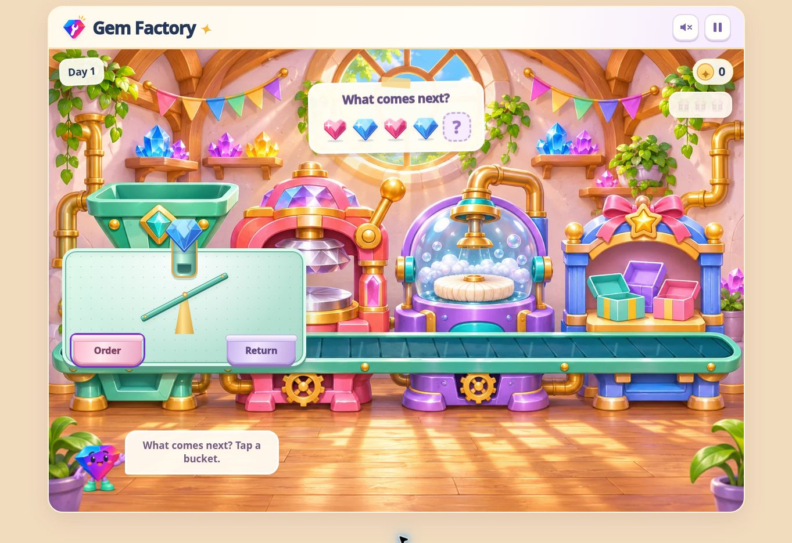

# Jem Factory

A complete, cheerful starter game: find the next jem in a pattern, route it into
a gift, work the machines on the factory line, and choose its wrapping paper.
It appears first
in **Ready to Play jems**. This game has its own local play progress and does not
depend on mining, achievements, or GemBots.

**November 22, 2026 refinement:** the owner requested clearer first-time play,
more prominent pattern matching, a sorter mounted above the hopper, a gentle
consequence for missed cuts and faster difficulty progression. The
[accepted decision](../decisions/2026-11-22-factory-play-clarity.md) records that
scope. This contract describes the new behavior; execution, merge and release
evidence belong in [delivery state](../../DELIVERY-STATE.md).

## Child-facing design

The illustrated factory itself is the interface. A larger pictured pattern is
the primary sorting task. A transparent sorting mechanism sits above the
hopper opening, and **Keep** and **Return** controls are attached to the green
machine. The mechanism must not read as an opaque pop-out panel covering the
hopper or conveyor. The candidate, ramp and receiving paths show where the jem
will go. Keep the physical world and the visible ramp/trays aligned.

The cutter, jem polisher and gift remain the controls for their own actions.
A short contextual prompt and an active-station cue explain the next action.
Avoid a mandatory tutorial, detached control console or repeated instructions.
Apply [Child interface: clear at six](CHILD_INTERFACE.md): large visible labels,
usable touch targets and a clue that fits narrow phones without horizontal
scrolling. Readable reflow takes priority over shrinking the pictured jems.

On phones, the upper pattern area becomes the next-stage instruction after
sorting, keeping the wrapping choices unobstructed. Focusing a machine control
must not internally scroll the camera frame or move the active station out of
view.

Pattern completion replaces the earlier one-to-one order match. Wrapping is an
expressive choice: its result must remain visible on the actual gift, rather than
being a selected swatch with no effect. These are native gameplay changes; they
do not redefine the host's Math/Language learning or claim measured educational
benefit.

## Play

- Read the larger pictured jem sequence and work out what belongs in its **?**
  slot. Six or seven examples establish the repeating rule. The required jem is
  the exact next position, not any color already in the sequence.
- The hopper presents one candidate. Use **Keep** if it belongs next in the
  pattern, or **Return** if it is a distractor. Each machine control aims the
  ramp and releases the jem in one action. Both are ordinary accessible buttons;
  left/right keys remain available without requiring a precision lever drag.
- Gravity, ramp contact and tray sensors determine the physical journey. One gem
  moves at a time, and both controls remain locked during its flight so another
  tap cannot accidentally redirect it. A correct distractor return presents the
  next candidate. A correct Keep arrival fills the gap and moves the jem to the
  cutter.
- A wrong bucket leaves the pattern unsolved, reduces the bounded sorting bonus
  and automatically presents that candidate for another try. It never awards
  coins or requires a separate recovery control.
- Tap the cutter while its pointer is in the broad green middle zone, from
  **26% through 74%** of the track. This accepts an ordinary good cut; the
  central **38.5% through 61.5%** gives a perfect cut and the existing higher
  packed-gift reward. The pictured zone and the checked bounds must agree.
- A cut outside that zone briefly shows the current jem being recycled, then
  returns to sorting for a fresh candidate. This transition uses active game
  time, so manual and host pauses freeze it. Keep the current pattern and
  difficulty, previously packed gifts, their paper and earned coins. A miss
  awards nothing and never advances to polishing or completes the day. Waiting
  without tapping is not a failure; the pointer continues to cycle.
- Rub or hold the jem at the polisher to make it shine. Repeated activation also
  works with a keyboard or assistive technology. The physical gem is the input
  target, and its shine shows progress.
- At the gift station, choose **hearts**, **stripes** or **stars** from the three
  paper rolls. The gift preview changes immediately. Tap the gift to wrap and
  send it; its selected paper stays visible during shipping and in the finished
  gift collection. Each gift can have a different paper.
- The default order contains **two gifts**. Complete it to reach the existing
  required learning activity. The normal host **Next level** action opens the
  next day. Explicit remixes can still select two through five gifts per day.
- Pattern difficulty advances after **two completed pattern-to-gift cycles**,
  including within longer custom orders. Only shipping the completed gift
  counts: rejecting distractors, correcting a wrong route or repeating a cut
  retry cannot accelerate difficulty. Preserve the current puzzle's tier while
  retrying it and carry partial progress across days, including odd-sized orders.
- The first tier introduces alternating **AB** patterns. The second introduces
  **AAB**; the third uses **ABC**. Later tiers vary the sequence and palette.
  With the default two-gift order these changes coincide with the next day.
  A sequence
  may stop at a different position in its repeating unit, so the answer is not
  always the first color. Supplies include distractors, and an incorrect gem
  cannot complete the gap merely by reaching Keep.
- Sound is opt-in. Pause, reduced motion, touch cancellation, and host learning
  pauses are supported. Reduced motion removes decorative movement while the
  essential physical sorting remains playable. Day, earned coins and pattern
  progression use the same profile-separated local game persistence. Preserve
  older saved day/coin records when adding the progression field.

The game exposes three real remix settings: gifts per day, cutter speed, and
extra sparkle power. There is no shared gem currency, purchase system, network
call or new achievement database. The progression counter is local gameplay
state, not an educational score or a change to Math/Language difficulty.

## Artwork

`public/gem-factory-workshop.webp` is the generated workshop backdrop. The
current helper is `public/jems-gem-companion.png`, copied byte-for-byte from the
owner-selected Jems Brand Library v1.2 welcome pose
(`art/character_spark_wave.png`, SHA-256
`0ee72973597493499b251fde68134bb03e91184f761fc271ef0cc131b2fef001`).
It is the faceted blue/violet/coral Gem companion with mint boots, distinct from
the human maker characters. The approved face, silhouette and transparency are
preserved; its full body is contained and anchored to the workshop floor. Both
assets are served locally, without external image dependencies. SVG game pieces
remain crisp and preserve distinct heart, diamond, hexagon, crystal, and star
silhouettes. All order labels, controls, live gems, animation, and rewards are
functional UI drawn above the backdrop.

Workshop prompt direction: a luminous premium cartoon gem workshop, cream
plaster walls, honey-colored curved timber beams, sunny round window, rainbow
bunting, crystal shelves, substantial mint hopper, coral cutter, lilac/turquoise
polisher and a ribboned gift station. Empty continuous teal conveyor, bright
Jems palette, no baked-in text or UI, no industrial grime.

The previous `gem-factory-helper.webp` robot remains only as a versioned asset
used by renderer/provider fixtures; it is no longer displayed by Gem Factory.
The new helper reuses the approved artwork and adds no new animation rig.

The wrapped gift keeps a stationary button target. Only its inner artwork bobs,
so normal mouse/touch activation remains stable while the visual cue moves.

## Verification

The November 22 candidate requires the actual Studio starter browser contract,
`npm run test:gem-factory`, at desktop, tablet and phone widths, with a narrow
phone layout and reduced-motion coverage. Retain actual tray contact, exact
next-pattern acceptance, the one-jem flight lock, wrong-route recovery,
keyboard/touch input, pointer cancellation, both pause paths, required learning,
profile isolation and scene coverage. Exercise all three paper previews even
though a default day now ships only two gifts. Captures go to
`test-results/gem-factory/`; PRs retain them in the Arcade factory shard’s `arcade-evidence-<run>-<attempt>-factory` archive at the repository-default retention. A manual full visual review retains them as `gem-factory-gameplay`.

The new acceptance cases are deliberate out-of-zone cuts, paused recovery,
successful retry, preservation of an already packed gift and its coins/paper,
and progression after two completed cycles. Include longer and odd-sized custom
orders so changing **gifts per day** cannot silently slow, repeat or regress the
pattern tier. Inspect the composed clue, candidate, physical sorter and machine
controls together, including at narrow phone widths. Code must check the same
cut bounds that the interface depicts.

These are acceptance requirements, not an assertion of successful execution.
Report exact source checks, reviewed captures and any live-site verification
separately in the delivery receipt. The earlier captures below predate this
overhaul and do not establish its layout or behavior.

`tests/gem-factory-physics.test.ts` separately checks route differences for the
same released gem, a mid-flight tilt, collisions between live gems, fixed-step
behavior at 30/60/120 render rates, bounded catch-up and disposal. The lower-level
simulation still supports multiple bodies; the child-facing interaction
deliberately releases only one at a time. Pattern unit checks verify the clue,
its exact next item and the progression independently of browser rendering.
Actual tablet performance and children's enjoyment have not been measured in
this change.

The approved workshop is a visual reference for this illustrated game. The
[presentation-quality contract](../game-intelligence/PRESENTATION-QUALITY.md)
also supports pixel, flat 2D, dimensional and realistic games without copying
this room, palette or mascot into every game. Child-uploaded artwork remains a
separate future task.

## Preserved companion artwork — earlier verification

The actual Site preview loaded the exact 1254 × 1254 transparent master and
was visually checked with the new helper anchored beside the existing hint.

## Earlier direct-on-line gameplay captures

These screenshots were captured from the direct-on-line revision before the
subsequent Gem companion swap. They show actual gameplay, but the robot visible
in these historical captures is no longer the current helper. Desktop play completed a gift, including a deliberately wrong bucket,
automatic retry, correct next-pattern selection, cutter, held/keyboard polish,
all three paper previews and a shipped striped gift. A 390 px browser frame
completed the same route and shipped a star-wrapped gift. The existing host's
Math activity paused and resumed both sessions. A resized 820 px frame was also
visually checked; these frame sizes do not establish actual touch-device
performance or a completed full-day/profile-isolation browser run.

The earlier `gem-factory-desktop.png` and `gem-factory-phone.png` files remain
historical evidence for the preceding physical-sorter interface; they are not
current UI captures.
