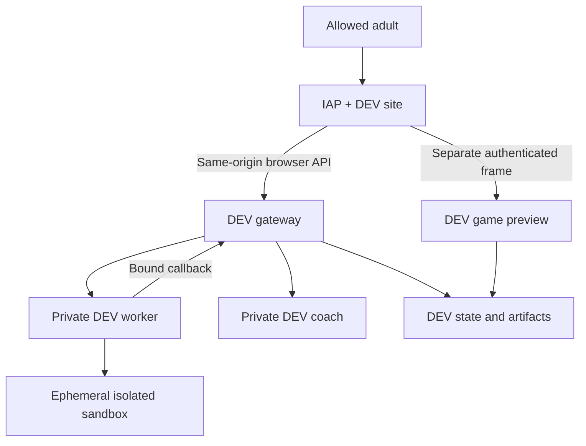

# Jems DEV workbench

**Scope:** implementation following the owner's November 20, 2026 authorization to proceed with lightweight, fast development, real child-experience and adult-experience AI testing by adults only, and no interference with the current production smoke or deployments. Public source started from `a5f1f41cad0c8881cbb05ca97d0d1364cf5878f4` and was integrated with main `d0d05944ea4957aef51b690bf02dc8f6bb73f04e`, preserving the parallel production smoke acceptance and activation-inventory work. The independent private companion starts from worker `52729ad231179d633b2f15fa910aa2b23273a2d6`.

**Delivery boundary:** local preview, runtime authorization, packaging and deployment-controller source are implemented and tested with synthetic fixtures. These are not a deployed DEV site, a live IAP login, a working private runner, or activated provider evidence. Exact integration/CI receipts belong in [delivery state](../../DELIVERY-STATE.md). The [environment plan](ENVIRONMENTS.md) retains the larger release direction; this runbook describes the concrete first implementation.

## 1. The everyday loop

| Place | Use it for | Access and AI |
| --- | --- | --- |
| Local preview | Layout, artwork, navigation, local games, editing and save/reload | Loopback only; AI disconnected; hot reload |
| Shared DEV | Real generation, coaching, speech and the complete Build → Test → Review → Play → Edit → Keep journey | Explicit adult accounts; synthetic profiles and data; independent DEV services and worker |
| Production smoke | Acceptance of the existing exact production candidate | Existing production operator flow and pins; unchanged by these DEV commands |
| Production | Real use after its own release and activation gates | Existing controls and deployment workflow |

For ordinary visual work:

```sh
npm ci
npm run dev:preview
```

The command prints a stable `127.0.0.1` port derived from this checkout. It refuses a busy port instead of silently moving saved work to another origin. A visible **DEV PREVIEW · AI disconnected** banner shows the source and local-edit state. It includes untracked changes in its source fingerprint, has no proxy to production, overrides public configuration to `unavailable`, and blocks external browser connections with CSP. Work is saved only in this separate browser origin.

`npm run dev:preview:build` creates a review artifact under `.factory-deployment/previews/local`, separately from production `dist/`. `npm run dev:preview:verify -- --dir PATH --allow-dirty` verifies a local edited snapshot. Omit `--allow-dirty` for a clean commit artifact. The manifest binds full source/tree identity, actual working bytes, individual file hashes and package size; it is an inventory, not a signature or independent CI attestation.

The observed full artwork build was approximately 234 MB and took about five seconds in this workspace. That measurement is not a hosting cost or another machine's performance guarantee. Use HMR for repeated edits. A same-repository PR can opt into an unprivileged downloadable artifact with the `dev-preview` label; retention is three days. This workflow grants no cloud credentials and does not publish a public website. Public Firebase preview publishing remains an optional later slice, subject to its own reviewed publisher and visibility policy.

## 2. One shared DEV backend, both experiences

The same shared DEV installation supports the child UI and the adult workspace. There are no separate stacks per PR or per experience.

An operator records the actual Google subject/email for each known adult. Both the site and gateway cryptographically verify Google's signed IAP assertion, exact issuer/audience, expiration and allowlist pair. An email-looking header or possession of a public URL grants nothing. IAP establishes account identity; the operator's explicit adult confirmation supplies the testing audience restriction.

Adults use existing trusted-device enrollment. The adult workspace retains its existing permit, passphrase unlock, cookie and per-tab proof. To test the child experience, a verified adult uses the exact `dev-synthetic` family/workspace. The server attaches a distinct, at-most-one-hour synthetic test grant to the ordinary child-style session. No guardian verification, child consent or ZDR receipt is fabricated. This tests the child product experience with an adult operator; it does not establish real-child privacy acceptance.

Paid admission and asynchronous completion recheck the original grant. Revoked, expired or replaced authorization cannot resume pending work or publish a late model/speech result. Existing completed synthetic games can remain available to a fresh authorized adult session, so routine login renewal does not erase saved work.

### Request boundaries



The site forwards only the needed Jems cookies/headers and the verified IAP assertion. It strips unrelated caller credentials, refuses internal/worker paths and redirects, and never replays an uncertain paid POST. Browser cancellation propagates upstream. Browser APIs use the app origin; worker and scheduler identity use the direct gateway origin.

The generated-game preview remains on a separate untrusted host with its existing sandbox/content policy. DEV adds its own IAP gate before signed-ticket data. The authenticated shared site disables offline service-worker response caching; disconnected built previews still support the real offline shell. An authenticated site's cached shell must not become an alternate login path.

## 3. Isolation and limits

The fixed service names are `jems-dev-app`, `jems-dev-gateway`, `jems-dev-preview` and `jems-dev-coach`. Each has its own service account in a separate project. Firestore, `${projectId}-artifacts`, signing keys, GitHub Apps, provider credentials, worker repository/group and WIF trust all belong to DEV. Runtime startup checks actual Google metadata project ID/number before state access. Mixed production resource names, numeric identities and origins fail validation.

The direct gateway admits network transport for GitHub OIDC callbacks; it still cryptographically gates browser routes with the app IAP assertion and ordinary device/origin checks. The coach accepts only the exact DEV gateway service identity. Model keys remain outside the browser, site, gateway, generated preview and sandbox VM.

The private worker lives in a separate private repository ending in `-dev`, uses `factory-private-dev.yml`, its own main/execution tag/SHA and the `jems-dev-generation`, `jems-dev-sandbox`, `jems-dev-quality` and `jems-dev-infrastructure` environments. Production's current private main and approved pin do not move as a DEV prerequisite. A separate runner-registration App is required in addition to the narrowly scoped gateway dispatch App.

The sandbox image is public code in the separate `jems-dev-sandbox` Artifact Registry repository. Private service images stay in `jems-dev-images`. Anonymous sandbox-image read is granted only after the build's actual source provenance and digest are verified. The VM receives no cloud service account, model secret, registry credential or external address. The private companion manages its own VPC/subnet/NAT, IAP SSH, per-run ephemeral runner and cleanup/backstop.

### Initial spending and concurrency

The example starts with a **$5 total AI admission limit**, at most **$1 per generation** and **$0.10 per coach turn**. Speech has its own explicit per-request cap. These are configurable private DEV inputs, not evidence that money has been spent or a provider has been enabled.

The durable DEV counter reserves each request's maximum possible cost permanently across generation, coach and speech. Cancellations, uncertain calls, ordinary family allowance changes and month rollover do not refill it. The existing transactional family ledger also applies. Only one paid operation may be active at a time. An unresolved interrupted operation can block the next admission until its outcome is reconciled; do not delete the ledger or replay the POST to clear it.

Cloud Run uses zero minimum instances and one maximum instance per service. Cloud Build, storage, data transfer, Artifact Registry, NAT/IP and ephemeral VM charges are separate from the $5 model limit. In particular, the isolated NAT can have standing IP costs; this is not a zero-cost environment. See Google's [NAT pricing](https://cloud.google.com/nat/pricing). Keep one shared DEV stack and a small retained artifact set.

## 4. First setup: concrete prerequisites

The checked-in [manifest example](../../scripts/deployment/dev-manifest.example.json) is deliberately invalid until real identities are supplied. An example numeric project/repository ID is never accepted as provisioned evidence.

Setup needs a labelled and billed separate Google Cloud project, a keyless `jems-dev-bootstrap` principal that the operator can impersonate, real allowed-adult identities, the new private worker/repository/group/App identities, separate DEV provider credentials, and current model/price approval values. The public and private tools name exact DEV targets; they cannot create an authenticated account connection or invent provider credentials.

Native Cloud Run IAP may require a one-time console OAuth setup for a project outside a Google organization. Google documents that those OAuth clients cannot be created programmatically; retain this as a concrete setup requirement instead of claiming a CLI flag solves it. See [Cloud Run IAP](https://docs.cloud.google.com/run/docs/securing/identity-aware-proxy-cloud-run) and [signed assertion verification](https://docs.cloud.google.com/iap/docs/signed-headers-howto).

All private manifests, configs, receipts and keys go under ignored `.factory-deployment/` or a private operator location. The config writer creates restrictive file permissions and new distinct signing keys. Existing DEV signing keys must be passed deliberately during a config update; ordinary release work does not rotate them.

### Foundation, images and secrets

Run commands from the reviewed checkout. The examples assume the real private manifest is `.factory-deployment/dev/manifest.json`.

```sh
# Offline plan, then read-only verification, then the authorized DEV foundation.
npm run dev:plan -- --manifest .factory-deployment/dev/manifest.json
npm run dev:plan -- --manifest .factory-deployment/dev/manifest.json --check
npm run dev:plan -- --manifest .factory-deployment/dev/manifest.json --apply

# Each submission records an operation before one asynchronous Cloud Build.
npm run dev:images -- --manifest .factory-deployment/dev/manifest.json \
  --receipt .factory-deployment/dev/backend-build.json --submit
npm run dev:images -- --manifest .factory-deployment/dev/manifest.json \
  --components app --receipt .factory-deployment/dev/app-build.json --submit

# Inspect the same builds; do not submit again when a result is uncertain.
npm run dev:images -- --manifest .factory-deployment/dev/manifest.json \
  --receipt .factory-deployment/dev/backend-build.json --verify
npm run dev:images -- --manifest .factory-deployment/dev/manifest.json \
  --receipt .factory-deployment/dev/app-build.json --verify
```

The image builder reads exact Git blobs. App assets/server are built inside a source-bound multistage image, rather than accepting caller-created JS and a self-written inventory as provenance. Cloud Build must report matching archive SHA256, source object generation, exact steps/identity and immutable image results. Copy only the verified image digests into a new private manifest. Public sandbox read is a separate `dev:plan -- --publish-sandbox --build-receipt ...` operation after this verification.

Use `dev_config.py --manifest ... --out ... --initialize-private --approval ...` to render the three private configs with real generation approval. For a change, add `--existing-gateway` pointing at the prior private gateway config to preserve signing keys. Use `dev_secrets.py --manifest ... --config-dir ... --github-key-file ... --coach-key-file ...` for a local input/target plan; `--apply --out-manifest NEW_PATH` appends the named DEV secret versions and writes a new manifest containing numeric versions. Inactive/audio-only coaching does not mount a model key. Payloads are not printed. A partial or uncertain write must be inspected before continuing.

Install the companion's private DEV workflow, network, restricted WIF, runner group and registration identity in the new private repository. Its `scripts/dev/export.py` excludes the production workflows and must export outside existing Git checkouts. Protect the new repository's `main`, record its actual full private SHA, and create the lightweight `jems-dev-execution-<full-private-SHA>` tag at that same commit. The `jems-dev-isolated` organization runner group must select only this private repository and its exact `factory-private-dev.yml@refs/heads/main` workflow. Use a separate runner-registration App from the gateway's dispatch App.

In that private checkout, `scripts/dev/contract.py configure` requires the public DEV manifest, reviewed runner version and tarball SHA256, actual separate runner-App ID, and an explicit `--runner-zone` that belongs to the DEV region. The controller verifies that zone is enabled before creating a disk or VM; do not infer it by appending `-a`. If an unchanged sandbox image is reused after a UI-only source change, also pass `--sandbox-build-receipt` with its original verified build receipt. This retains the original `sandboxSourceSha` OCI label while the application checkout advances. Public release verification must independently prove the live build and identical backend archive inputs before reuse.

Follow the companion README's `scripts/dev/infrastructure.py plan`, `apply` and `audit` commands using the already established keyless DEV bootstrap identity. Keep repository `JEMS_DEV_ENABLED=false` until gateway, worker config, identities and acceptance inputs agree. For later private orchestration SHA changes, its `rotate-trust --previous-config ... --config ...` path requires the exact prior config, a new disabled config, the reviewed new main/tag, and no active workflows, JIT runners, VMs or disks; it changes only the pinned WIF condition. For a completed run after an API outage, `scripts/dev/recover.py --config ... --run-id ...` independently verifies and recovers that run's owned runner, VM and unattached disk. A standalone orphan disk has no VM lifetime backstop. The companion setup and recovery remain separate from the active production worker.

### First service deployment

With actual IAP OAuth setup, observed audiences, all five verified image digests and numeric secret versions in the manifest:

```sh
npm run dev:release -- --manifest .factory-deployment/dev/ready.json --mode plan
npm run dev:release -- --manifest .factory-deployment/dev/ready.json --mode create \
  --build-receipt .factory-deployment/dev/backend-build.json \
  --build-receipt .factory-deployment/dev/app-build.json
npm run dev:release -- --manifest .factory-deployment/dev/ready.json --mode check \
  --build-receipt .factory-deployment/dev/backend-build.json \
  --build-receipt .factory-deployment/dev/app-build.json
```

Creation verifies exact runtime identity/configuration before transport grants. App and generated preview use IAP access for the allowed adults; coach invocation is restricted to the gateway service account. These metadata checks do not establish successful adult login or real AI use.

Use the existing [trusted-device enrollment](../auth/TRUSTED_FAMILY_DEVICES.md) and [adult permit/unlock](../adult-pilot/VOICE_RELEASE_AND_UAT.md) procedures with the **DEV private config and DEV-only data identity**. Initialize only the synthetic family's bounded allowance. No production invitation, device, saved game, consent record, backup or credential should be imported. Once enrolled, everyday testing reuses that DEV browser profile and ordinary renewal; no new cloud stack is needed per change.

Those existing Node setup utilities use Application Default Credentials. Verify a separate DEV-only ADC identity and point `FACTORY_PRIVATE_CONFIG` at the reviewed DEV payload before running them. The Python controllers' explicit `gcloud --impersonate-service-account` flags do not configure Node ADC, and a successful CLI login alone does not prove which identity the Node utilities will use.

## 5. Routine updates and recovery

Package/test the selected commit, submit only needed image builds, verify their receipts, and save a new target manifest. Previously built backend images can be reused for a frontend change only when the independently reconstructed backend archive inputs are identical to those in the selected commit. Their actual old source/build identity is retained in evidence.

`dev:release -- --mode stage` checks the current service configuration and stages changed images without traffic. Save its returned stage receipt. `--mode promote --receipt PATH` moves traffic to those exact candidate revisions, after rechecking for concurrent changes. The controller never selects an arbitrary project, service, latest tag or production concurrency group.

For a runtime config, activation or worker-pin change, supply the exact prior manifest with `--previous-manifest`. This verifies the old live configuration, stages explicit target environment/secrets, and requires unchanged isolation, adult access set and aggregate cap. It is not an approval reset or a mechanism to expand spending/access implicitly.

Image-only rollback restores the recorded compatible serving revisions. Automatic rollback is refused for a config-changing release: old approval flags, secret versions or revoked policy must not be silently restored. Recover with a reviewed forward configuration using the same explicit target controls. After an uncertain cloud operation, inspect the named operation/revision instead of repeating a mutation.

## 6. Acceptance before calling shared DEV ready

Local validation covers signed fixture JWTs, forged headers/subjects, wrong audiences and production tuples, expired/revoked grants, proxy cancellation/no-replay, races across AI capabilities, source/artifact substitution and exact fake-cloud release state. Existing production adult/worker/coach behavior has separate regression coverage.

Live acceptance must observe all of the following on the deployed exact manifest:

1. Anonymous and unlisted accounts are denied; a recorded adult can enter the site and preview host. The real cloud/App/provider identities have no production authority.
2. The actual adult browser can enroll, renew, unlock/lock the adult profile and switch into synthetic child testing. Child and adult saved work retain their existing profile boundaries.
3. Both experiences complete a bounded real Build → isolated Test → Review → Play → Edit → Keep → Reload journey. Coaching/speech receive separate observed evidence when enabled. Readiness probes and fixture tests are not model-output evidence.
4. The private sandbox proves generated-code egress denial and cleanup of the exact VM/disk/runner; rejected, timed-out and cancelled cases cannot replay paid work or refill the allowance.
5. Served source, image/config/worker identities and actual ledger changes match the candidate. The active production workflow/pins/services were not changed by this operation.

The native `run.app` site and preview are cross-site. Opening the preview in a top-level tab can establish its login, but does not prove iframe access in a browser that blocks third-party cookies. Scope initial acceptance to the actual verified adult testing browser. Safari, incognito, restricted-cookie browsers, and mobile sessions remain unverified until tested; if needed, add reviewed same-site custom domains as a separate concrete change. Do not replace the isolated preview host or weaken access checks to make an iframe appear to work.

## Source map

| Concern | Implementation |
| --- | --- |
| Fast disconnected preview and artifact validation | `scripts/development/preview.ts`, `preview-contract.ts`, `tools/offline-build.ts` |
| Authenticated site/proxy and local package verification | `server/dev-site.ts`, `scripts/development/package-site.ts` |
| Source-bound app image | `server/Dockerfile.dev-site-source`, `scripts/development/build-site-image.ts` |
| Adult identity, project and synthetic test policy | `server/dev-access.ts`, `server/dev-test-policy.ts` and existing gateway/pipeline/coach integration |
| Exact environment contract and foundation | `scripts/deployment/dev_contract.py`, `dev_bootstrap.py` |
| Source-verified image publishing | `scripts/deployment/dev_images.py` |
| Private runtime configuration and numeric secrets | `scripts/deployment/dev_config.py`, `dev_secrets.py` |
| First deployment, stage, promote, recovery | `scripts/deployment/dev_release.py` |
| New isolated checks | `.github/workflows/dev-environments.yml`, `.github/workflows/dev-preview-artifact.yml`, `npm run test:dev` |

Production promotion remains with the existing Pages/worker release flow and the separate PR45/issue46 controller work. The DEV workbench does not dispatch, repair or replace the currently running production smoke.
