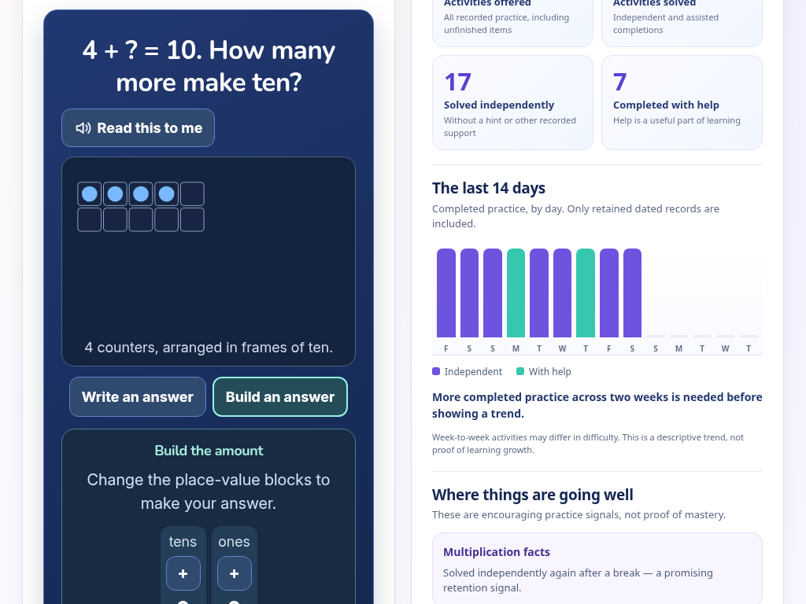
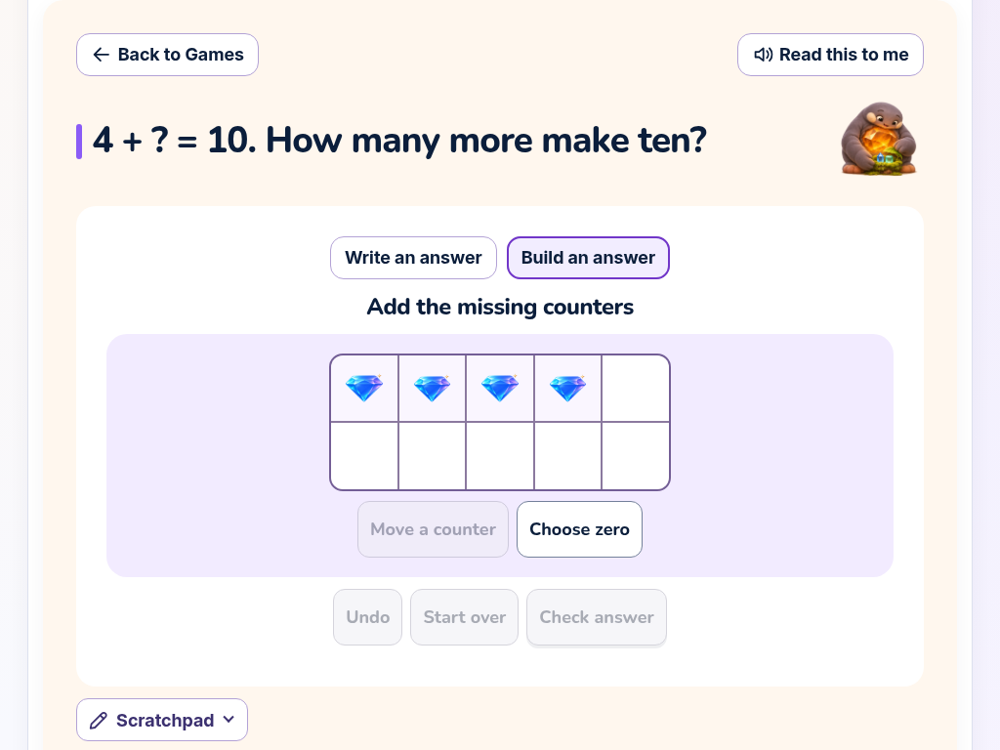

# Learning workspace browser review

## Open the gallery

Build the checked-out candidate with `npm ci` and `npm run review:build` using the repository's supported Node and Python/Pillow environment. Open `dist-review/jems-ui-review.html` in a desktop browser. The Standalone UI review GitHub Actions workflow also packages the file as a downloadable artifact for its exact source revision.

In **Page or journey state**, scroll to **Math workspace**, **English workspace**, or **Learning feedback and recovery**. Each sample opens a real curriculum item in My Powers through the trusted learning host. The listed grade supplies the initial learner profile. Change **Learning grade** to view the same item with another presentation band. **Game artwork context** selects the trusted illustration mapping. Compare the counting example across games to see the change. Use **Populated** under **Scenario** for an owned Nook, and **Hide toolbar** to give the app the full viewport. The findings export records the selected sample, game context and represented source.

The gallery supports tapping, building, editing and submitting. Preset feedback cases exercise those controls on synthetic attempts. The save-failure case rejects the initial save. Request a hint or submit an answer to see recovery. The unavailable-voice case supports the grown-up reading fallback. The sandbox disables real speech and network services.

## Viewport comparison

Each pair uses the same activity family, configured grade, screen size and entry point. The reading-evidence pair shows the archived choice format and a new selectable-passage item from the same skill. The local review toolbar is hidden for captures. Scrolling the outer page brings the activity into view. The screenshot records the resulting viewport, including any My Powers content that remains visible.

| Make ten before | Make ten after |
| --- | --- |
|  |  |

| Device | CSS viewport | Sample | Earlier application | Candidate application |
| --- | --- | --- | --- | --- |
| Phone | 390 × 844 | Build a word | [Before](before/phone.png) | [After](after/phone.png) |
| Tablet portrait | 768 × 1024 | Count objects | [Before](before/tablet-portrait.png) | [After](after/tablet-portrait.png) |
| Tablet landscape | 1024 × 768 | Complete ten | [Before](before/tablet-landscape.png) | [After](after/tablet-landscape.png) |
| Desktop | 1366 × 768 | Reading evidence | [Before](before/desktop.png) | [After](after/desktop.png) |
| Small phone | 320 × 667 | Build place value | [Before](before/small-phone.png) | [After](after/small-phone.png) |
| Short landscape | 844 × 390 | Sequence a picture story | [Before](before/short-landscape.png) | [After](after/short-landscape.png) |
| Large desktop | 1600 × 1000 | Construct a fraction | [Before](before/wide.png) | [After](after/wide.png) |

Additional candidate captures show [a placed letter](after/state-selected.png), [a worked example](after/state-worked.png), [successful completion](after/state-correct.png), [scratchpad and number pad](after/state-tools.png) and [a selected counter in the Dragon Island context](after/dragon-counting.png).

The original application came from protected main at `bc602f1ede502f398308ad56f973c4bf7997ff08`. The review-only harness supplied the fixtures for the comparison. Browser receipts identify the exact represented application revision and Chromium version. [Before receipt](before/browser.json) · [Candidate receipt](after/browser.json)

## Candidate results

Chromium 156.0.8078.79 opened all 36 samples at application revision `b7dd0cbe6cc06da462caf508529d5394f6f31c4d`. The seven viewport captures passed the width and pointer checks, all five game-context choices decoded their counters, and the failed save recovered on a later hint. The reviewer could place one letter, change the native browser zoom to 150%, enter fullscreen, place a second letter and exit with both letters intact. The primary offline run recorded zero external requests and zero uncaught page errors.

Across 45 synthetic openings the synchronous learning-host mount measured a median of 14.6 ms and a nearest-rank 95th percentile of 91.9 ms on this runner. This interval includes the local host and DOM work until mount returns. It ends before browser painting and image decoding. The comparison does not measure ordinary game frame rate or physical-device latency.

## Reproduce

After building the artifact, run `node tools/ui-review/learning-browser.cjs`. Set `CHROMIUM_PATH` to use an installed Chromium binary. The runner opens the offline HTML through a local in-memory route for browsers that disable file URLs. It writes unmodified viewport screenshots and its JSON receipt under `test-results/learning-workspace`. Use `UI_REVIEW_FILE` or `UI_REVIEW_EVIDENCE` to select a different artifact or output location.

These observations cover a synthetic learner in Chromium. Real-device touch and pen ergonomics, acoustic pronunciation, owner visual acceptance, supervised child usability, and deployed gameplay verification each require their own evidence.
