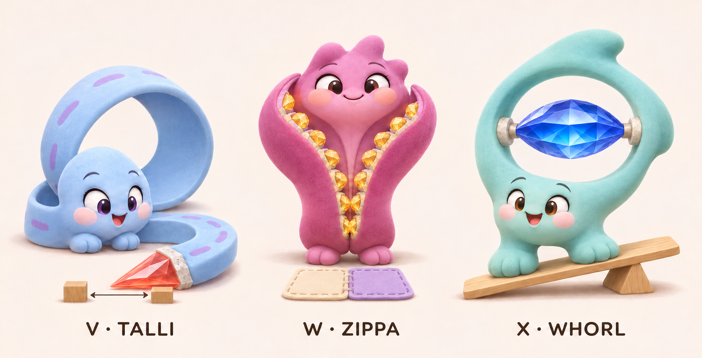

# Approved Gem Pal base designs

**Approval recorded:** November 19, 2026 (America/New_York). The owner approved **S Poff, T Chimi, U Pleeko, V Talli, W Zippa and X Whorl** at the displayed board revision 2. These six join the sixteen previously selected designs, bringing the selected base-design roster to **22**.

**Growth work is paused.** Its replacement approach is not defined by this adoption. Base-design approval does not approve growth forms, expression sets, animation rigs, collection thresholds or application identity mappings. The [decision record](../../decisions/2026-11-19-pal-base-design-adoption.md) preserves this scope.

## Approved records and boards

[approved-base-designs.json](approved-base-designs.json) contains the six base specifications, protected identity anchors, selection summaries and exact board provenance. It is an artwork registry; the application does not load it. The two PNGs are byte-for-byte copies of the approved concept boards, with multiple characters and presentation labels. Individual game assets remain pending.

| Alias | Base design | Design-catalog identity | Approved board |
| --- | --- | --- | --- |
| S | Poff | `GP-S019` | [S–U, revision 2](boards/pals-s-u-r2.png) |
| T | Chimi | `GP-S020` | [S–U, revision 2](boards/pals-s-u-r2.png) |
| U | Pleeko | `GP-S021` | [S–U, revision 2](boards/pals-s-u-r2.png) |
| V | Talli | `GP-S022` | [V–X, revision 2](boards/pals-v-x-r2.png) |
| W | Zippa | `GP-S023` | [V–X, revision 2](boards/pals-v-x-r2.png) |
| X | Whorl | `GP-S024` | [V–X, revision 2](boards/pals-v-x-r2.png) |

The catalog identities are preserved from design catalog revision 2. Review letters belong to their boards, and display names are editable labels. Neither is an application ID. All application mappings and production-asset references remain null.

### Poff, Chimi and Pleeko

### Talli, Zippa and Whorl

## Selected roster

The earlier sixteen entries below are **selection summaries**, carried forward from the design catalog. Their complete original artwork records and canonical species IDs are not reconstructed here. Navi and Mote count as one roster entry. C Tollo and J Pock remain set aside.

| Alias | Previously selected design | Recorded role |
| --- | --- | --- |
| A | Luma | Backlight |
| B | Nook | Gem nursery |
| D | Mizzle | Dew gardener |
| E | Tumble | Tail-gem balancer |
| F | Navi and Mote | Floating gem partnership |
| G | Sivo | Sieve hands |
| H | Furl | Matched gem wings |
| I | Tessit | Tile-stamping feet |
| K | Flick | Seed collector |
| L | Clasp | Hook-gem climber |
| M | Skiff | Ski-like gem foot |
| N | Peep | Magnifying gem eye |
| O | Weft | Gem loom ring |
| P | Cache | Geode storage |
| Q | Brim | Shade canopy |
| R | Wink | Signal-tail gems |

Together with S–X, the selected aliases are **A B D E F G H I K L M N O P Q R S T U V W X**. A selected design is not evidence that a playable collection entry or an isolated production asset exists.

## Base-design boundaries

The six records preserve their existing story, body plan, palette, gem arrangement and protected identity anchors. Suggested actions describe fictional design affordances; they do not establish implemented mechanics or physical performance. Small-size readability, multiple anatomy views and in-game appearance still need their own evidence.

The active records have empty `growth_forms` and a paused growth status. Earlier growth boards and prescriptions are outside this adoption. This record does not infer the replacement approach from another conversation or change the existing companion implementation's growth logic.

Expression and animation references remain null. Later work should preserve the approved base identity, inspect face and attachment compatibility, and record its own revision and approval scope.

## Application handoff

This additive record starts from main `34b5306786c89f94a8f1824b5ded9800a22504e3`. The separate [companion implementation PR68](https://github.com/jzwyrzyk/family-game-factory/pull/68), inspected at `ccd48cb0367822bb288bd4478410fcd7aab1389f`, uses persistent `glim`, `kip` and `riff` identities with provisional gem portraits. No mapping from these approved designs to those identities has been established.

Preserve those saved collection and scene identities when application binding is designed. Reconcile the full selected roster and prepare isolated assets before wiring runtime mappings. Collection rules, growth and expression work remain separate. A concept board must not be used as a single-character runtime portrait.

The adoption does not create `docs/pals/README.md`, which PR68 introduces as its feature contract. When that branch is reconciled with main, link this artwork record from its feature contract while retaining the runtime and design distinctions. The [documentation map](../../README.md) and [review registry](../../context/registry.json) make this record discoverable in the meantime.

The approved [brand library v1.2](../../brand/art-library/README.md) remains separate. Its Gem helper and Spark/Nova makers are not reassigned as collectible species. These concept boards are documentation assets and do not enter its runtime illustration set.

## File integrity

Paths below are relative to this directory. The registry records PNG dimensions and byte counts alongside these SHA-256 values; approval refers to these exact bytes.

| Board | Dimensions | Bytes | SHA-256 |
| --- | --- | --- | --- |
| `boards/pals-s-u-r2.png` | 2172 × 724 | 1,899,161 | `c998f9ff5b1ed8d85b0059bd3b8d2ebbef76b9c1ceeb194601a14fe9d33f1c49` |
| `boards/pals-v-x-r2.png` | 1755 × 896 | 1,915,988 | `47ac1d9ded0d5b945b3552f66ec5c71b277d79db4e806ca0f8de5413e20f4fc9` |

The original filenames and source catalog revision/hash are in the JSON record. Importing these files establishes design provenance only. Merge, deployment and in-game acceptance require separate evidence in [delivery state](../../../DELIVERY-STATE.md).
