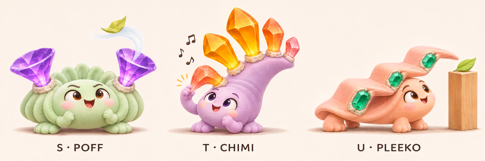
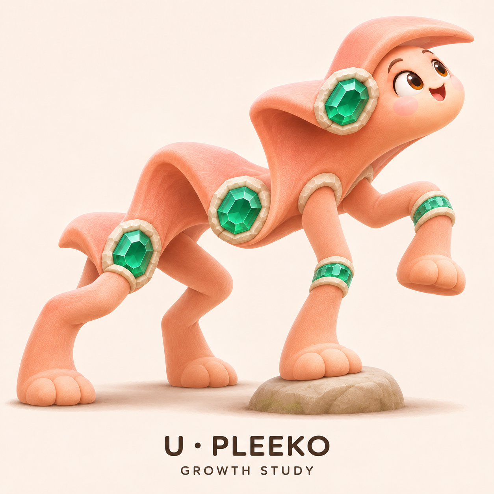
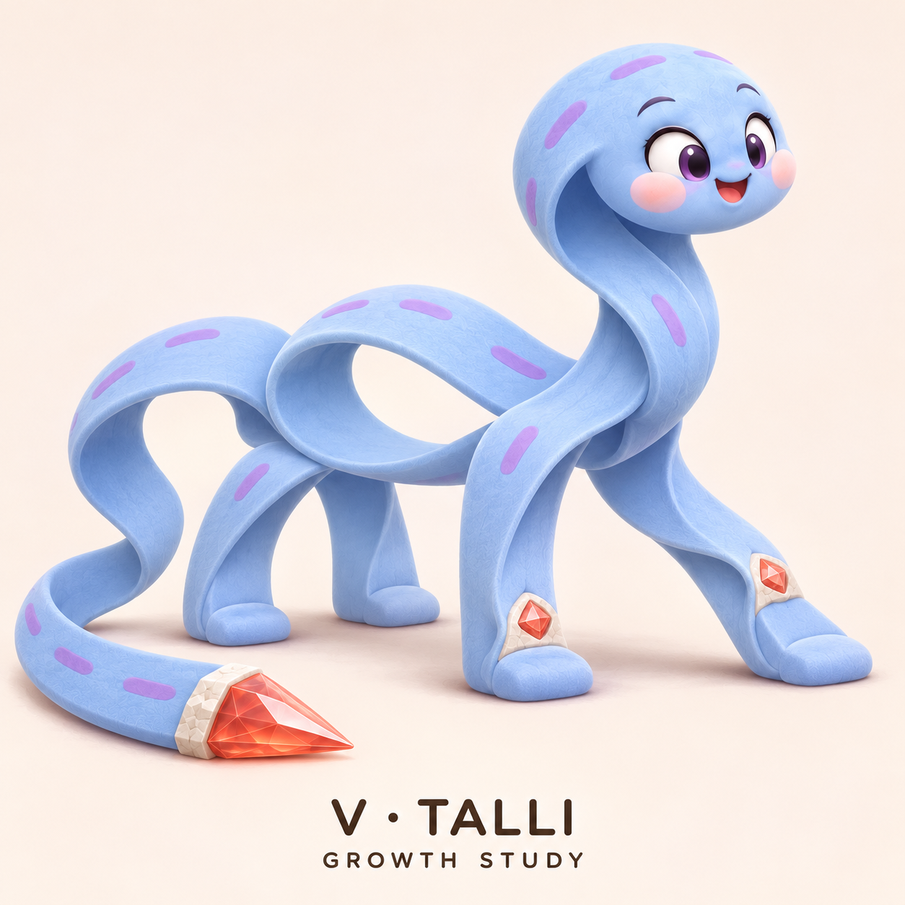
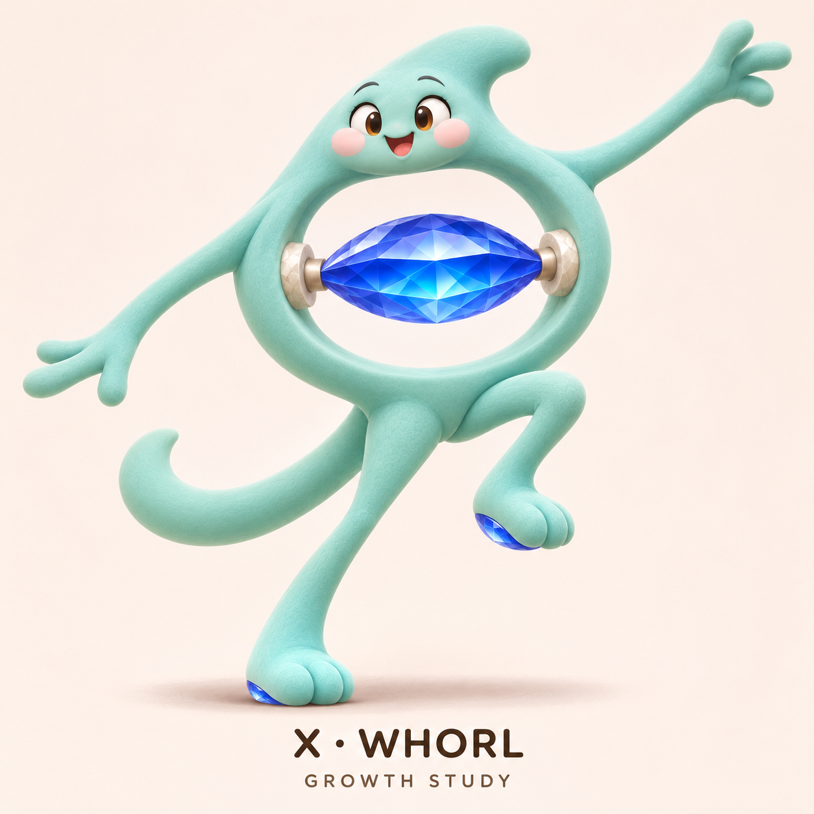

# Gem Pal character and form references

**Current artwork decisions:** November 19, 2026 (America/New_York). The roster contains **22 selected entries and 23 individual profiles** because F comprises F1 Navi and F2 Mote. C Tollo and J Pock remain set aside.

The owner selected the newly shown **U Pleeko, V Talli and X Whorl** mature portraits, and preferred **T Chimi and F1 Navi from the other companion artwork conversation**. The exact latest Chimi and Navi files remain unresolved in this record; their selection is recorded without substituting another image. S Poff and W Zippa remain review candidates.

Growth review has resumed. The [later form-selection decision](../../decisions/2026-11-19-pal-form-reconciliation.md) supersedes the earlier pause and preserves specific selections. It does not approve every mature candidate or establish application integration.

## Two growth stages: Base and Grown

The current product decision is **exactly two visible forms per Pal**, not three. **Stage 1 — Base** uses its approved original creature. **Stage 2 — Grown** uses its individually selected, substantially transformed creature. There is **no Bright/intermediate form** to illustrate, approve, or produce in this release. The earlier three-form Luma studies are archival. Approved base images and selected grown images remain independently versioned and retain their full revision history.

This is a **form-count and artwork-mapping decision**, not a new earning threshold or a declaration that all Grown portraits are approved. The existing [PR68](https://github.com/jzwyrzyk/family-game-factory/pull/68) still derives three levels (New/Bright/Radiant at 0/5/15 adventures). That implementation, its UI and tests **must change to two states before release**; this artwork PR does not silently modify those rules. Preserve saved receipts and adventure counts, ownership, backup formats and current selections while reconciling.

## Authoritative records

- [character-references.json](character-references.json) is the current character/form index. It separates identity, form, artwork revision, exact-reference resolution, user selection, superseded history and production status. Every selected base source is resolved; mature-reference gaps remain explicit.
- [approved-base-designs.json](approved-base-designs.json) preserves the six original S-X base specifications, design IDs, protected base anchors and exact board hashes. It links current grown-form status to the character index instead of duplicating a second active growth specification.
- The [base-adoption decision](../../decisions/2026-11-19-pal-base-design-adoption.md) preserves the original scope and reasoning. Its growth hold is historical.

The index contains **three selected exact mature portraits, two selected mature references awaiting their exact image, two accepted growth directions awaiting the latest single-character profile, five exact review candidates and eleven unresolved current mature references**. An unresolved reference does not mean the artwork has never been made. It means this record has not recovered the exact current artifact and must not guess.

Only the two approved S-X base boards and three selected U/V/X grown portraits are copied into this repository. Other exact sources retain their Library identifiers, versions, URLs and hashes. Those URLs preserve their source access controls; the files are not bundled runtime assets.

## Current character map

Navi is the peach hooded character, and Mote is the distinct violet faceted partner with orange eyes. Keep F1 and F2 separate when assigning images. The selected newest Navi image must be inspected before deciding whether its floating gem is Mote or a non-character spell gem.

| Alias | Character | Base reference | Mature reference status |
| --- | --- | --- | --- |
| A | Luma | [Selected base source](https://chatgpt.com/library?file_id=libfile_fde3_f-d3903e8b517c8191b2334d4587e20777_64db2735d5688191ad02463aaa0cddc5&account_id=personal) | Latest current portrait unresolved |
| B | Nook | [Selected base source](https://chatgpt.com/library?file_id=libfile_fde3_f-5fbd5cf2fcc48191bd1375e47469f30e_64db2735d5688191ad02463aaa0cddc5&account_id=personal) | Latest current portrait unresolved |
| D | Mizzle | [Selected base source](https://chatgpt.com/library?file_id=libfile_fde3_f-5bff8aebfa3c8191b3729a24575341cb_64db2735d5688191ad02463aaa0cddc5&account_id=personal) | Latest current portrait unresolved |
| E | Tumble | [Selected base source](https://chatgpt.com/library?file_id=libfile_fde3_f-5bff8aebfa3c8191b3729a24575341cb_64db2735d5688191ad02463aaa0cddc5&account_id=personal) | Latest current portrait unresolved |
| F1 | Navi | [Selected base source](https://chatgpt.com/library?file_id=libfile_fde3_f-5bff8aebfa3c8191b3729a24575341cb_64db2735d5688191ad02463aaa0cddc5&account_id=personal) | Selected; exact portrait pending |
| F2 | Mote | [Selected base source](https://chatgpt.com/library?file_id=libfile_fde3_f-5bff8aebfa3c8191b3729a24575341cb_64db2735d5688191ad02463aaa0cddc5&account_id=personal) | Latest current portrait unresolved |
| G | Sivo | [Selected base source](https://chatgpt.com/library?file_id=libfile_fde3_f-dd35e40edafc819181887b9cfcc1c9ed_64db2735d5688191ad02463aaa0cddc5&account_id=personal) | Direction accepted; current single profile pending |
| H | Furl | [Selected base source](https://chatgpt.com/library?file_id=libfile_fde3_f-75c4fa8f62048191a5bc3a2bb39522d2_64db2735d5688191ad02463aaa0cddc5&account_id=personal) | Latest current portrait unresolved |
| I | Tessit | [Selected base source](https://chatgpt.com/library?file_id=libfile_fde3_f-dd35e40edafc819181887b9cfcc1c9ed_64db2735d5688191ad02463aaa0cddc5&account_id=personal) | Latest current portrait unresolved |
| K | Flick | [Selected base source](https://chatgpt.com/library?file_id=libfile_fde3_f-545e330eb0288191937db57d3f381427_64db2735d5688191ad02463aaa0cddc5&account_id=personal) | Latest current portrait unresolved |
| L | Clasp | [Selected base source](https://chatgpt.com/library?file_id=libfile_fde3_f-545e330eb0288191937db57d3f381427_64db2735d5688191ad02463aaa0cddc5&account_id=personal) | Latest current portrait unresolved |
| M | Skiff | [Selected base source](https://chatgpt.com/library?file_id=libfile_fde3_f-26b870d9a8088191bdef91b77c0860ab_64db2735d5688191ad02463aaa0cddc5&account_id=personal) | [Review candidate; not selected](https://chatgpt.com/library?file_id=libfile_fde3_f-4ae0ae9b02c881919b7f3fb09319309d_64db2735d5688191ad02463aaa0cddc5&account_id=personal) |
| N | Peep | [Selected base source](https://chatgpt.com/library?file_id=libfile_fde3_f-26b870d9a8088191bdef91b77c0860ab_64db2735d5688191ad02463aaa0cddc5&account_id=personal) | Latest current portrait unresolved |
| O | Weft | [Selected base source](https://chatgpt.com/library?file_id=libfile_fde3_f-75c4fa8f62048191a5bc3a2bb39522d2_64db2735d5688191ad02463aaa0cddc5&account_id=personal) | Direction accepted; current single profile pending |
| P | Cache | [Selected base source](https://chatgpt.com/library?file_id=libfile_fde3_f-7a33362fd7a48191a44559e777eb015b_64db2735d5688191ad02463aaa0cddc5&account_id=personal) | [Review candidate; not selected](https://chatgpt.com/library?file_id=libfile_fde3_f-976e2a59097c8191a5bf8b287150f5a2_64db2735d5688191ad02463aaa0cddc5&account_id=personal) |
| Q | Brim | [Selected base source](https://chatgpt.com/library?file_id=libfile_fde3_f-7a33362fd7a48191a44559e777eb015b_64db2735d5688191ad02463aaa0cddc5&account_id=personal) | [Review candidate; not selected](https://chatgpt.com/library?file_id=libfile_fde3_f-e829b8466f5c819193162c5e7a311b30_64db2735d5688191ad02463aaa0cddc5&account_id=personal) |
| R | Wink | [Selected base source](https://chatgpt.com/library?file_id=libfile_fde3_f-7a33362fd7a48191a44559e777eb015b_64db2735d5688191ad02463aaa0cddc5&account_id=personal) | Latest current portrait unresolved |
| S | Poff | [Selected base source](boards/pals-s-u-r2.png) | [Review candidate; not selected](https://chatgpt.com/library?file_id=libfile_fde3_f-eb99cbb9a7588191a467e6c6efc97e93_64db2735d5688191ad02463aaa0cddc5&account_id=personal) |
| T | Chimi | [Selected base source](boards/pals-s-u-r2.png) | Selected; exact portrait pending |
| U | Pleeko | [Selected base source](boards/pals-s-u-r2.png) | [Selected exact portrait](growth-selected/pleeko-u-growth-selected.png) |
| V | Talli | [Selected base source](boards/pals-v-x-r2.png) | [Selected exact portrait](growth-selected/talli-v-growth-selected.png) |
| W | Zippa | [Selected base source](boards/pals-v-x-r2.png) | [Review candidate; not selected](https://chatgpt.com/library?file_id=libfile_fde3_f-67f94aa08b108191885ecce2eeeff910_64db2735d5688191ad02463aaa0cddc5&account_id=personal) |
| X | Whorl | [Selected base source](boards/pals-v-x-r2.png) | [Selected exact portrait](growth-selected/whorl-x-growth-selected.png) |

The index records a character's region within a source board. A board containing several characters is not an isolated portrait. Review aliases are board-scoped labels, names are editable, and the six S-X species IDs remain GP-S019 through GP-S024. None is an application ID. Earlier canonical species IDs remain unassigned where they were not recovered.

### Selected base boards

### Selected mature portraits

**U Pleeko:** tall articulated peach climber, connected emerald torso hinges and four supporting limbs.

**V Talli:** extended blue ribbon body and supporting ribbon limbs, preserving the coral terminal anchor.

**X Whorl:** open aqua torso, supported sapphire rotor, long balancing limbs and a counterbalancing tail.

The other-chat Chimi selection is the latest correction with short attached arms and paired sound chambers. The Navi selection is the hovering violet-crystal caster with a broad natural hood and curled lower body. Their exact source references are pending. The local Chimi growth study is retained only as superseded history in the external reference index; it must not stand in for the chosen other-chat version.

## Revision and production boundaries

A newer generation does not move a selected pointer. Record the requested change, the selected source revision, preserved identity features, the resulting artifact and its actual review status. A base edit preserves base anchors; a grown form may deliberately change body architecture. Never overwrite a base record with a mature form.

The selected images are concept portraits with backgrounds and presentation labels. Isolated transparent assets, small-size readability, multiple anatomy views, expression compatibility and animation anchors remain separate work. Design capabilities describe fictional affordances, not implemented mechanics or verified physical performance.

The approved [brand library v1.2](../../brand/art-library/README.md) remains separate. Its Gem helper and Spark/Nova makers are not reassigned as collectible species. These reference images do not alter its fixed runtime illustration set.

## Application handoff

This record is reconciled with main `0dedb7839e17a4a0df84e83ebdde65261056b32d`. The separate [companion implementation PR68](https://github.com/jzwyrzyk/family-game-factory/pull/68), inspected at `ccd48cb0367822bb288bd4478410fcd7aab1389f`, still uses persistent `glim`, `kip` and `riff` identities and temporary gem portraits. This artwork registry is not loaded by that implementation.

PR68 currently expects three growth states but supplies one image path per identity; stage-dependent CSS framing is not the selected visual growth. This record does not map base/mature artwork to those states or change progression thresholds. Resolve missing visual stages explicitly during integration.

Next work is to recover exact missing current references, prepare selected isolated form assets, review form-specific expressions and movement, and explicitly bind the roster to persistent application and saved-scene IDs. Preserve earned collections, source attribution, profile boundaries and backup behavior. A shared Navi/Mote design entry does not by itself decide how the application acquires, owns or equips the pair.

When PR68 is reconciled with main, link this entry point from its feature contract at `docs/pals/README.md`. Keep its collection and runtime contract distinct from art review. Verify the complete collection-to-growth-to-creative-scene journey, reload/backup behavior and intended device layouts before claiming integration acceptance. Merge and deployment remain separately evidenced in [delivery state](../../../DELIVERY-STATE.md).

## File integrity

Repository paths below are relative to this directory. These images match the exact selected sources; the reference index also records byte counts and external provenance.

| File | SHA-256 |
| --- | --- |
| `boards/pals-s-u-r2.png` | `c998f9ff5b1ed8d85b0059bd3b8d2ebbef76b9c1ceeb194601a14fe9d33f1c49` |
| `boards/pals-v-x-r2.png` | `47ac1d9ded0d5b945b3552f66ec5c71b277d79db4e806ca0f8de5413e20f4fc9` |
| `growth-selected/pleeko-u-growth-selected.png` | `fa4b7948259ec286aa1cacd6b29d6527b753a803e1674a7b783f0a845e327ab8` |
| `growth-selected/talli-v-growth-selected.png` | `3918ad275e9761bb0e2b75e55ae27fc01ba5496537e9699378e736d0bc210aee` |
| `growth-selected/whorl-x-growth-selected.png` | `1f30067a5928d0139e9f2a5fd20c6eafe9a40f4da507de3ae7cf4f88ac510306` |
