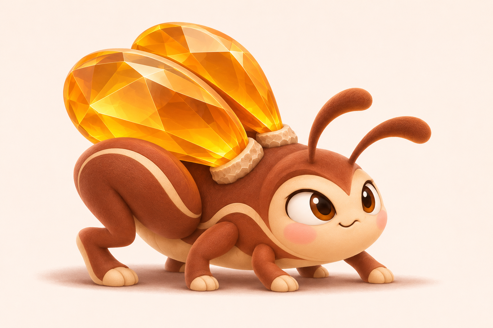
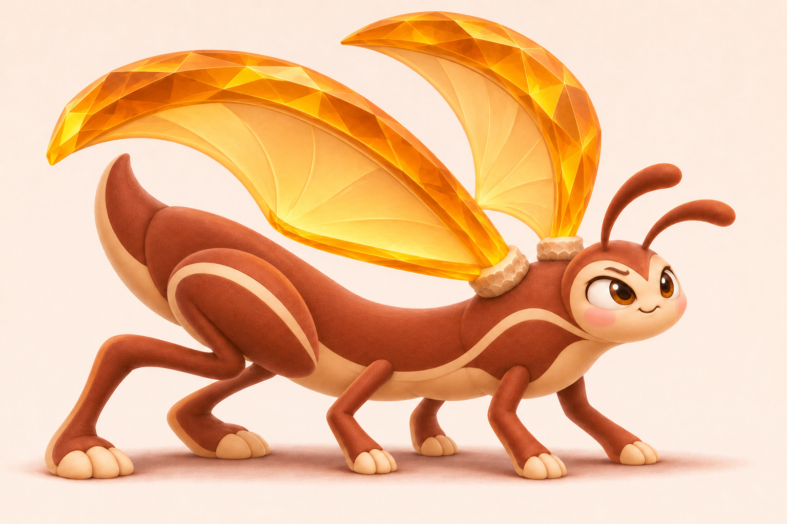
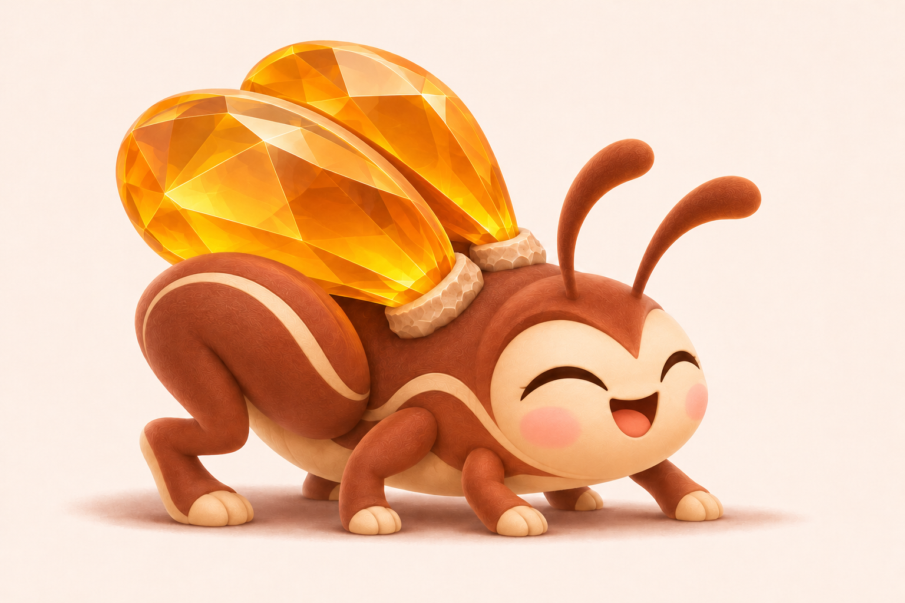
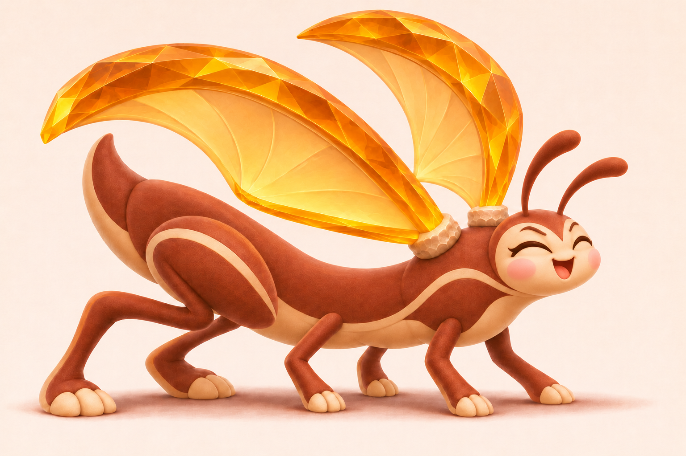
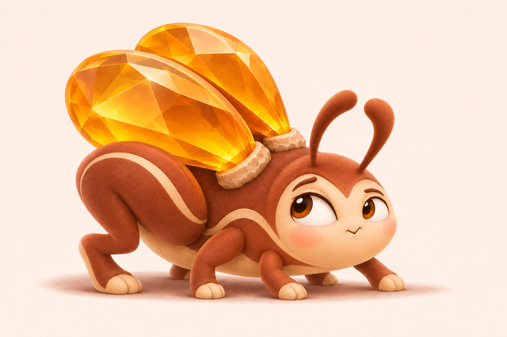
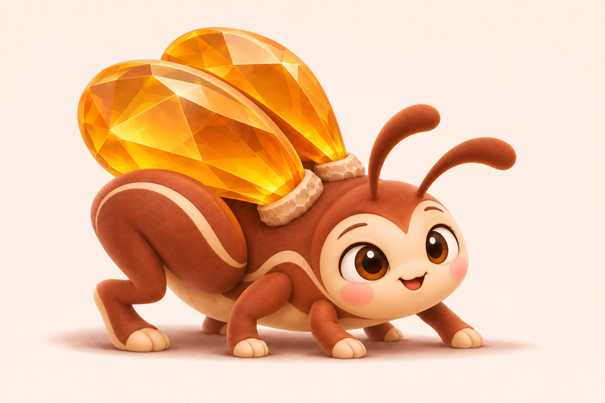

# Brio — approved Base and Grown, expression review

**Character:** Brio · **Species reference:** GP-S025 · **Character key:** `brio-2026-11-19/brio`
**Recorded:** November 19, 2026 (America/New_York).
**Selection:** The owner approved the compact Base and the corrected Grown shown below and requested emotion development and inclusion in the shared artwork reference library.

The [character reference index](../../character-references.json) is authoritative for exact asset hashes, form keys, approval evidence and expression status. This page is the visual profile, not a second registry. [Decision and scope](../../../../decisions/2026-11-19-brio-art-adoption.md).

## Exact selected masters

| Base — approved | Grown — approved |
| --- | --- |
|  |  |

There are exactly two forms and one transition. The existing index keys are `base` and `mature`; **Grown** is the display name of `mature`. The neutral reference is each master above; no duplicate neutral expression is stored.

## Character and purpose

Brio is a cheerful rhythm perfectionist: it cannot cross a room without turning its footsteps into a beat. The inspiration is an acoustic guitar's plucked vibration, tension, resonant curves and warm honey/mahogany colors. The private inspiration photograph is not published.

In Base, the compact crouching body supports two solid amber, pick-shaped sounding plates. Its large folded hind legs supply the springing movement; a leg ridge can excite a plate edge. Grown develops an elongated articulated body, longer jumping legs, a tapered curved abdomen and two swept resonance sails. Each grown sail has a thick faceted crystal frame around a translucent inner membrane. The broader acoustic surfaces suggest a sustained rhythm. These are fictional design affordances, not shipped game mechanics.

Family anchors are the cinnamon-mahogany matte body, cream wedge face and curved markings, brown eyes, two curved antennae, six legs, and paired amber sound structures with pale mineral roots. Base's solid plates and Grown's membrane sails must not be interchanged.

## Emotions — six new review candidates

Each image was generated from its own approved form master. **The images below are in review; their internal QA pass is not an owner approval.**

| State | Base candidate | Grown candidate |
| --- | --- | --- |
| **Celebrate** — visible joy after effort |  |  |
| **Thinking** — curious concentration |  |  |
| **Encouraging retry** — warm attention and an invitation to continue |  |  |

The expressions use face, gaze, brows and small antenna/head changes. The six leg positions, crystal roots, body proportions and form-specific gem architecture remain stable. Thinking is curious rather than punitive; retry is reassuring rather than disappointed.

Optional character copy, not runtime UI: “That took practice!” · “Let me listen for the next beat…” · “One more go—we can change the rhythm.”

### Visual QA

All six candidates were inspected against the exact corresponding neutral master. Six connected legs, two antennae, paired roots, face construction, materials and readable expression differences passed internal review. Grown's crystal rims remain distinct from its translucent membranes. The earlier grown attempt's extra raised appendage is absent from the selected master and every expression.

## Clean handoff and provenance

This character folder holds **eight PNGs total**: one current `initial.png`, one current `growth.png`, and three emotions for each form. It contains no Timbri artwork, uncorrected grown attempt, old revisions, alternate neutral, raster contact sheet or duplicate preview.

The exact original PNG bytes are preserved. SHA-256 and byte sizes live in the authoritative index. [Generation prompts](prompts.json) preserve the actual briefs; model version and seed were not exposed. Prompts support further editing but do not guarantee identical regeneration. Use the selected image, rather than text alone, for future expressions.

An earlier exploration was not selected. The grown candidate needed one local anatomy correction before owner selection. That history is recorded in prose without bundling discarded images into the current character assets.

## Implementation status

These are full-body concept portraits with an ivory background. Transparent sprite export, animation/rig work, target-size device checks, application identity mapping, collection/growth rules, saved-scene integration and in-game acceptance remain separate. No runtime ID, earning threshold or deployed behavior is assigned by this artwork addition.

The owner-approved neutral pair is settled. Review the six expression candidates independently, then preserve the chosen form-specific masters through any later sprite or animation work.
