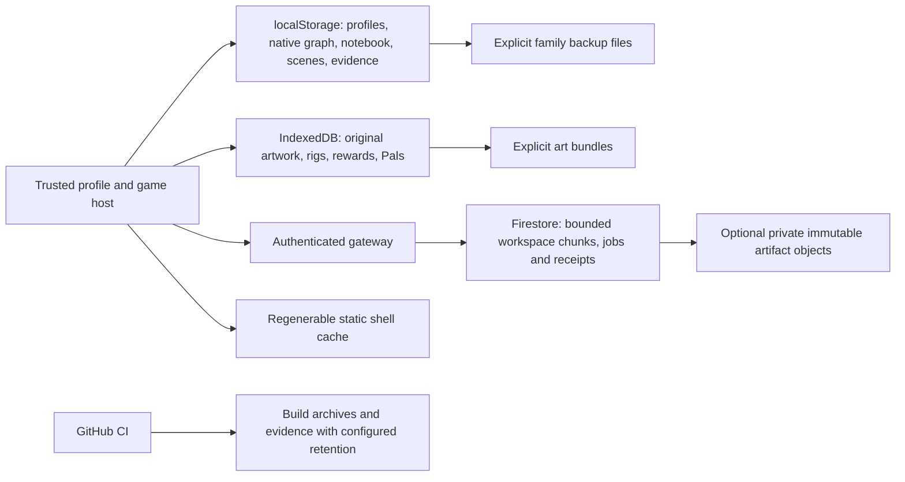
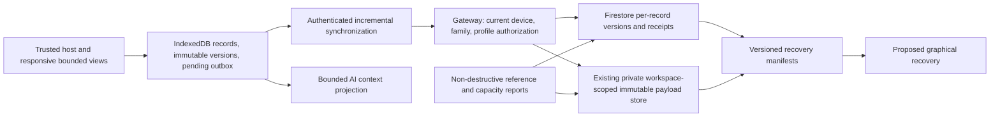

# Storage reliability and continuity — PR166

Creative Studio scenes can pin the same private drawing in an actor, background or placed object. Complete recovery checks each selected owner, original and digest. Portable scene export includes only referenced revisions, their original ancestry and selected rig dependencies. [Creative recovery evidence](../creative-universe/EVIDENCE.md)

**Current-main completion continuation, November 25:** the application now combines protected main `0f459f5` with the preserved storage and family-beta/audit source. The [combined acceptance register](../family-beta/COMPLETION.md) records current requirements and dispositions; the [nine-stage runbook](../family-beta/ACTIVATION.md#nine-stage-activation-plan) is the consolidated future cloud plan. The dated PR166 measurements and implementation record below remain historical evidence for their original tree. Final-source implementation/evidence must not be inferred from those old results.

## Current integrated implementation

The combined candidate now selects actual `NativeWorkspace`, `NotebookWorkspace` and Creation record authorities in the explicitly built `storage-preview` application, after user-invoked resumable preparation. Ordinary builds retain compatible legacy sources. Cards, selected records and committed notebook presentation summaries avoid reading every conversation or revision during navigation; saves await durable commit. Whole-owner notebook validation and projection still occur during writes, and retained legacy originals, immutable payloads/history and recovery copies increase occupied bytes. These tradeoffs are measured rather than hidden behind the earlier isolated-record throughput result. Profiles, Math/English and APS retain their bounded atomic source formats; lazy Parent capture avoids an unnecessary startup report scan.

Actual same-origin continuity routes and the native private-copy controls bind current device, guardian, profile and category consent. Local/server versions are separate, uncertain acknowledgments use receipt lookup, and explicit Keep both preserves a playable branch before resolving the original conflict. Complete Parent recovery captures active sources and original drawing/rig/draft bytes; preview, rollback, interrupted recovery and private cloud-copy controls are integrated. The private schedule, split encoder, remote continuity and migrations remain off unless explicitly selected and authorized. [Rollout and compatibility](ROLLOUT.md) gives the current operational contract; the November 24 section below is preserved history.

The source-backed acceptance includes real IndexedDB notebook tests (ten scenario groups: resumed migration, metadata-only pages, exact oversized Unicode/chapter recovery, projection parity, concurrency/quota, backup/duplicate restore, awaited facade/rewards, compound commit and source guard, scope revocation, corruption); actual ordinary and prepared Studio desktop/phone journeys; native continuity conflict/receipt/Keep both fixtures; and complete Parent recovery desktop/tablet/phone controls. The [combined register](../family-beta/COMPLETION.md) distinguishes those component receipts from the final exact-head hosted gate, physical devices and live TEST.

### Comparable application benchmark v2

The [v2 main baseline](evidence/application-main-0f459f5-v2.json) adds actual visible draft editing and durable flush, IDB request/payload counters, per-key source occupancy, current/history/vault logical footprint, startup CPU observations and a delivered-build digest. It uses protected main `0f459f5`, Chromium `156.0.8078.79`, five samples and the same 5/25/50-project and 100/2,500/14,000-message libraries as the earlier receipt. Original-art bytes are unchanged. Baseline medians are 966/1,832/2,191 ms to application readiness, 329/676/1,571 ms to open the saved game, and 45/138/211 ms for the real draft/flush interaction. These supersede no historical observation: the older v1 run used fewer counters and shared-host conditions differed.

Use `STORAGE_BENCHMARK_AUTHORITY=indexed` only against a `storage-preview` build. The harness invokes the actual Parent preparation button, reloads once, verifies all three active native/notebook/Creation authorities, and exercises their real domain methods and visible UI. Run the default build separately. The pinned comparisons below distinguish ordinary and prepared builds from later hosted acceptance; no overall readiness percentage is claimed. The game-library fixture's profile source is 1,134 UTF-8 bytes and has no populated learning/APS history: its 0–0.1 ms baseline profile-save median is not a worst-case profile/learning result. The separate bounded-source results below measure populated histories.

The preserved [prepared `595a926` checkpoint](evidence/application-indexed-595a926-regression.json) identified a serious write-latency tradeoff and led to a focused notebook optimization. It is not substituted for the later final measurement. Small/medium/large readiness medians were 651/682/2,066 ms, but actual durable draft editing took **120/353/2,152 ms**, against main's 45/138/211 ms. At the large size, cold saved-game opening took 3,685 ms and a source draft transaction took 1,367 ms. The first measured draft transaction made 377 observed object-store read calls and 53 writes, reading about 3.94 MB and writing 0.743 MB of logical payload; recursive equality caused 462,759 instrumented `JSON.stringify` calls. Prepared-build startup read only 1,706 localStorage code units and 0.508 MB of IDB payload, against main's 87.35 million code units and 10.78 MB. Reducing startup hydration therefore did not, by itself, make writes faster.

This checkpoint verified complete recovery at all three sizes: capture medians 0.288/1.706/13.283 seconds, and one successful restore plus reload per size at 1.157/4.504/35.507 seconds. Complete receipts, every original PNG hash, saved-session identity and original native revision were checked after reload. The earlier [large `b7b9004` failure](evidence/recovery-large-b7b9004-failure.json) is retained: a localStorage safety journal could not fit, rollback ran, and the receipt did **not** complete. Moving that journal to the existing IndexedDB vault and preserving prepared legacy originals repaired the failure; a reload without a committed receipt was never counted as recovery success. The final harness additionally hashes every original message and native revision definition after restoration.

### Application comparison at pinned checkpoints

The [ordinary receipt](evidence/application-ordinary-a56cadd.json) and [optimized prepared receipt](evidence/application-indexed-683bf5c.json) use five samples at each size, the same built-application fixture and Chromium 156 as the v2 main baseline. Each receipt pins source/tree, harness hash and delivered-build digest. These are measurement checkpoints; later recovery/access fixes and the final hosted head have their own acceptance receipts. They must not be relabeled as measurements of that later head. Ordinary and optimized prepared runs were serial; the shared host still had other engineering activity. No physical-device, production-network, billing or stable latency SLA is inferred.

Every cell below gives **small / medium / large** median milliseconds. The library has 5/25/50 native projects, 5/100/450 initial revisions, 5/25/70 notebook sessions and 100/2,500/14,000 original messages. Each sample retains another native revision. All three prepared authorities are activated through Parent, but this fixture has no saved Creation scenes; Creation correctness tests are separate from scene-library performance. The populated profile/learning/APS probe below is also separate.

| Operation | Main `0f459f5` | Ordinary `a56cadd` | Prepared `683bf5c` |
| --- | ---: | ---: | ---: |
| Reload to app ready | 966 / 1832 / 2191 | 1893 / 833 / 809 | 379 / 457 / 467 |
| Visible home library | 136 / 265 / 394 | 183 / 93 / 123 | 153 / 154 / 208 |
| Saved card to Studio open | 329 / 676 / 1571 | 528 / 255 / 345 | 186 / 318 / 857 |
| Actual visible draft + durable flush | 45 / 138 / 211 | 96 / 53 / 202 | 58 / 141 / 287 |
| Draft through newly opened source adapter | 1.5 / 21.5 / 91.8 | 1.1 / 7.2 / 44.0 | 27.9 / 117.1 / 438.6 |
| Immutable native revision save | 0.3 / 2.9 / 13.6 | 0.8 / 2.0 / 4.5 | 6.0 / 9.2 / 9.3 |
| Source list / first native page | 0.8 / 5.7 / 17.9 | 0.2 / 2.5 / 9.3 | 1.9 / 4.3 / 4.4 |
| Selected native revision lookup | 0.1 / <0.1 / 0.1 | <0.1 / 0.2 / <0.1 | 1.6 / 2.3 / 2.1 |

The prepared path reduces repeated startup source hydration and uses a bounded, validated notebook cache keyed to the exact committed head. It retains authorization, head/CAS checks and fresh integrity validation for explicit captures. The large visible draft improves from the preserved 2,152 ms checkpoint to 287 ms, but remains slower than main’s 211 ms and the ordinary candidate’s 202 ms. A first write through a newly opened adapter still reconstructs and validates the owner notebook; its 439 ms large result is a real remaining cost. Metadata paging and durability are not constant-time writes. Small ordinary startup is slower than its medium/large samples; those observations are retained rather than selecting a favorable ordering.

The separate [warm source-write diagnostic](evidence/notebook-warm-write-604c6e6.json) isolates only the notebook change, using an identical 4.19 MB, 70-session/14,000-message source and one warmed write per variant. It observes 708.3→260.3 ms, 380→28 adapter reads, 4,548,199→6,010 read bytes and 462,740→1,904 stringify calls. Both variants write 443,189 bytes in 22 record changes. Its adapter counters and single-sample warm fixture are distinct from the full application’s object-store counters; it is explanatory evidence, not another UI percentile.

### Recovery, artwork and retained footprint

| Operation, small / medium / large | Main `0f459f5` | Ordinary `a56cadd` | Prepared `683bf5c` |
| --- | ---: | ---: | ---: |
| Progress/domain export, median ms | 0.4 / 7.4 / 28.2 | 0.3 / 6.4 / 27.5 | 14.3 / 107.9 / 512.1 |
| Progress/domain restore, median ms | 0.8 / 14.4 / 63.0 | 0.7 / 10.6 / 48.1 | 46.3 / 318.1 / 1322.7 |
| Original-art export, median ms | 100.8 / 848.5 / 1554.3 | 114.5 / 644.9 / 1275.7 | 65.0 / 443.1 / 1408.1 |
| Original-art idempotent restore, median ms | 81.7 / 680.3 / 1144.0 | 132.5 / 377.8 / 1119.8 | 54.5 / 384.9 / 1083.4 |
| Complete capture + local vault save, median s | Not present | 0.499 / 1.851 / 3.700 | 0.256 / 1.258 / 4.059 |
| Vault read + checksum verification, median ms | Not present | 65.3 / 203.0 / 482.7 | 30.0 / 241.5 / 723.9 |
| Complete restore + reload, one observation s | Not present | 1.915 / 6.365 / 8.975 | 1.007 / 4.699 / 13.545 |
| First complete archive, MB | Not present | 0.48 / 4.86 / 15.94 | 0.52 / 5.52 / 19.51 |

Progress/domain operations exclude originals, rewards and Pals and must not be called complete backups. Both candidate builds pass complete receipts and SHA checks for every original PNG, every original message/session identity and every original native revision definition after all three restores; pending restore journals are absent. These timing runs restore the reviewed point into the existing synthetic library. Separate source-loss and fresh-target tests establish restoration without the original record database, including 82 notebook sessions, 52 native games and 42 coding scenes across two prepared owners. First-restore timings do not establish a later-disaster retry SLA.

The single Parent preparation operation, including its final reload, took 0.808 / 1.242 / 3.014 seconds. Original PNGs remain 336,612 / 3,146,610 / 9,260,556 bytes, with 336,612 / 684,427 / 1,517,028 derived-preview bytes. No original is compressed, discarded or replaced to obtain these results. The metadata index keeps another preview projection to avoid opening original-image records during library startup.

Logical IndexedDB payload MB after the **first → fifth** sample, including retained history and complete recovery points:

| Build | Small | Medium | Large |
| --- | ---: | ---: | ---: |
| Main `0f459f5` | 0.67 → 0.67 | 3.83 → 3.83 | 10.78 → 10.78 |
| Ordinary `a56cadd` | 1.50 → 2.02 | 9.38 → 12.41 | 28.23 → 42.92 |
| Prepared `683bf5c` | 1.79 → 2.85 | 12.34 → 14.43 | 41.86 → 45.37 |

MB means 1,000,000 bytes. These are serialized logical payloads, not browser disk pages, indexes or billed storage. Main has no complete recovery points in this sequence. Original localStorage sources remain about 0.029 / 0.608 / 3.315 MB; prepared migration preserves those originals. The repeated measurement sequence deliberately creates five retained recovery points and explicit source-restoration generations, so its growth is not a forecast of one ordinary edit. Content reuse reduces some duplicate bytes, while immutable history, source originals, preview projections and rollback points increase retained occupancy. No automatic garbage collection or retention deadline is assumed.

### Large-library CPU, serialization and I/O

The following counters are from the **first large sample** unless labeled median. JSON/localStorage instrumentation adds overhead. UTF-16 code units are not UTF-8 network bytes. IDB counters cover object-store `get/getAll/openCursor/add/put`, omitting index cursors, key reads and browser disk overhead. The full receipts preserve every sample, p95 UI distributions, browser storage estimates and per-store footprint.

| Observation | Main `0f459f5` | Ordinary `a56cadd` | Prepared `683bf5c` |
| --- | ---: | ---: | ---: |
| Startup localStorage read code units | 87,349,289 | 24,257,227 | 1,706 |
| Startup JSON parsed / serialized, million code units | 170.93 / 85.71 | 32.18 / 25.57 | 0.38 / 0.07 |
| Startup IDB read payload MB | 10.7798 | 0.0003 | 0.5088 |
| UI draft JSON stringify calls | 849 | 800 | 1,781 |
| UI draft localStorage write code units | 3,136,967 | 3,136,967 | 0 |
| UI draft IDB read calls / write calls | 0 / 0 | 0 / 0 | 95 / 53 |
| UI draft IDB read / write payload MB | 0.00 / 0.00 | 0.00 / 0.00 | 0.46 / 0.74 |
| Startup CDP TaskDuration / ScriptDuration, median ms | 2093 / 226 | 784 / 23 | 445 / 35 |
| Startup observed JS heap, median MB | 74.31 | 66.84 | 135.70 |
| Measured page-lifetime TaskDuration, median ms | 7440 | 8959 | 10831 |

CDP values describe renderer observations, not isolated CPU-core consumption or peak physical memory. The separate `performance.memory` heap observation rises to 135.70 MB in the prepared large fixture; raw samples vary with allocation and garbage collection, and this is not evidence of reduced peak memory. Page-lifetime measurements include the explicit backup and footprint traversal; main lacks the new complete-backup operation, so that total is not an equal-work speed comparison. The source list uses a 24-game first page in the prepared build and a complete bounded list in the legacy build. Startup reductions come from narrower reads and lazy reports; write/history amplification and extra verification still have costs. Cloud database billing cannot be inferred from these local counters.

### Bounded profiles, learning and APS

The [main bounded-source receipt](evidence/bounded-main-0f459f5.json) and [candidate bounded-source receipt](evidence/bounded-candidate-595a926.json) run the actual built `FG.store` save/backup validator and real-browser `ProblemSolvingStore` list/export/record APIs, with five samples in Chromium 156. The tool is `tools/storage-bounded-sources-benchmark.cjs TARGET OUTPUT.json`. These independent fixtures populate 1/3/6 profiles, 10/60/120 attempts **per subject per profile**, 10/100/100 fact summaries per profile and 20/100/200 APS episodes per profile. Synthetic repeated fact summaries model storage volume; they are not learner evidence or estimates of typical growth.

| Metric, small / medium / large | Main `0f459f5` | Candidate `595a926` |
| --- | ---: | ---: |
| Profile source UTF-8 bytes | 42,340 / 1,087,298 / 3,102,467 | Same |
| APS source bytes after five writes | 11,488 / 139,128 / 548,408 | Same |
| Profile save median ms | 0.4 / 97.0 / 233.3 | 0.3 / 131.2 / 281.6 |
| Profile stringify / parse median ms, large | 56.3 / 48.4 | 35.8 / 36.4 |
| Profile backup validation median ms | 0.9 / 22.7 / 100.7 | 1.2 / 26.5 / 55.6 |
| Selected-owner APS list median ms | 0.5 / 10.6 / 86.9 | 0.5 / 27.9 / 53.2 |
| APS complete export median ms | 0.4 / 5.8 / 108.7 | 0.5 / 8.3 / 54.2 |
| APS record median ms | 1.3 / 29.1 / 149.0 | 1.6 / 44.5 / 76.7 |

These formats remain whole-key stores and their byte amplification is unchanged. Shared-host scheduling and concurrent tests make timings noisy; the slower medium/large profile saves remain in the report. No speed claim follows from faster parse or APS samples alone. The existing APS retention policy keeps 200 episodes for the active owner and records five discarded middle observations in the large fixture after five new writes; this assignment does not change that inherited policy. The receipt retains the discarded count and preserved first-episode range explicitly.

An additional **simultaneous capacity stress case fails on both source versions**: six profiles with 120 attempts in each subject and 250 fact summaries each form a valid 4,949,267-byte profile source. Adding a valid 548,373-byte APS source exceeds this Chromium origin's localStorage quota. Both previously stored source strings remain unchanged after the rejected write. This is an observed existing capacity limit, not a successful save or a new candidate regression. Per-domain schema bounds (including the 1,500-fact cap) do not promise that every maximum fits together with other localStorage sources. A future migration of these bounded domains needs separate engineering and compatibility acceptance; the prepared native/notebook/Creation path does not remove this limit.

## Preserved v1 application baseline

`CHROMIUM_PATH=/usr/bin/chromium node tools/storage-application-benchmark.cjs TARGET OUTPUT.json` runs the built application with only loopback requests. It creates records through the actual `RevisionStore`, `StudioNotebook` and original-drawing store, reloads the real Studio, opens a saved game from its visible card, and measures source operations in real browser storage. The [main baseline JSON](evidence/application-main-0f459f5.json) pins the full source/tree, Chromium version, five samples per size, counters and process metrics. It is distinct from the older isolated 50,000-record adapter benchmark.

| Scenario | Small | Medium | Large |
| --- | ---: | ---: | ---: |
| Projects / retained initial revisions | 5 / 5 | 25 / 100 | 50 / 450 |
| Notebook sessions / messages | 5 / 100 | 25 / 2,500 | 70 / 14,000 |
| Original PNGs / original bytes | 2 / 336,612 | 5 / 3,146,610 | 8 / 9,260,556 |
| Derived preview bytes | 336,612 | 684,427 | 1,517,028 |
| Persisted localStorage bytes after first measured save | 29,004 | 608,121 | 3,315,149 |
| Reload to application ready, median ms | 918.48 | 766.38 | 1,283.35 |
| Home library visible, median ms | 134.83 | 145.03 | 314.61 |
| Saved-game card to open Studio, median ms | 364.65 | 335.97 | 1,018.71 |
| Source list / saved revision lookup, median ms | 0.4 / <0.1 | 3.6 / 0.1 | 16.6 / 0.1 |
| Draft save / immutable revision save, median ms | 1.6 / 0.6 | 13.8 / 1.7 | 71.1 / 13.3 |
| Legacy progress JSON export / restore, median ms | 0.5 / 0.7 | 4.7 / 9.7 | 28.8 / 64.2 |
| Original-art bundle export / idempotent restore, median ms | 1,227.9 / 716.1 | 882.8 / 786.4 | 2,012.6 / 1,577.5 |

These are historical v1 main-baseline measurements, not the v2 before/after comparison above. The legacy progress measurement excludes artwork, rewards and Pals; original artwork is measured separately. The integrated complete recovery handler is measured separately above so a progress-only JSON operation is not presented as a complete family backup. All original PNG hashes are distinct in this fixture; original/preview copies are deliberate and not counted as redundant art revisions.

The browser is desktop emulation on a shared Linux host, with warm HTTP cache and instrumented `JSON`/localStorage operations. The nonmonotonic small/medium startup and artwork samples are retained; CPU scheduling, decoder/cache state and other concurrent tests affect them. The raw report retains median/p95 and every sample rather than hiding slow runs. Each sample adds a retained revision, preserving the final-source caps. Heap and CDP Task/ScriptDuration are observations, not isolated peak memory or physical-device CPU estimates. localStorage counters count cumulative UTF-16 code units read/written, not network bytes or billed database operations. Final comparison uses the same fixture, browser and instrumentation.

### Cost and scaling interpretation

The retained [cost model](evidence/cost-model.json) projects a five-person family's end-of-year-five monthly storage/metadata/object/network run rate of approximately **$0.023 / $0.295 / $2.581** for its low/typical/high assumptions. It includes one sizing allowance for a recovery copy. It excludes Cloud Run, load balancing, NAT/IP/worker compute, provider calls, support, logs, CI, taxes, discounts and free tiers. Rates are historical planning inputs, not newly verified pricing or observed bills; the target region and architecture must be read back before activation. The [environment cost model](../development/COSTS.md) supplies separate infrastructure/worker assumptions and warns about standing NAT/IP charges.

The storage projection cannot be called the total beta cost or a spending ceiling. Content sharing can reduce retained object bytes while increasing hashing, conditional puts, dependency reads and backup verification work. Full-workspace reads, serial reconciliation and a globally contended ledger can dominate latency before raw storage charges are significant. Keep metadata-only reads and bounded concurrent scans separate from the global atomic admission transaction: strict family/global spending enforcement must not be weakened for throughput. No cloud billing savings or production capacity result was observed in this assignment.

### Authorized continuity payload observations

The [source-pinned wire receipt](evidence/synchronization-wire-478c988.json) records the native adapter and real Chromium Parent control transport at source `478c988`, using real IndexedDB and a deterministic in-page continuity server. It is an earlier component receipt, distinct from the final application build and later reversible-removal tests. Values count JSON bodies only; HTTP headers, retries outside these cases, authentication reads and billed Firestore operations are excluded. The fixture is a small native game graph, not bulk artwork or conversation synchronization.

| Scenario | JSON request / response bytes | Observed logical calls |
| --- | ---: | --- |
| Native first selected copy, modeled transport | 1,437 / 1,948 | status 1, lookup 1, commit 1, changes 2 |
| Native unchanged check, modeled transport | 82 / 189 | status 1, changes 1 |
| One mechanic revision, modeled transport | 1,477 / 1,988 | status 1, lookup 1, commit 1, changes 2 |
| Parent selected-copy journey, actual browser fetch | 2,710 / 6,202 | status 3, changes 8, lookup 1, commit 1 |
| Parent unchanged check, actual browser fetch | 83 / 237 | status 1, changes 1 |
| Parent concurrent-edit conflict, actual browser fetch | 1,870 / 478 | status 1, lookup 1, commit 1, read 4 |
| Parent Keep both with interrupted preservation and retry | 2,369 / 4,046 | read 6, status 1, lookup 1, commit 1, changes 3 |

Unchanged checks avoid sending retained game payloads. Preserving both branches and resolving uncertainty costs extra reads and metadata; those requests are part of recovery, not hidden inefficiency. The feed/current indexes retain references rather than duplicating every large value. Exact database billing cannot be inferred from HTTP call counts. Current-principal/device checks and atomic global admission remain required even when their operations dominate a small payload.

The historical five-year cost scenarios exceed today's configured per-device domain caps; they represent future demand, not demonstrated application capacity or permission to raise limits. Browser originals, immutable history and complete recovery copies remain retained. The small fixture deliberately has previews equal in byte size to its original 256-pixel PNGs; larger fixtures retain separate smaller derivatives. No quality reduction or deletion is counted as a saving. At the historical `$0.15/GiB-month` metadata rate, one 16 MB logical recovery copy is about `$0.0022/month` before current/history duplication, keys/indexes, operation charges and service overhead. This is arithmetic on an explicit planning rate, not a current quote or observed bill. Approved hosting/load-balancer, worker networking, Cloud Run, provider and operational costs still need the separate environment plan.

## Preserved November 24 implementation record

**November 24, 2026, America/New_York. Branch implementation, not deployed.** Continues PR166 head `1743c9e6560ae9416ec08a23cb660eb06af68351`, based on refreshed main `13260750b7771beb024cc6a94bf823ee5a4e29ff`. Main includes premium #139, environment preparation #155 and the CI work. No competing open storage PR was found. Other open branches include operations/evidence #143/#138/#116/#113/#110/#109/#105, historical environment #106/#45, test #84, optional analytics #83 and research #60/#54/#50/#31/#29. Their work remains untouched. A separate efficiency PR was not visible in that inventory; this work avoids static artwork and CI selection policy.

This package improves real application persistence and prepares additional adapters. **It does not complete the assignment's entire definition of done.** The existing application still has bounded whole-workspace stores, and the new indexed/cloud adapters have no application migration or live synchronization route. Those are remaining repository engineering, not Cloud Shell dependencies. [Inventory](INVENTORY.md), [implementation and activation](ROLLOUT.md), measured [baseline](evidence/baseline.json), [browser evidence](evidence/browser.json) and [cost model](evidence/cost-model.json) distinguish source, fixtures and projections.

### Selected architecture and alternatives

Retain the existing hybrid: synchronous local state for the current application, IndexedDB for transactional records and binary artwork, authenticated gateway/Firestore for authoritative remote metadata and private workspace-scoped GCS for immutable payloads; new split blobs also bind the family/Adult audience. Never make an AI prompt proportional to retained history. No new vendor, database service, synchronization framework or public object URL is needed.

| Alternative | Evidence and decision |
|---|---|
| PR166 full before/after journal | Exact and easy to inspect, but duplicates both complete records. In the 14,000-message fixture, two images occupy 9,078,695 UTF-8 bytes, excluding live sources. Reject as the default new implementation. |
| Compact reversible string journal | Common prefix/suffix stored once; exact original strings reconstruct without hashes or normalization. Same fixture needs 4,539,411 bytes. Selected for current synchronous create/copy APIs; still roughly one extra source copy and can exceed real quota. Fail before source mutation if intent cannot fit. This is recovery, not an unlimited-capacity solution. |
| IndexedDB transactional records | Browser benchmark supports indexed paging and small writes at 50,000 records. Implemented as an isolated adapter with atomic history/receipt/outbox. Preferred future authoritative device store after domain mapping, migration and all reader/export integration. Do not synchronously fake IndexedDB or migrate implicitly. |
| Whole Firestore workspace | Preserve current production contract. Its 3 MiB logical limit and repeated chunk reads/writes make it unsuitable as the eventual unbounded history store. New per-record adapter remains disabled and unmounted. |
| Per-record Firestore metadata + immutable private payloads | Version compare-and-swap, independently recoverable receipts, retained versions and soft tombstones. Selected preparation; gateway grant binding, sync orchestration, account provisioning/readback and migration still required. |
| Full cloud replacement | Reject: offline gameplay, latency and unnecessary operations are worse; it does not make local unsynchronized data durable. |
| Long revision delta chains / cross-family asset pooling / destructive TTL | Reject: fragile reconstruction, isolation changes and unauthorized deletion. Keep complete small definitions with shared immutable payloads. |

### Current architecture

### Proposed future architecture

The arrows beyond the current host are a target, not a deployed capability. Browser principal callbacks and server `ContinuityPrincipal` are integration contracts, not authentication implementations. The server adapter must only receive a principal produced by the current trusted-device/Adult/family authorization path. It exposes no HTTP route.

### Ranked implementation register

| Priority/category | Change | State and benefit | Remaining constraint |
|---|---|---|---|
| 1 / A | Exact reversible creation/copy journal | Integrated with staged workspace/notebook/profile bytes, writer lock, startup and authenticated Adult entry; pending rollback or committed cleanup before readers | localStorage physical quota; older readers cannot safely ignore an intent |
| 1 / A | Construction and learning-format copy | Stage profile alongside game and conversation; update live profile only after durable commit | Other legacy Keep/preview flows retain their existing compensation and are not all covered by this journal |
| 1 / A | Atomic coach reply/evidence | One notebook write contains plan, provenance, reply messages and source reward outbox | Capacity or quota can still reject the entire reply; no durable overflow inbox or paid replay |
| 1 / A | Remote copy uncertainty | Persist request identity before POST; retained intent uses GET-only reconciliation; gateway duplicate identity returns same revision; local completion clears intent atomically | Backend-first rollout; an unadmitted uncertain intent remains unresolved, never automatically retried |
| 2 / A | Revision validation indexes | Maps and memoized ancestry retain cycle/owner validation without repeated graph scans | Existing project/revision/play caps unchanged |
| 2 / A | Notebook validation cache | Reuse validation only for exact unchanged raw bytes; return independent copies and observe external changes | Still parses/clones a whole notebook; not paginated application UI |
| 3 / B | Indexed record persistence | Atomic records/history/receipts/outbox; indexed pages; conflict rejection, acknowledgment and remote application | Isolated preparation; complete schema migration and application adapters remain |
| 4 / B | Shared artwork/code payloads | Opt-in v2 private manifest; same asset bytes stored once across mechanic-only revisions; exact legacy decode | Disabled by default; compatible reader rollout and real-art acceptance required |
| 5 / B/C | Firestore continuity | Per-record CAS, immutable history, idempotent receipts, default-off service, memory and Firestore adapters | Gateway route, verified principals, paginated server pull and application sync orchestration remain |
| 6 / C | Automated backups / retention | Reference tracing, versioned history and resumable hash-verified recovery-point manifests; proposed recovery policy and activation plan | Complete backup scheduler/manifest restore UI and owner retention/RPO/RTO decisions |
| 7 / D | Automatic user-record GC | No delete API or job added | Reconsider only after complete reference roots, retention approval and recovery evidence |

### F06 disposition

- Browser termination between local create/copy writes: integrated rollback before use. Current journal has pending and committed phases; after the committed marker, cleanup failure does not report lost work. All key images are checked before recovery writes. Unknown bytes, corruption or wrong scope stop recovery without erasing data.
- Profile/construction copies: the staged host cannot directly call the legacy save. Its profile image joins the transaction. Copy learning mode joins it as well. Existing data formats and engine IDs remain unchanged.
- Concurrent tabs: existing origin-wide `jems-source-writer-v1` remains the only lock. Recovery asserts lock ownership but can run while ordinary source writes are paused. Any pending journal blocks normal source saves and backup replacement. Adult journals are only read after a fresh authenticated grant.
- Remote copy: request ID persists with source, name and API origin; unknown acknowledgment never causes another POST. Notifications and a visible Check my copy action expose pending copies after reload. Duplicate server identity is family/Adult audience scoped. Unknown request lookup does not prove a failed admission. No paid operation is introduced.
- Conversation: a reply's design/provenance and up to three message entries save as one notebook write. Capacity validation rejects the entire transition. Existing child draft remains; durable overflow and independently stored provenance are open.
- Backup/restore: existing family undo journal remains authoritative for its stores. It cannot start over a pending project journal. Existing backups and original image bundles retain their separate formats. Coordinated arbitrary-store backups have not been replaced with a new untested protocol.
- Saved games/art: full definitions, original bytes, rig hashes, Keep/Undo/Fork identities and frozen engines remain. No real Splash or Pass/Dragon family records were accessed; preservation evidence is synthetic and existing regression coverage, not actual-data acceptance.

### Capacity and performance evidence

`node --import tsx tools/storage-benchmark.ts` reproduces a warm-process comparison with the original PR166 source. It does not measure physical-device startup. `node tests/storage-browser.cjs` uses actual Chromium localStorage, Web Locks, IndexedDB and renderer termination; desktop/tablet/phone are emulated layouts.

| Metric | Before | After | Scope |
|---|---:|---:|---|
| Validate 500 native revisions, median | 136.64 ms | 1.29 ms | Synthetic Node, 25 samples; same 500 cap |
| Retrieve one session from 14,000-message notebook, median | 32.91 ms | 20.38 ms | Warm cached validation; whole notebook still cloned |
| Recovery image encoding | 9,078,695 bytes | 4,539,411 bytes | Common-content sharing; UTF-8 measurement, browser accounting varies |
| 50 revisions with identical 450 KB artwork/code | 23,928,030 object bytes | 525,358 object bytes | Opt-in encoder; synthetic bytes, 97.8% less; objects increase 50→52 |
| Same encoding CPU | 222.00 ms | 316.96 ms | Cold synthetic encoding; savings trade off more puts/hashing; not network latency |
| 100-record IndexedDB page, 1k→50k records | Whole-store design not applicable | 7.4 / 4.2 / 4.2 ms median (1k / 10k / 50k) | Isolated browser adapter; latest exact samples in JSON |
| Small IndexedDB save, 1k→50k records | Whole-store design not applicable | 2.2 / 1.3 / 1.4 ms (1k / 10k / 50k) | Isolated browser adapter, not current production saves |
| Application conversation capacity | 80 sessions/chapters; 200/page | Same | No caps inflated and no history silently discarded |
| Recovery reliability | 19 offline prototype cases | Additional fault tests and 18 renderer boundaries | Passing fixtures are not a field reliability percentage |

The 4.31 MB notebook plus even the compact journal can exceed a browser's localStorage budget. A smaller journal reduces amplification; it does **not** close structural capacity. The indexed adapter can store 50,000 independent records without scanning all of them for a page, but the application has not been migrated to it. Multi-year fixture counts model five profiles × five years × 2,000 metadata records; the separate conversation fixture models retained text. They do not substitute for a realistic entire family import with large decoded images and every domain.

### Economics

`node tools/storage-cost-model.mjs` generates low/typical/high assumptions for five people over five years and linear 100/1,000-family sensitivities. It includes assets, revision/conversation metadata, a recovery-copy allowance, database operations, object operations and network allowance. It excludes model inference, compute, logs, CI, tax and support. No spending was activated.

Rates were read from official [Firestore Standard pricing](https://cloud.google.com/firestore/pricing) and [Cloud Storage pricing](https://cloud.google.com/storage/pricing) on November 24, 2026. Reference location is **us-central1**, not a claimed live configuration. Use $0.03/100k reads, $0.09/100k writes; hourly GiB rates ×730 produce about $0.15 database storage, $0.03 backup storage and $0.02 Standard objects per month. The $0.12/GiB egress sensitivity is an explicit assumption; verify the actual route and allowances before activation. Free tier is excluded from gross estimates. Index overhead, retries and retained versions can materially change cost. Lookup/hash documents avoid field indexes; the provided exemption must be merged with the actual index configuration.

The main drivers are original/derived artwork accumulation, revision duplication, device downloads and full-workspace amplification. Sharing unchanged art reduces retained bytes but adds immutable-object reads/puts; a process cache and per-operation deduplication are future optimizations if measurements justify them. No image recompression or quality reduction is proposed. Masters and runtime derivatives remain separate approved objects. Archiving only changes visibility.

Gross projected end-of-year-five storage/operations/network monthly subtotals are **$0.02 / $0.30 / $2.58** for low/typical/high, before the excluded services. These unusually small storage-only figures must not be presented as the total Jems bill. Typical retained assets are 4.69 GiB and metadata 0.41 GiB; high assets are 42.19 GiB and metadata 2.36 GiB. A full independent asset copy per revision would multiply the asset portion by 5 / 20 / 50 in the model. Actual duplication rates are unknown.

Chromium measurements overlap other local work: the [prior run](evidence/browser-prior.json) includes a 10k-record latency spike, and the [five-boundary run](evidence/browser-five-boundaries.json) includes a 1k-record spike. The final six-boundary run is also retained rather than selecting favorable samples. No stable throughput SLA or complete-application startup claim follows from this single run.
